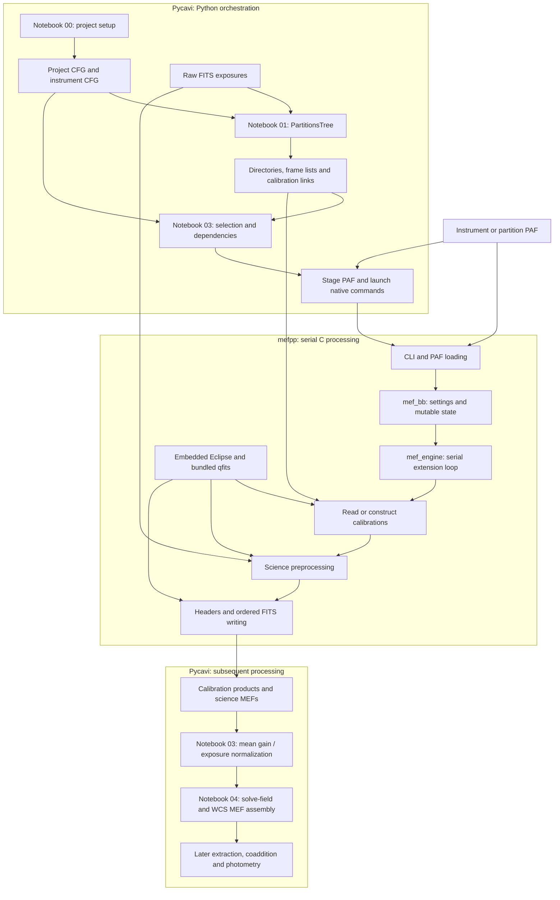

# Original Pycavi/mefpp architecture

Observed source baseline: accepted main 22a32d39463a73ab32d2ba9d811f949198852902.
Recorded: 29 October 2026. "Original" means the pre-refactor architecture at this baseline, not the first historical release.
This is current implemented behavior; see the separate [proposed target](../proposed/pycavi-mefpp.md).
The accepted Stage 2.1 endpoint is notebook 04.

## Current processing architecture

## How the components interact

1. Notebook 00 writes project-directory configuration. Instrument CFG supplies classification/header/detector mappings; Instrument also reads product-name prefixes from PAF.
2. Notebook 01 calls PartitionsTree. It groups exposures, creates calibration/science directories and lists, selects calibration associations, and materializes symlinks/processing markers.
3. Notebook 03 discovers partitions, permits selecting a subset, rebuilds dependencies from paths/links and calls reduction wrappers. Calibration dependencies are processed before the selected science.
4. The wrappers copy/reuse a partition-local mefpp.paf, enter the partition directory and launch native commands with relative list/calibration names. The BPM wrapper copies a supplied mask; native BPM construction is a separate existing capability.
5. Native CLI parsing creates mef_bb from the chosen PAF and CLI settings. mef_bb holds configuration, paths, detector selection, statistics and mutable work state.
6. mef_engine loops serially over detector extensions, loads/builds calibrations, corrects science and writes ordered FITS products. Eclipse and qfits are linked implementation dependencies, not independent processing clients.
7. Back in Python, mefpp_normalize_science modifies science pixels/headers using the mean configured detector gain divided by exposure time.
8. Notebook 04 extracts detector images, calls solve-field through worker processes and assembles WCS-corrected MEFs. Later notebooks handle extraction/SCAMP, SWarp, calibration, illumination and catalogues.

## Working-directory dependence: precise current behavior

The prepared partition directory acts as a hidden input to execution. In pycavi_associate_reduction.py, copy_paf stages/reuses basepath/mefpp.paf; mefpp_reduce_science changes into basepath and passes relative master-bias, master-flat and science-list names. Other calibration wrappers also change directories.

This does not require all raw pixel files to physically reside in that directory: frame-list entries can point elsewhere. Actual Chapman lists reference /home/fselman/fits, resolving to /gluster storage. The dependence is on the prepared reduction arena, its relative names, local configuration and output location.

mefpp.c::mef_bb_load now supports selecting the PAF before context construction. That earlier configuration-order defect has been repaired in source. However, the default name is still mefpp.paf, science output names are made from input basenames, and native writers receive relative output names from the present workflow. An explicit PAF path alone does not remove the broader working-directory contract.

The current diagram abstracts these filesystem effects. Configuration, dependency relationships and execution state are spread across CFG/PAF, directories, lists, links and in-memory objects.

## Scientific and execution invariants to preserve

- Common mosaic-flat normalization uses the reference detector's statistics; independently normalizing every detector changes behavior.
- The current mean-gain/exposure conversion belongs to Python after native preprocessing.
- MEF writing is ordered and serial; multiple workers must not append to one output.
- Numeric extension loading and logged EXTNAME comparisons do not establish general detector-ID matching.
- Existing output presence does not prove validity or completion. Preserve all accepted and failed baseline products.

## Source anchors

- [Notebook 01](../../../Pycavi2/pycavi/notebooks/01_pycavi_partition_data.ipynb), calls PartitionsTree.
- [Notebook 03](../../../Pycavi2/pycavi/notebooks/03_pycavi_run.ipynb), discovery/selection, association cascade and wrapper calls.
- [Python association/reduction](../../../Pycavi2/pycavi/pycavi/pycavi_associate_reduction.py): PartitionsTree, ExposuresPartition, associateBPM/Bias/Dome/Sky/MFF, copy_paf, mefpp_reduce_* and mefpp_normalize_science.
- [Native recipe](../../../mefpp2/ins/mef/recipes/mefpp.c): mef_bb_load, mef_engine and main.
- [Native common code](../../../mefpp2/ins/mef/common/mefp_lib.c) and [header](../../../mefpp2/ins/mef/common/mefp_lib.h): configuration/context, calibration, loading and output helpers.
- [Accepted functional baseline](../../developer/stage2-1-functional-results-2026-10-29.md).
