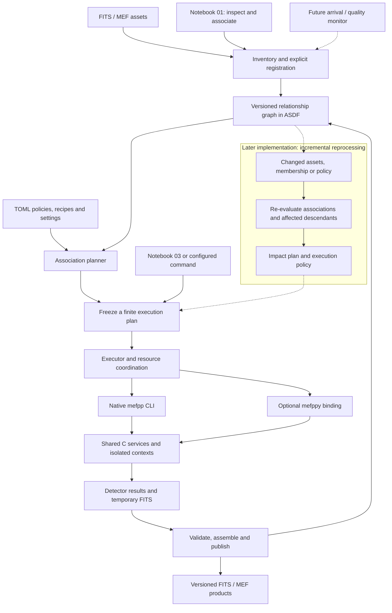

# Proposed Pycavi/mefpp target architecture

Discussion proposal, revision 2, 29 October 2026. Builds on accepted baseline 22a32d3, [owner direction v2.9](../../developer/native-roadmap-amendment-v2.9-2026-10-29.md), the [source analysis](../../developer/mefpp-refactor-analysis-2026-10-29.md) and [Chapman4 inventory](../../developer/mefpp-refactor-chapman4-inventory-2026-10-29.md).
Status: proposed contracts and names; no implementation or dependency selection. Owner-directed revision 2 includes versioned dependency/association tracking and future incremental reprocessing as part of the architecture, with automatic cascades deferred beyond the first pass.
Compare the [original architecture](../original/pycavi-mefpp.md).

## Executive summary

Use a versioned relationship graph to connect observations, scientific groups, calibration candidates, association decisions, processing tasks and products. ASDF stores the durable logical records and FITS locations; TOML defines classification/association policies, processing recipes and execution settings. Explicit planning resolves these into typed requests for the shared modular C library through the CLI or optional mefppy.

The first pass is manually initiated and serial. It must nevertheless record stable IDs, exact versions, ordered group membership, association rationale, task inputs/configuration and output provenance so a later impact planner can identify affected work without redesigning those interfaces. No automatic watcher, full invalidation engine, database, recursive scheduler or re-reduction cascade is implemented in the first pass.

The broad relationship graph can contain cycles and back-references. Each executable plan uses exact versions and only processing-dependency edges and must be acyclic. Genuine iterative processing is represented by bounded successive versions with explicit stopping/failure rules, not an unfinished task depending on itself.

New or better calibrations, additional science frames, revised quality information and policy changes can later trigger association re-evaluation and a proposed plan for affected descendants. An event does not automatically require reprocessing, and a newly arrived calibration is not intrinsically better. Preserve old associations/products and let project policy distinguish frozen releases from projects following new eligible inputs.

Retain cwd-independent explicit input/config/output/work paths, detector-ID mapping for primary-HDU/single-extension/MEF images, common mosaic-flat normalization and isolated contexts for future parallel workers. Discovery remains in the planning layer. Scientific kernels do not search for files, select the latest calibration or mutate graph state.

## Target architecture



Solid paths describe the manually initiated target workflow, not already implemented software. Dashed paths describe later arrival/change monitoring and impact planning. Publication adds immutable graph records; that feedback edge is provenance, not a circular dependency within an executing task plan. The C core is shared by both transports and does not contain the graph scheduler.

The first serial executor and later parallel/incremental executors consume the same explicit plan/result boundary. Calibration services provide required shared-reference statistics before dependent tasks; no worker independently chooses a normalization reference or appends to a common MEF.

## 1. Finding inputs without depending on cwd

### Discovery is separate from execution

Notebook 01 or a headless inventory command explicitly scans chosen roots and records candidate observations. Classification, grouping and calibration association use instrument metadata and versioned policies. Users can inspect/select a single partition or an explicit collection of groups. An execution request refers to frozen group/asset IDs and ordered membership; it must not silently re-glob directories while processing.

The ASDF model stores asset identity, one or more location bindings, detector identity, physical HDU selector, geometry, units, acquisition metadata and associations. Availability is independent from logical identity. A path alias is not a new exposure; identical basenames are not proof of the same exposure.

A resolver performs preflight: locate the configured asset, check appropriate identity/availability and FITS layout, resolve the selected detector/HDU, verify calibration applicability and prepare exact output paths. Missing, ambiguous, incompatible and deliberately unbuilt inputs are distinct states. No fallback recursive search, nearest filename, guessed calibration or network retrieval is implicit.

### Explicit path-resolution rules

| Input or reference | Proposed base / resolution rule |
|---|---|
| Relative CLI arguments | Resolve once against the initial invocation directory, before execution; record resulting paths |
| TOML subset reference | Resolve relative to the containing TOML file |
| ASDF external FITS or child-document URI | Resolve relative to the containing ASDF document, or through an explicitly named storage-root binding defined by our schema |
| Legacy frame-list member | Import relative to the recorded original execution base when known; preserve literal text and line order; ambiguous bases require explicit mapping |
| Configuration pathname fields | Declare their base in the schema; reject fields whose interpretation would depend on later chdir |
| Output/work/log roots | Explicit request or configuration values, resolved before the first native call |
| Native C call | Resolved explicit file references/paths or array handles; no cwd fallback or environment-dependent search |

Resolve syntactic relative paths separately from physical filesystem aliases. Preserve original logical URI and selected physical location; do not rewrite every stored reference to a host-specific realpath. A relocation mapping changes locations, not asset identity or calibration selection. If a supplied content identity disagrees, fail rather than silently accept another file.

Legacy list bases are particularly important: opening an old list from another directory cannot establish what its relative members originally meant. The importer must not invent a list-relative rule and claim historical equivalence.

Config/asset verification must be proportional: use existing frozen identities and explicitly scoped checks; do not rehash every gigabyte of every image for every task by default. Record whether an asset is content-verified, metadata-checked or only located. Recheck relevant assumptions immediately before use according to the selected integrity policy.

### Native execution contract

Each request contains:

- Selected operation, configuration/schema version and effective settings identity.
- Ordered input asset references with resolved paths and detector/HDU selectors.
- Applicable calibration handles/references and correction state.
- Shared mosaic reference/statistic identity where needed.
- Explicit product, temporary and diagnostic paths.
- Resource/cancellation policy and predictable structured status/results.

No routine changes the caller's cwd, mutates process-wide environment to find inputs, calls exit on an ordinary processing error or assumes all inputs share a directory. Paths with spaces and duplicate basenames in different roots are valid and must not collide. Filesystem access stays in I/O adapters rather than per-pixel kernels.

For external legacy executables, a subprocess-specific private working directory may still be needed. That is an explicit adapter detail: the parent/kernel remains in its own directory, inputs/outputs are accounted for, and no concurrent job shares that private arena.

## 2. TOML subsets and one effective configuration

The initial proposed domains remain project/composition, instrument/detectors, association, processing parameters, recipe, execution, quality and product requirements. These are reusable subsets, not a requirement to populate eight files for a small project. Keep reduction profile, recipe and product profile distinct.

One loader validates and resolves subsets, records provenance/overrides and produces immutable typed settings. Native routines consume the typed settings, not TOML table objects or strings naming files to discover. During transition the existing PAF reader populates the same types; compare effective settings before removing PAF.

Measured calibration results stay versioned calibration products in ASDF, with selection/provenance; do not overwrite static instrument defaults. Reuse policy checks input/calibration/configuration identities and actual output state. No silent precedence from an old partition-local mefpp.paf is permitted in the target.

## 3. ASDF and the native boundary

Recommendation for the first reviewed design: Python owns project discovery, ASDF validation/resolution, association planning and publication records. The C numerical core remains independent of the serialized ASDF tree. ASDF retains the complete logical provenance, including effective TOML snapshots or immutable recoverable references.

Native CLI can remain independently usable with explicit FITS inputs/lists and TOML settings, without requiring Python for every numerical operation. When launched by the Python coordinator, any resolved native configuration/input-list files are derived transport artifacts, pinned to the parent ASDF request and never edited as an alternative source of truth.

Optional native ASDF access via libasdf remains a separate adapter alternative to qualify, including exact feature/dependency/language/platform requirements. It is not necessary to decide that library merely to define cwd-independent C services.

Illustrative future Python command; not currently implemented:

```bash
pycavi-reduce \
  --project /projects/cn-ori/project.asdf \
  --config /configs/cn-ori/project.toml \
  --group science-cn-ori-r-20170311 \
  --output-root /projects/cn-ori/products \
  --work-root /scratch/cn-ori
```

Illustrative future native command; option names are proposed:

```bash
mefpp \
  --config /runs/attempt-001/resolved-native.toml \
  --science /runs/attempt-001/science.list \
  --bias /calibrations/bias-001.fits \
  --mff /calibrations/flat-r-001.fits \
  --output-dir /projects/cn-ori/products/attempt-001 \
  --work-dir /scratch/cn-ori/attempt-001
```

These commands may be invoked from any directory. The derived list contains explicit resolved entries. A future mefppy call submits the equivalent typed request directly, bypassing native subprocess/list transport while retaining the same plan and algorithms. Naming/packaging and binding technology remain open.

## 4. C subroutines, ownership and single detectors

Separate configuration validation, input/layout inspection, calibration construction, master-flat combination, detector science preprocessing and product writing. Supporting services handle geometry, arrays, FITS, diagnostics and status. Public .h contracts evolve with .c extraction; do not expose the historical mef_bb structure as the permanent API.

Use immutable configuration, an execution request, isolated mutable work context and owned result handles. One allocation has one documented destruction owner, including partial failure. Do not promise reentrancy/thread safety until Eclipse/qfits globals, caches and initialization are addressed.

Detector ID is independent from HDU index and output position. Resolve each science/calibration file's detector map separately. Support primary image HDU 0, one image extension and MEF through the same image-reference contract; preserve required MEF order and original identity when excluding detectors. Operational health, selection and processing outcome stay distinct.

Keep current mean-gain/exposure normalization in its existing owner during equivalence extraction; any later move into C/mefppy is an explicit contract change with exactly-once correction-state checks. Geometry, units, masks, variance availability and provenance travel with images even before new variance algorithms are implemented.

## 5. Parallel readiness and publishing

A plan deduplicates shared calibration tasks and makes the common reference statistics explicit. Initial serial execution reuses that plan. Later workers receive immutable inputs/config and isolated work directories/contexts. A worker count must obey CPU, memory and I/O limits; multiple independent mefppy calls are not automatically safe threads.

Workers never append concurrently to a published MEF or update the same ASDF record. A coordinator validates results, assembles in deterministic detector order and publishes a product record after successful FITS completion. Distinguish temporary, partial, existing-unverified, validated and published states. An absent planned calibration target is not automatically corruption.

FITS and ASDF publication need a recovery protocol, not an assumed multi-file transaction. Preserve attempt identity, prevent accidental overwrites, and record interrupted/unreferenced artifacts for inspection. Checkpoint/resume compares operation state and provenance before skipping anything. Do not rerun normalization merely because an outer notebook cell is repeated.

## 6. Notebook responsibilities

| Client | Proposed responsibility |
|---|---|
| Notebook 00 | Select project/configuration roots and show the resolved configuration |
| Notebook 01 | Inventory explicit raw roots; inspect groups/calibration proposals; save an ASDF plan |
| Notebook 03 | Choose group(s), inspect dependencies and build/reuse choices; execute the reviewed plan through a shared library |
| Configured Python command | Submit the same plan/execution routines headlessly |
| Notebook 04 and later clients | Consume published FITS/products through explicit references; do not infer success or ownership solely from paths |

Notebook inspection must not materialize or alter the reduction tree merely by reading a plan. Retain the useful choice to build/inspect calibrations before science. Existing directory structure remains supported by a legacy adapter; a shallow redesign, database, remote retrieval service or recursive workflow framework is not selected by this proposal.

## 7. Versioned relationship graph and future cascades

### Node and edge contracts

| Entity | Versioned record |
|---|---|
| Observation/asset | Stable identity, acquisition metadata, content/metadata revisions, locations and availability |
| Scientific group | Group identity, definition/policy and exact ordered membership snapshot |
| Calibration candidate | Product version, detector/readout/filter applicability, validity and quality-assessment references |
| Association decision | Policy version, candidates considered, selected exact calibration versions, rejected reasons and manual overrides |
| Task/attempt | Logical task, recipe/operation version, immutable request identity, attempt ID, software/settings/resource policy and structured outcome |
| Product | Immutable product version, exact parents, detector coverage/correction state, FITS location and validation/publication state |
| Assessment | Quality/validation information with source, version, scope and applicability; not an unversioned "better" flag |

Edges have explicit types. Examples: uses_input, uses_calibration, selected_by, member_of, produced_by, assessed_by, supersedes and located_at. Distinguish dependency edges from descriptive/lineage/location relationships. Reverse indexes can accelerate impact queries but do not add physical data dependencies.

Use stable logical IDs, version IDs and content identities for different purposes. Relocating the same FITS asset does not by itself create different science pixels; replacing content at a reused path does. A quality assessment or association-policy revision can alter selection without altering calibration bytes. Record exact versions when freezing a request so a running plan cannot silently follow a moving "latest" pointer.

ASDF serialization must use IDs/references for graph edges, not recursively expand cyclic objects into a tree. Per-project indexes can reference observation/calibration/run/product documents; one coordinator owns each mutable index revision. Eventual database/index acceleration is optional and rebuildable from the durable records; no database is selected.

### Change handling, implemented later

1. Register an idempotent change record: new observation/calibration, additional group member, content or relevant metadata revision, quality assessment, applicability/policy update, or asset loss.
2. Find candidate affected associations using compatibility/validity metadata and the recorded association policies. A newly available candidate may affect consumers that never depended on it before; a walk over existing selected-input edges alone is insufficient.
3. Re-evaluate association decisions and group membership. Preserve the old decision; record changed selection and its rationale as a new version.
4. Compare effective task inputs/settings against existing product signatures and validation state. Determine actual affected consumers, shared intermediates and downstream combinations.
5. Produce an impact report: changed associations, proposed tasks, reusable results, unavailable dependencies, expected product changes and bounded CPU/memory/storage estimates when measured information exists.
6. Apply the project's execution policy. Default proposal: review before a cascade; later opt-in automatic execution can be bounded by eligible change classes and task/resource limits.
7. Freeze exact versions into a finite execution plan, deduplicate shared calibration tasks and run only required work. Preserve independent branches and completed compatible results.
8. Validate and publish new products/association snapshots; keep previous versions and failures. An interrupted or rejected plan does not silently replace the accepted project state.

An association policy must define compatibility, eligibility, ranking/ties and the role of an owner's decision. Do not change scientific calibration selection merely by enabling an event monitor. Initial import reproduces existing recorded selection; policy improvements remain explicit reviewed changes.

### Project modes and precise invalidation

Frozen projects use pinned memberships/associations; new arrivals can generate an advisory without changing the release. Following projects may re-evaluate an explicitly defined selection query. The result of every query is still frozen as a membership snapshot for each run.

| Change | Possible effect; decided from declared consumed inputs/policy |
|---|---|
| New calibration candidate | Re-evaluate eligible associations; no science rerun if effective selection remains unchanged |
| Selected calibration version changes | Rebuild affected native/normalization/downstream consumers; reuse unrelated branches |
| Additional science exposure | Process the added exposure and update consuming combinations; existing individual reductions can remain reusable |
| Raw science enters a calibration recipe | It can also affect calibration construction and its consumers; follow actual declared dependencies |
| Display-only annotation | Update descriptive metadata without pixel work if no operation/selection consumes it |
| Gain, exposure, geometry or WCS metadata changes | Can affect pixel scaling, associations or downstream operations; classification is consumer-specific |
| Same asset is relocated | Update location bindings and revalidate availability/identity; no automatic numerical recomputation |
| Config/software/quality policy changes | Invalidate only the operations/selections that consume the changed settings, with an explicit compatibility policy |

A reusable-result signature includes the operation/recipe and relevant software identity, effective scientific settings, ordered input/calibration versions, detector/geometry, shared normalization and correction state. Resource/layout-only changes need a declared equivalence policy rather than automatic exclusion from the signature. Record the signature specification/version. If consumed dependencies are not known, mark reuse unqualified rather than claiming a safe cache hit.

Separate freshness relative to current selection from validity of a historical product. An old product can remain a valid result for its pinned inputs while no longer being the selected product of an active project. File existence, success text or a timestamp alone is never the reuse criterion.

### Cycles, iteration and termination

The full graph may be cyclic through membership, cross-links or historical supersession relationships. Extract executable dependencies from exact-version producer/consumer edges and reject cycles before launching any task. Unknown/unbuilt dependencies remain planned states and cannot be mistaken for finished inputs.

For a recipe with scientific feedback, explicitly create iteration 0 inputs, iteration 1 calibration/results and subsequent versions. Define convergence/quality checks, maximum iterations, resource limits and failure disposition before implementation. Do not request a calibration derived from a product that itself requires that identical calibration version. No iterative scientific recipe is selected merely by supporting graph relationships.

Future event processing must prevent endless cascades caused by its own publications: distinguish external input changes from task-result events, deduplicate change/request identities, coalesce bursts, and compare effective signatures before scheduling. A shared calibration is built once per selected version; consumers use that exact result. Snapshot consistency and atomic index updates prevent concurrent planners from silently publishing conflicting selections.

### First-pass allowance versus deferred capability

| Included in the first implementation's contracts | Deferred beyond the first pass |
|---|---|
| Stable IDs and schema-versioned asset/group/association/task/product records | Automatic filesystem/archive watchers or arrival services |
| Exact versions, ordered memberships and typed producer/input/calibration edges | Full incremental invalidation and automatic descendant scheduling |
| Selection policy/source and association rationale | Automatic adoption of "better" calibrations or new science |
| Explicit manual plan with dependency validation and task/result IDs | General iterative workflow engine/convergence execution |
| Isolated attempts, provenance, product availability/validation states | Persistent query/index/database service |
| Shared-reference and single-writer contracts | Full parallel processing and automatic distributed coordination |
| Frozen snapshots usable as later impact-analysis inputs | Automatic cascades and background re-reduction |

Do not add a heavy graph framework to the first serial extraction. A small schema and explicit plan/result interface can establish the required information without implementing future trigger behavior. Optional mefppy handles native execution; it does not independently choose associations or maintain a second graph.

## 8. Bounded migration and acceptance proposal

1. Freeze path/configuration/identity contracts, graph node/edge/version semantics, a minimal explicit plan/result boundary and C header types.
2. Retain PAF/CLI serial behavior while splitting configuration from mutable work.
3. Add typed TOML adapter/subsets and field-by-field effective-configuration comparison.
4. Make file resolution and output destinations explicit through loaders, kernels and writers; add a temporary legacy arena adapter only where unavoidable.
5. Add ASDF/FITS resolver and legacy association importer without moving existing data.
6. Extract one service at a time and adapt notebooks to the shared planner/executor.
7. Qualify single-detector cases and the optional mefppy binding.
8. Introduce bounded process parallelism after serial equivalence and shared-reference/output-ownership gates.
9. Add change registration/impact planning and optionally automatic cascades in separately scoped later passes, using the first-pass version/provenance records.

Proposed targeted checks:

- Run the same explicit request from two unrelated directories; compare pixels and relevant metadata and confirm cwd is unchanged.
- Raw/calibration inputs in separate read-only roots, spaces in paths, duplicate basenames, missing/ambiguous references, relocation aliases and interrupted publication.
- Preserve legacy list order and explicit local overrides; reject an unknowable relative-list base.
- Missing, duplicate, permuted and excluded detector IDs; primary-HDU and one-extension inputs.
- Exactly-once gain/exposure normalization; preserved common mosaic-flat reference; no duplicate shared calibration writers.
- CLI versus optional library equivalence, repeated calls and partial cleanup without terminating Python.

Graph-specific future controls must also cover unchanged association after arrival, a newly eligible calibration not previously selected, deduplicated shared rebuilds, pinned versus following projects, added science without unnecessary reruns, changed metadata/configuration, real dependency-cycle rejection, bounded iterations and publication-event loop suppression.

These checks are proposed, not executed. Agree the smallest relevant acceptance per implementation increment; do not replay Stage 2's memory/compiler matrix or reduce the full Chapman dataset as a prerequisite.

## Review questions

- Are the proposed configuration domains appropriately separated for daily use?
- Is Python ownership of ASDF planning/resolution acceptable initially, while preserving an independently usable native TOML/FITS CLI?
- Should file-based C requests be the initial stable interface before exposing borrowed array buffers?
- What product/attempt retention and publication policy should be the default?
- Which concrete first extraction provides the clearest equivalence check?
- Which future change classes should produce advisory impact plans, and which might eventually permit bounded automatic execution?

Current assessment: explicit resolution and typed requests are the necessary first boundary. Merely adding an input-directory option or setting subprocess cwd preserves too much hidden state. Those can support legacy compatibility but do not define the target API.

## Revision history

- Revision 1: explicit-request/TOML/ASDF/FITS and CLI/library design; cwd-independent resolution, 29 October 2026.
- Revision 2: owner requests versioned dependency/association graph and future cascades as architectural requirements; first-pass allowances and deferred automation distinguished, 29 October 2026.
