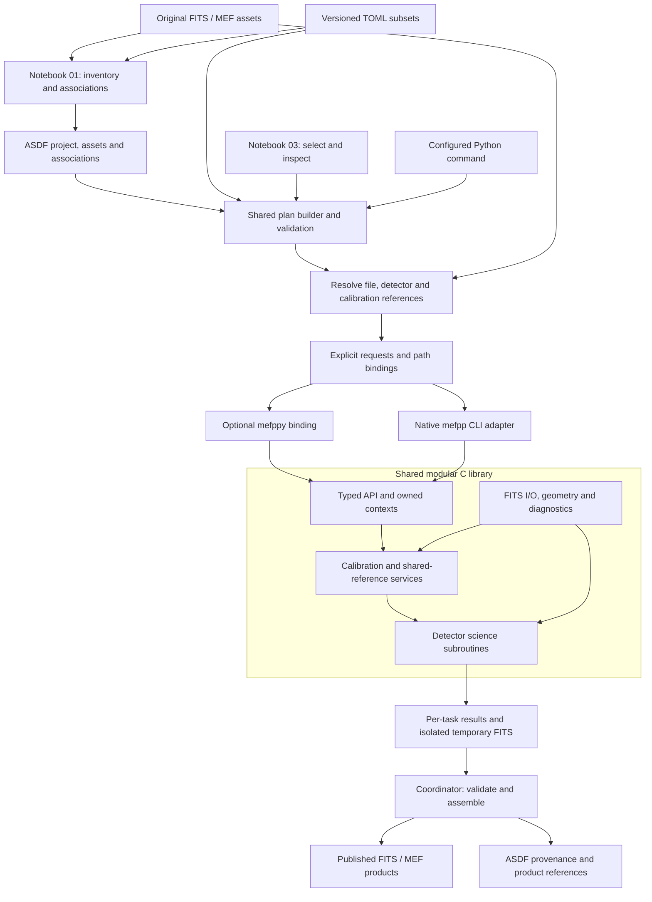

# Proposed Pycavi/mefpp target architecture

Discussion proposal, 29 October 2026. Builds on accepted baseline 22a32d3, [owner direction v2.9](../../developer/native-roadmap-amendment-v2.9-2026-10-29.md), the [source analysis](../../developer/mefpp-refactor-analysis-2026-10-29.md) and [Chapman4 inventory](../../developer/mefpp-refactor-chapman4-inventory-2026-10-29.md).
Status: proposed contracts and names; no implementation or dependency selection.
Compare the [original architecture](../original/pycavi-mefpp.md).

## Executive summary

Replace the reduction directory as an implicit processing input with an explicit, validated request. TOML defines settings and recipes; ASDF identifies observations, calibrations, selected groups, FITS locations and processing history. A resolver turns those descriptions into precise file/detector references before calling a modular C library.

Both the native CLI and optional mefppy Python binding use the same C subroutines. Numerical code receives explicit paths or owned array handles, calibration references, immutable settings and a destination policy. It neither changes cwd nor searches directories to guess its inputs.

Keep the first implementation serial and numerically equivalent to the accepted OCAM/WFI baseline. Design isolated work contexts, shared-reference dependencies and one ordered product publisher now, so later parallel execution and primary-HDU/single-extension images use the same contracts.

Recommendations for discussion:

- Keep discovery/association in shared Python planning code, exposed through notebook 01 and configured scripts.
- Make notebook 03 a client that selects, inspects and executes a saved plan.
- Retain FITS/MEF images; store structured associations/state/provenance in ASDF.
- Use typed configuration populated by PAF and TOML adapters during transition, then retire production PAF after equivalence.
- Provide explicit input/config/output/work paths; no mandatory staging beside raw data and no parent-process chdir.
- Design a shared native API for both CLI and optional mefppy; decide the binding and ASDF implementation after bounded feasibility checks.
- Preserve detector identity/order, common flat normalization and correction-state/uncertainty semantics. New calibration algorithms remain separate.

## Target architecture



The diagram shows component responsibilities. The calibration/shared-reference box includes detector-specific computations plus required reference-statistic barriers; it is not a rule that every request must build every calibration. The coordinator may run one serial task initially. CLI and binding are alternative transports into the same core, not duplicate scientific implementations.

## 1. Finding inputs without depending on cwd

### Discovery is separate from execution

Notebook 01 or a headless inventory command explicitly scans chosen roots and records candidate observations. Classification, grouping and calibration association use instrument metadata and versioned policies. Users can inspect/select a single partition or an explicit collection of groups. An execution request refers to frozen group/asset IDs and ordered membership; it must not silently re-glob directories while processing.

The ASDF model stores asset identity, one or more location bindings, detector identity, physical HDU selector, geometry, units, acquisition metadata and associations. Availability is independent from logical identity. A path alias is not a new exposure; identical basenames are not proof of the same exposure.

A resolver performs preflight: locate the configured asset, check appropriate identity/availability and FITS layout, resolve the selected detector/HDU, verify calibration applicability and prepare exact output paths. Missing, ambiguous, incompatible and deliberately unbuilt inputs are distinct states. No fallback recursive search, nearest filename, guessed calibration or network retrieval is implicit.

### Explicit path-resolution rules

| Input or reference | Proposed base / resolution rule |
|---|---|
| Relative CLI arguments | Resolve once against the initial invocation directory, before execution; record resulting paths |
| TOML subset reference | Resolve relative to the containing TOML file |
| ASDF external FITS or child-document URI | Resolve relative to the containing ASDF document, or through an explicitly named storage-root binding defined by our schema |
| Legacy frame-list member | Import relative to the recorded original execution base when known; preserve literal text and line order; ambiguous bases require explicit mapping |
| Configuration pathname fields | Declare their base in the schema; reject fields whose interpretation would depend on later chdir |
| Output/work/log roots | Explicit request or configuration values, resolved before the first native call |
| Native C call | Resolved explicit file references/paths or array handles; no cwd fallback or environment-dependent search |

Resolve syntactic relative paths separately from physical filesystem aliases. Preserve original logical URI and selected physical location; do not rewrite every stored reference to a host-specific realpath. A relocation mapping changes locations, not asset identity or calibration selection. If a supplied content identity disagrees, fail rather than silently accept another file.

Legacy list bases are particularly important: opening an old list from another directory cannot establish what its relative members originally meant. The importer must not invent a list-relative rule and claim historical equivalence.

Config/asset verification must be proportional: use existing frozen identities and explicitly scoped checks; do not rehash every gigabyte of every image for every task by default. Record whether an asset is content-verified, metadata-checked or only located. Recheck relevant assumptions immediately before use according to the selected integrity policy.

### Native execution contract

Each request contains:

- Selected operation, configuration/schema version and effective settings identity.
- Ordered input asset references with resolved paths and detector/HDU selectors.
- Applicable calibration handles/references and correction state.
- Shared mosaic reference/statistic identity where needed.
- Explicit product, temporary and diagnostic paths.
- Resource/cancellation policy and predictable structured status/results.

No routine changes the caller's cwd, mutates process-wide environment to find inputs, calls exit on an ordinary processing error or assumes all inputs share a directory. Paths with spaces and duplicate basenames in different roots are valid and must not collide. Filesystem access stays in I/O adapters rather than per-pixel kernels.

For external legacy executables, a subprocess-specific private working directory may still be needed. That is an explicit adapter detail: the parent/kernel remains in its own directory, inputs/outputs are accounted for, and no concurrent job shares that private arena.

## 2. TOML subsets and one effective configuration

The initial proposed domains remain project/composition, instrument/detectors, association, processing parameters, recipe, execution, quality and product requirements. These are reusable subsets, not a requirement to populate eight files for a small project. Keep reduction profile, recipe and product profile distinct.

One loader validates and resolves subsets, records provenance/overrides and produces immutable typed settings. Native routines consume the typed settings, not TOML table objects or strings naming files to discover. During transition the existing PAF reader populates the same types; compare effective settings before removing PAF.

Measured calibration results stay versioned calibration products in ASDF, with selection/provenance; do not overwrite static instrument defaults. Reuse policy checks input/calibration/configuration identities and actual output state. No silent precedence from an old partition-local mefpp.paf is permitted in the target.

## 3. ASDF and the native boundary

Recommendation for the first reviewed design: Python owns project discovery, ASDF validation/resolution, association planning and publication records. The C numerical core remains independent of the serialized ASDF tree. ASDF retains the complete logical provenance, including effective TOML snapshots or immutable recoverable references.

Native CLI can remain independently usable with explicit FITS inputs/lists and TOML settings, without requiring Python for every numerical operation. When launched by the Python coordinator, any resolved native configuration/input-list files are derived transport artifacts, pinned to the parent ASDF request and never edited as an alternative source of truth.

Optional native ASDF access via libasdf remains a separate adapter alternative to qualify, including exact feature/dependency/language/platform requirements. It is not necessary to decide that library merely to define cwd-independent C services.

Illustrative future Python command; not currently implemented:

```bash
pycavi-reduce \
  --project /projects/cn-ori/project.asdf \
  --config /configs/cn-ori/project.toml \
  --group science-cn-ori-r-20170311 \
  --output-root /projects/cn-ori/products \
  --work-root /scratch/cn-ori
```

Illustrative future native command; option names are proposed:

```bash
mefpp \
  --config /runs/attempt-001/resolved-native.toml \
  --science /runs/attempt-001/science.list \
  --bias /calibrations/bias-001.fits \
  --mff /calibrations/flat-r-001.fits \
  --output-dir /projects/cn-ori/products/attempt-001 \
  --work-dir /scratch/cn-ori/attempt-001
```

These commands may be invoked from any directory. The derived list contains explicit resolved entries. A future mefppy call submits the equivalent typed request directly, bypassing native subprocess/list transport while retaining the same plan and algorithms. Naming/packaging and binding technology remain open.

## 4. C subroutines, ownership and single detectors

Separate configuration validation, input/layout inspection, calibration construction, master-flat combination, detector science preprocessing and product writing. Supporting services handle geometry, arrays, FITS, diagnostics and status. Public .h contracts evolve with .c extraction; do not expose the historical mef_bb structure as the permanent API.

Use immutable configuration, an execution request, isolated mutable work context and owned result handles. One allocation has one documented destruction owner, including partial failure. Do not promise reentrancy/thread safety until Eclipse/qfits globals, caches and initialization are addressed.

Detector ID is independent from HDU index and output position. Resolve each science/calibration file's detector map separately. Support primary image HDU 0, one image extension and MEF through the same image-reference contract; preserve required MEF order and original identity when excluding detectors. Operational health, selection and processing outcome stay distinct.

Keep current mean-gain/exposure normalization in its existing owner during equivalence extraction; any later move into C/mefppy is an explicit contract change with exactly-once correction-state checks. Geometry, units, masks, variance availability and provenance travel with images even before new variance algorithms are implemented.

## 5. Parallel readiness and publishing

A plan deduplicates shared calibration tasks and makes the common reference statistics explicit. Initial serial execution reuses that plan. Later workers receive immutable inputs/config and isolated work directories/contexts. A worker count must obey CPU, memory and I/O limits; multiple independent mefppy calls are not automatically safe threads.

Workers never append concurrently to a published MEF or update the same ASDF record. A coordinator validates results, assembles in deterministic detector order and publishes a product record after successful FITS completion. Distinguish temporary, partial, existing-unverified, validated and published states. An absent planned calibration target is not automatically corruption.

FITS and ASDF publication need a recovery protocol, not an assumed multi-file transaction. Preserve attempt identity, prevent accidental overwrites, and record interrupted/unreferenced artifacts for inspection. Checkpoint/resume compares operation state and provenance before skipping anything. Do not rerun normalization merely because an outer notebook cell is repeated.

## 6. Notebook responsibilities

| Client | Proposed responsibility |
|---|---|
| Notebook 00 | Select project/configuration roots and show the resolved configuration |
| Notebook 01 | Inventory explicit raw roots; inspect groups/calibration proposals; save an ASDF plan |
| Notebook 03 | Choose group(s), inspect dependencies and build/reuse choices; execute the reviewed plan through a shared library |
| Configured Python command | Submit the same plan/execution routines headlessly |
| Notebook 04 and later clients | Consume published FITS/products through explicit references; do not infer success or ownership solely from paths |

Notebook inspection must not materialize or alter the reduction tree merely by reading a plan. Retain the useful choice to build/inspect calibrations before science. Existing directory structure remains supported by a legacy adapter; a shallow redesign, database, remote retrieval service or recursive workflow framework is not selected by this proposal.

## 7. Bounded migration and acceptance proposal

1. Freeze path/configuration/identity contracts and minimal C header types.
2. Retain PAF/CLI serial behavior while splitting configuration from mutable work.
3. Add typed TOML adapter/subsets and field-by-field effective-configuration comparison.
4. Make file resolution and output destinations explicit through loaders, kernels and writers; add a temporary legacy arena adapter only where unavoidable.
5. Add ASDF/FITS resolver and legacy association importer without moving existing data.
6. Extract one service at a time and adapt notebooks to the shared planner/executor.
7. Qualify single-detector cases and the optional mefppy binding.
8. Introduce bounded process parallelism after serial equivalence and shared-reference/output-ownership gates.

Proposed targeted checks:

- Run the same explicit request from two unrelated directories; compare pixels and relevant metadata and confirm cwd is unchanged.
- Raw/calibration inputs in separate read-only roots, spaces in paths, duplicate basenames, missing/ambiguous references, relocation aliases and interrupted publication.
- Preserve legacy list order and explicit local overrides; reject an unknowable relative-list base.
- Missing, duplicate, permuted and excluded detector IDs; primary-HDU and one-extension inputs.
- Exactly-once gain/exposure normalization; preserved common mosaic-flat reference; no duplicate shared calibration writers.
- CLI versus optional library equivalence, repeated calls and partial cleanup without terminating Python.

These checks are proposed, not executed. Agree the smallest relevant acceptance per implementation increment; do not replay Stage 2's memory/compiler matrix or reduce the full Chapman dataset as a prerequisite.

## Review questions

- Are the proposed configuration domains appropriately separated for daily use?
- Is Python ownership of ASDF planning/resolution acceptable initially, while preserving an independently usable native TOML/FITS CLI?
- Should file-based C requests be the initial stable interface before exposing borrowed array buffers?
- What product/attempt retention and publication policy should be the default?
- Which concrete first extraction provides the clearest equivalence check?

Current assessment: explicit resolution and typed requests are the necessary first boundary. Merely adding an input-directory option or setting subprocess cwd preserves too much hidden state. Those can support legacy compatibility but do not define the target API.
