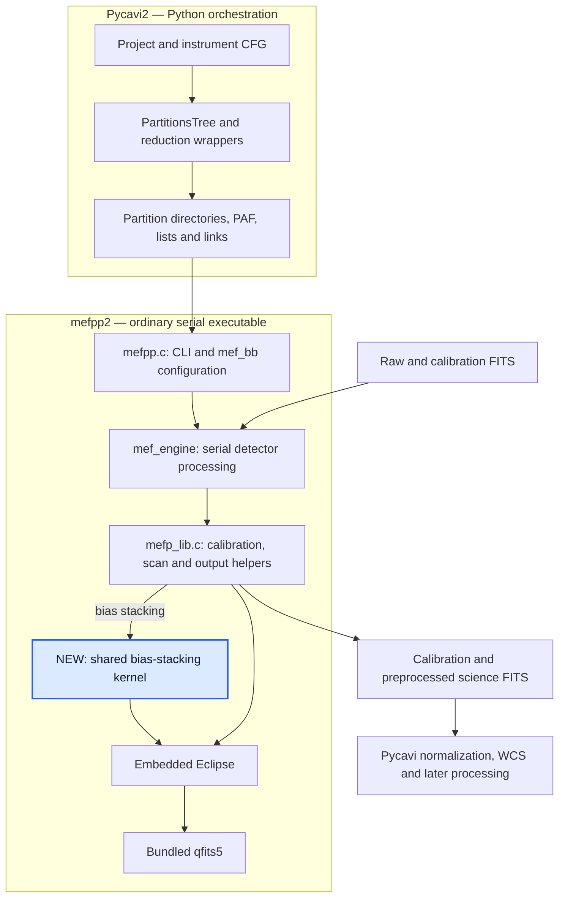
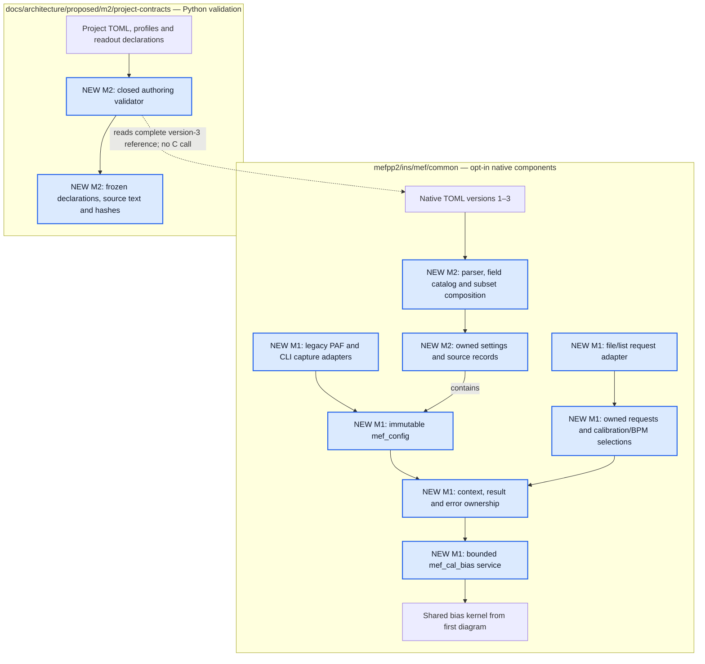

# Architecture snapshot — wenu-imaging

Recorded: 2026-10-30T11:41:10-03:00 (America/Santiago).
Filename uses the ISO 8601 basic timestamp form.

Source baseline: `0160ed181cd1e609f5e82cfab7932763b228f698`.
This is the as-is merged repository, based on direct source and CMake inspection,
not the proposed target architecture. Blue boxes identify the new components.
The snapshot is historical; future changes should produce another dated file.

## Ordinary reduction path

The first diagram shows the ordinary reduction path built from this source.
Installed binaries have not been replaced during these increments.

## Implemented opt-in and authoring components

The remaining new components exist alongside that path. Arrows below show
implemented relationships, not future integration.

## Source locations and actual status

| Element | Actual location | Current status |
|---|---|---|
| Shared bias kernel | `mefpp2/ins/mef/common/mef_bias_kernel.c` | Used by both the ordinary bias builder and the new bias service |
| M1 configuration, requests and bias service | `mefpp2/ins/mef/common/mef_config.c`, `mef_runtime.c`, `mef_*request.c`, `mef_cal_bias.c` | Built through opt-in test targets |
| M2 native TOML reader | Same directory: `mef_config_toml.c`, `mef_toml_bundle.c`, `mef_config_domains.c` | Implemented and tested; ordinary `mefpp` does not load it |
| TOML parser | `third_party/tomlc17`, with private `mef_toml_bridge.c` | C99 parser boundary; surrounding native code stays C90/C17 |
| Project/readout validator | `docs/architecture/proposed/m2/project-contracts/validate_project.py` | Standalone Python validation; no reduction launch |
| Optional overscan and header rules | Project catalog/examples and `docs/architecture/proposed/overscan-readout-policy.md` | Configuration validation implemented; numerical adaptation remains ahead |

The build separation is explicit in
[CMakeLists.txt at the baseline](https://github.com/fselman/wenu-imaging/blob/0160ed181cd1e609f5e82cfab7932763b228f698/mefpp2/CMakeLists.txt):
`MEFPP_BUILD_CONFIG_PROBES` defaults to **OFF**. Bundled qfits is physically under
`mefpp2/qfits5`; the earlier sibling layout is historical.

The project validator currently preserves separate reduction purpose, ordered
recipe and product requirements, plus amplifier-specific overscan declarations
and unverified header evidence. Its snapshots explicitly say **execution is not
ready**. There is no operational ASDF project store, Python-to-native service
binding, or general numerical dispatcher connecting these new components to
ordinary reductions yet. The metadata-only `mef_execute` returns unsupported;
the concrete bounded bias service is called separately through `mef_cal_bias`.

## Inspection evidence and limits

Source anchors checked at the baseline:

- `Pycavi2/pycavi/pycavi/pycavi_associate_reduction.py`: PartitionsTree,
  reduction wrappers, PAF staging, subprocess launch and science normalization.
- `mefpp2/CMakeLists.txt`: normal executable/library graph and default-off
  opt-in native targets.
- `mefpp2/ins/mef/common/mefp_lib.c`: existing bias builder calls the shared
  `mef_bias_stack` kernel.
- `mefpp2/ins/mef/common/mef_cal_bias.c`: concrete bias service uses that same
  kernel with its explicit input/context contract.
- `mefpp2/ins/mef/common/mef_runtime.c`, `mef_config_toml.h` and
  `mef_input_request.h`: ownership, unsupported general dispatch and adapter limits.
- `docs/architecture/proposed/m2/project-contracts/validate_project.py`:
  Python-only frozen authoring records, explicit readiness/validation statuses.

This snapshot records source organization and implemented calls/build relations.
It is not a new processing run, deployment, hardware/readout validation, numerical
qualification or full M2 acceptance. Preserve the existing paired results and
private evidence; no native test replay is required to save this document.
