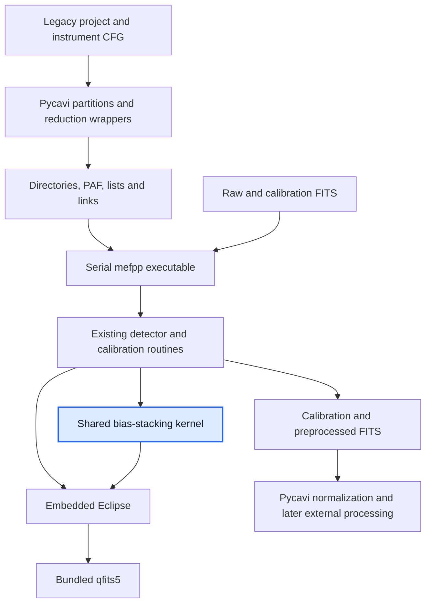
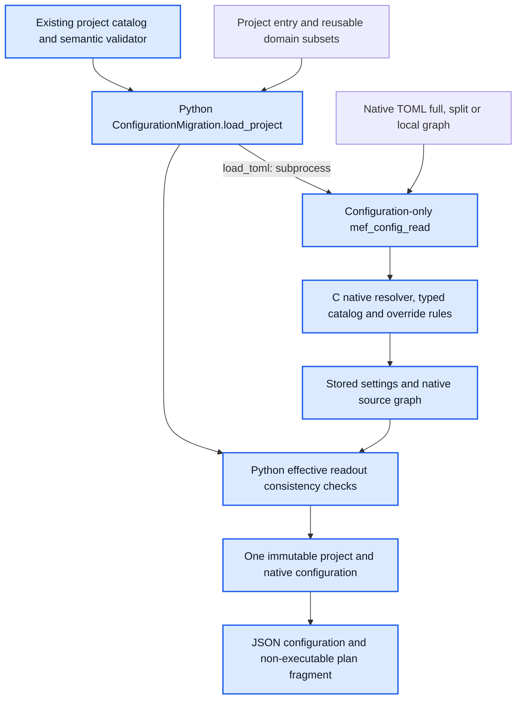
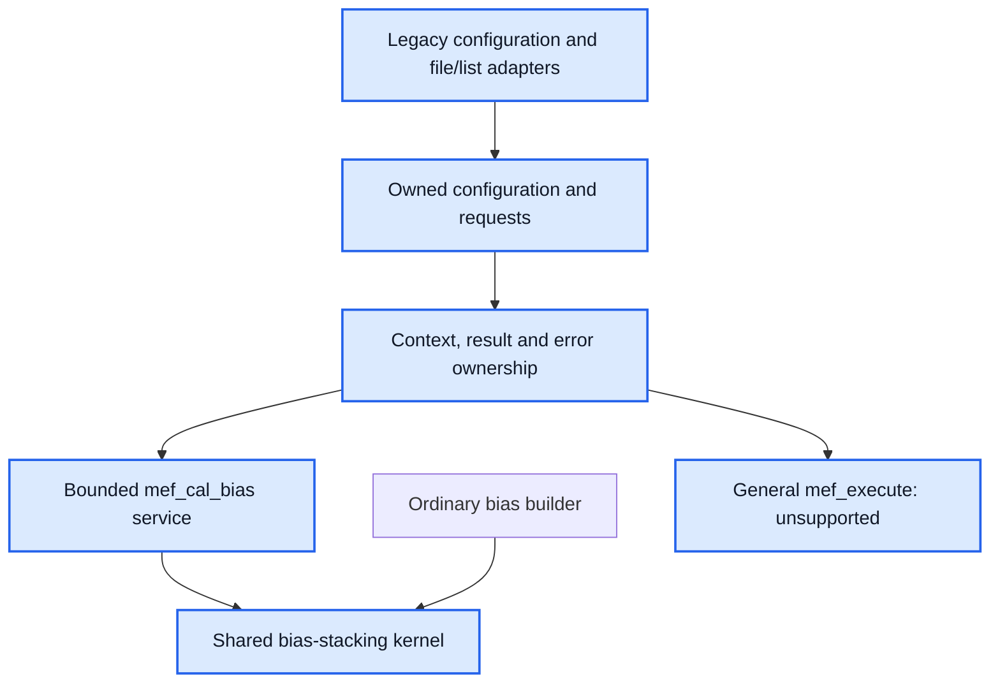

# Architecture snapshot — wenu-imaging

Recorded: 2026-10-30T14:16:56-03:00 (America/Santiago).
Source baseline: `b3d245fcd2855a018b4ef4242d9f07eb6298f5ff`, PR #157 review head.
Implementation tested on both targets: `d0ab19e91b46e6fe6e21c541af99c21ed35029b4`.
The intervening commit records documentation only. Main remains at
`ea35197a7f074ac1c44289e7bcc94336f92d6681`; PR #157 is not yet accepted or merged.

This records implemented source calls and build relationships. It preserves the
[earlier snapshot](arch_snapshot.20261030T114110-0300.md) as historical evidence.
Blue boxes identify the modernization components alongside ordinary reductions.

## Executive summary

A project can now combine reusable project/profile files with the existing native
parameter subsets, producing one checked, immutable configuration. The loader
retains the contributing texts, hashes, include relationships and domain origins.
Conflicting project definitions fail explicitly; permitted numerical overrides
continue through the existing native resolver. Reduction purpose, ordered recipe
and product requirements remain separate.

The migration regression and project-composition checks passed 2/2 on both the
Intel Mac and representative shared Chapman4. Both reported protected installed
files and clean checkouts unchanged. The #155 integration gap is resolved and
PR #157 is ready for owner review. Full M2 closure remains a cumulative review
and owner decision. No installation or numerical algorithm change occurred.

## Ordinary reduction path

The ordinary Pycavi reduction wrappers still stage directories, PAF files, lists
and links, then launch external tools. They do not consume the new frozen project
record or call the new C services through a Python binding.

The shared bias kernel is the implemented connection between the ordinary bias
builder and the bounded M1 service. Installed engine selection was preserved by
the target checks; a source review does not establish deployment of this PR.

## Integrated M2 configuration path

The diagram shows the integrated `freeze-project` CLI/library route. The same
Python module also exposes `freeze-toml` and `migrate-paf`. PAF migration obtains
stored values through the original native constructor; supplied legacy CFG text
is retained as compatibility evidence. It does not invent scientific associations.

Project envelope version 2 composes complete domain-v1 declarations. Complete
project version 1 remains valid. Native versions 1–3 remain supported through the
existing C reader. Includes, project roots and native references use explicit
containing-file bases. Disjoint or identical project domains compose; conflicting
domains fail, with an empty project replacement allowlist. Native numeric overrides
retain their existing allowlist. Versions, closed keys, cycles and graph limits
are checked before a configuration is published.

Native parsing uses the private C99 parser/shim boundary. The surrounding native
configuration code retains the C90/C17 baseline. Python does not supply a second
native default or numeric resolution implementation.

Frozen records retain project/native source texts and hashes, include edges,
native winning definitions and project-domain contributors. The saved record can
be restored without reopening original sources. `configuration.json` and
`plan-configuration.json` are JSON artifacts, not an operational ASDF store or
an executable task plan. `execution_ready` remains false.

## M1 services and build separation

`MEFPP_BUILD_CONFIG_PROBES` defaults to OFF. Configuration libraries, the reader
and service probes are opt-in developer targets. The TOML reader/parser is not
linked into ordinary mefpp or installed by this increment. The Python migration
API requires an explicit source root and absolute native-reader path; a stable
installed ABI or in-process Python/C binding is not claimed.

| Component | Source anchor | Implemented role |
|---|---|---|
| Ordinary Python orchestration | `Pycavi2/pycavi/pycavi/pycavi_associate_reduction.py` | Partitions, staging and subprocess launch |
| Shared Python configuration API/CLI | `Pycavi2/pycavi/pycavi/pycavi_configuration.py` | Migration, composition, freeze and restore |
| Project semantics | `docs/architecture/proposed/m2/project-contracts/validate_project.py` | Reused closed catalog and readout checks |
| Native configuration bridge | `mefpp2/ins/mef/common/mef_config_read.c` | PAF/TOML settings and source metadata report |
| Native composition | `mef_config_toml.c`, `mef_toml_bundle.c`, `mef_config_domains.c` under `mefpp2/ins/mef/common` | Typed native values, includes and permitted overrides |
| M1 ownership and service | `mef_runtime.c`, `mef_cal_bias.c` in the same directory | Owned contexts and bounded bias operation |
| Shared bias calculation | `mef_bias_kernel.c`, called by `mefp_lib.c` and `mef_cal_bias.c` | Retained legacy bias-stacking behavior |
| Build boundary | `mefpp2/CMakeLists.txt` | Ordinary engine and default-off opt-in targets |

## Verification and remaining boundary

| Target | Migration | Project composition | Total |
|---|---|---|---|
| Intel Mac | Passed, 11.41 s | Passed, 16.55 s | 2/2, 27.97 s |
| Chapman4 | Passed, 6.43 s | Passed, 13.16 s | 2/2, 19.61 s |

See the [paired receipt](../m2-project-composition-paired-results-2026-10-30.md)
for exact private directories and evidence limits. This snapshot is a source
inspection and documentation update; it launches no new test or processing run.

The configuration foundation is connected. General execution dispatch,
Python/native service binding, FITS applicability and hardware/header trust,
ASDF publication and the later numerical services remain outside this increment.
No complete M2 acceptance, scientific validation or Phase 3 compliance follows
from the configuration checks alone. Owner review precedes merge and cleanup.
