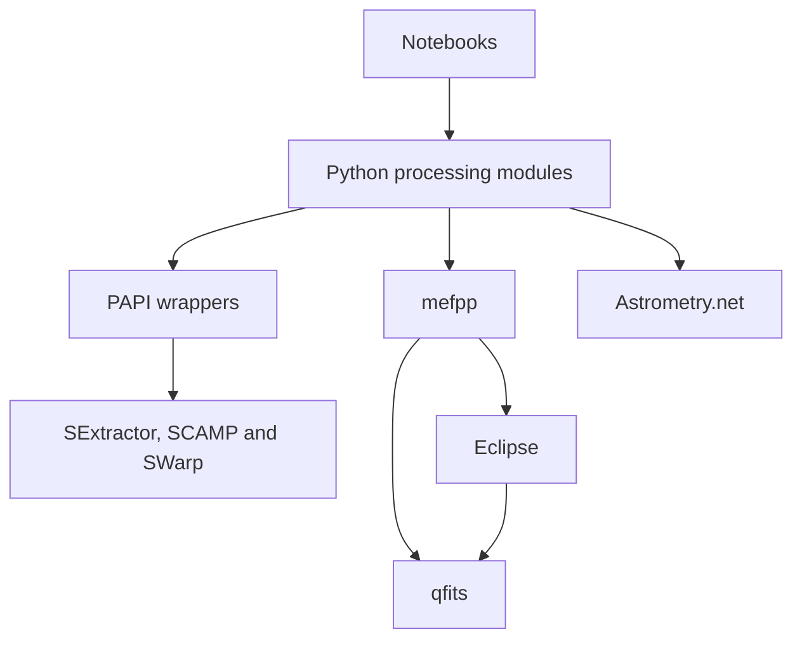

# wenu-imaging architecture

30 October native M3 path candidate after owner-accepted/merged PR #161 and
clean Mac/shared Chapman main ded31e876582dcbe044c2b99167c9d36e8c6ee03:
[direct C path execution](m3-native-paths.md) adds explicit PAF/input/list/calibration,
output/work/log selection without chdir or Python runtime routing. Agent C90/C17
focused tests pass 2/2 (51 CLI cases plus 16 path profiles/14 rejections); scoped
ASan/UBSan passes, with LeakSanitizer unavailable in this container. Actual
selected-tool Mac/representative Chapman qualification remains pending.
#163 optional-type ownership, #165 WFI fixture expectation and #166 direct-FITS
statistics corrections remain open for targets; existing #164 swap/O_CREAT,
#125 long FITS strings and #144 wider OOM limits remain separate. M3/#159 remains
open; no installation, configured-engine activation, new algorithms, ASDF/JSON
policy change or automatic merge/cleanup. Preserve all successful/failed runs and
selected tools. Earlier inspector-only notes below are historical.

29 October 2026: see the [original architecture diagram](../architecture/original/pycavi-mefpp.md) and [target architecture proposal](../architecture/proposed/pycavi-mefpp.md). The proposed execution contract resolves inputs, calibrations, configuration and output/work destinations explicitly, without changing the caller's working directory or implicitly searching for files. Existing cwd-dependent behavior remains unchanged; this is design for discussion.

Native roadmap revision 1.2, 25 October 2026: retain C89/C90 as the portable C
source baseline and explicitly qualify compilation and behavior in C17 mode.
C17 is a compatibility target, not a new source-feature baseline. Inventory
legacy/dependency extensions and isolate platform APIs; do not claim existing
strict compliance. Newer facilities need a reviewed exception. C23 checks are
optional. Mac compiler support is distinct from unperformed mefpp tests;
chapman3's inventoried GCC 4.8.5/Clang 3.4.2 cannot provide the C17 lane. Qualify
an isolated compatible compiler without implicitly replacing system tools or
upgrading glibc. This clarification authorizes documentation, not installation.

Roadmap revision 1.1 adds observatory/archive data-model examples, required native
Apple Silicon qualification, and a provisional assessment of intra-detector CPU
threads/GPU backends. These do not change the observed architecture: mefpp is
still serial and no new format or accelerator is implemented. See the versioned
native roadmap for gates, CPU fallback, precision and platform requirements.

Data-representation review added to native roadmap v1, 25 October 2026: insert
stage 2A immediately after memory qualification and before component contracts.
Review current accepted formats/metadata models and in-memory structures,
including FITS, HDF5, ASDF and Zarr, without preselecting a replacement. Preserve
FITS ingestion/interchange and originals; compare actual performance/fidelity
and ANSI-C/platform/dependency costs. Any new backend needs a separate reviewed
migration and renewed memory checks. See the version-1 native roadmap.

## Current native architecture and provisional target — 25 October 2026

Read the versioned [current mefpp architecture](mefpp-current-architecture.md)
for actual source, library, state, processing and normalization boundaries.
The [native roadmap v1](mefpp-modernization-roadmap-v1.md) separately proposes
component services and staged qualification, retaining ANSI C and adding native
Windows as an explicit requirement. Older Windows/WSL and sequencing paragraphs
below are historical where superseded: WSL does not establish native Windows
support. Shared mosaic normalization is a required scientific invariant.
Target APIs, build tools and implementation details remain revisable proposals;
no source relocation or installation is performed by these documents.

## Architecture audit before component redesign, 25 October 2026

The [native architecture audit](native-architecture-audit-2026-10-25.md) records
current diagrams, actual source boundaries, compiler-assisted Eclipse/qfits
usage and modern-practice gaps. The workflow is concentrated in the recipe
and common MEF C units, linked with Eclipse and qfits static libraries; it is
not literally one standalone C library. Whole-object inclusion and potential
function calls are distinct from runtime use and safe removability.

Fernando requests eventual bias/BPM/non-linearity/dome/sky/master-flat/science
components. Treat them as candidate interfaces over reusable numerical code,
with shared infrastructure and explicit state/ownership/product contracts.
Whether they become modular C targets, subcommands or separate executables
is a full-roadmap decision, not something an audit should silently implement.
The architecture audit precedes that full roadmap; no source nesting, build
change or component extraction begins before roadmap review/agreement.
The prior installation migration proposal remains unimplemented.

## Approved native packaging direction, 25 October 2026

Fernando requests qfits as a bundled source dependency within mefpp, and brings
the build/install audit forward before the remaining Pycavi refactoring stages.
The [installation audit](native-installation-audit-2026-10-25.md) recommends
mefpp2/qfits5, retaining a distinct C-library/license boundary and one canonical
source copy. Current source still uses sibling mefpp2/qfits52; this document is
not evidence that the move or target build has happened. Build/install
qualification is Intel Mac first, then chapman3, with existing API/numerical
behavior and native selections preserved. The earlier three-directory layout
below describes the current/historical source until migration is implemented.
This direction does not authorize the full scientific native audit, upgrades
or runtime parallelism. Other earlier architectural constraints remain.

## Current direction, 21 October 2026

Latest clarification: discard the old reduction-script implementation path;
thin the notebooks first, derive new configuration-driven runnable scripts from
the resulting shared library calls, audit those Python routines, then audit
mefpp. WFI implementation/validation is deferred until Mac/Linux OmegaCAM works;
its requirements remain preserved. BPM production belongs in the normal
calibration workflow. Current Pycavi copies a static mask, but native mefpp
contains a construction path; validate and integrate existing work before
designing any replacement. No library or engine upgrades now. This clarification
controls where earlier proposed sequences below differ.

The immediate work is coherent wenu-imaging packaging and Pycavi debugging and
improvement with the existing library/engine versions retained. Library upgrades
and SEP or other backend adoption are deferred. Complete the Pycavi milestone
before mefpp implementation. Packaging must distinguish the wenu-imaging product,
Python distribution metadata, stable pycavi imports and separately built native
components; a successful Python install must not imply native engines were built.

Pycavi has two intended user interfaces: thin editable notebooks and
configuration-driven Python scripts/commands. Both call the same installed
library stages. Keep notebook choices and data inspection accessible while
moving stable processing/sequence logic to shared functions. WFI and OmegaCAM
are both required paths, including WFI calibration selection and instrument-
specific photometry/provenance; the OmegaCAM pilot does not validate WFI.
See [the two-interface review](pycavi-two-interface-review-2026-10-21.md).

The packaging acceptance target includes an obvious repository-root installation
entry point, correctly installed notebook/config resources, preserved edited
orchestration files, explicit external executable/resource configuration and a
record of the tested environment. Select the exact distribution metadata layout
in the focused packaging implementation; do not maintain competing independent
metadata definitions or rename imports merely to match the parent name.

Audit detector layout and concurrency now; implementation is staged. See
[single-detector and parallel-work audit](detectors-and-parallel-work-audit-2026-10-21.md).
Represent processing opportunities as tasks with explicit inputs, dependencies,
outputs and CPU/memory/thread budgets. Reuse current functions and simple process
tools rather than introduce a workflow framework. An independent file has one
writer; shared master calibrations become immutable inputs once complete.

### Complete application distribution

A Python wheel and a complete application installation are separate deliverables.
The Python package declares dependencies and contains its code/notebooks/config;
a coordinated environment supplies Python, scientific libraries and native
astronomy programs. A candidate delivery is one Conda-based environment recipe
with platform-specific tested resolutions and native component recipes where
needed, followed later by optional self-contained installers (for example with
constructor). Availability and licensing of every packaged native dependency
must be verified; this is an architecture proposal, not an existing installer.

Build/test separately for Linux, macOS Intel and macOS arm64. Native Windows
support is not established by packaging Python: current POSIX shell/symlink and
native-engine assumptions require porting and validation. Windows via WSL2 is
the practical candidate for reusing the Linux environment. Fernando's question
about feasibility does not change the urgent Intel Mac/cluster priorities.

Astrometry indexes and observational inputs remain separately identified data;
an offline distribution can include staged indexes as a separate data bundle.
Do not hide large downloads inside setup or a reduction run. Retain existing
dependency versions/limits during this packaging stage; platform builds and
installers do not constitute permission to upgrade libraries or engines.

References: [constructor](https://conda.github.io/constructor/),
[Python binary packaging](https://packaging.python.org/en/latest/guides/packaging-binary-extensions/),
[Microsoft WSL](https://learn.microsoft.com/en-us/windows/wsl/about).

Status: accepted architecture direction, updated with Fernando's scope decisions
on 20 October 2026. Existing behavior and future capabilities are distinguished;
this documentation update does not change component implementation.

## Parent workspace and baseline

wenu-imaging is the canonical monorepo. Pycavi2, mefpp2 and qfits52 are ordinary
source directories, retaining their separate build procedures and interfaces.
One Git checkout and one system release coordinate compatible component changes.
External astronomy software remains separately managed.

The migration merges the history reachable from each audited component commit
without squashing or rewriting its commits. Each imported directory's Git tree
is verified against its original source tree, including binary files, symlinks
and executable modes. Original branch and tag references are not copied into the
monorepo; their repositories remain intact. Older commits retain their original
root-relative paths. The audit below refers to the pre-migration baseline.

Pre-migration parent baseline: `4c46205539faa6bbf24cfcbce1a4e42ef63799ef`.

| Component | Pinned commit |
|---|---|
| Pycavi2 | `b1c401d612aee50a804942969fcb72738fafbcef` |
| mefpp2 | `c69c314a24e56311dfd0efeb5721c3549aa5cbd0` |
| qfits52 | `9470098a68ebaf8e2ba67f2bde1f5b1090a2524b` |

## Existing responsibilities

| Component | Responsibility | Boundary |
|---|---|---|
| Pycavi notebooks | User choices, sequencing and inspection | Python calls and project files |
| `pycavi.pycavi` | Instrument configuration, association, reduction, astrometry, calibration and catalogues | Python objects, CFG/PAF, lists, FITS, QC and logs |
| `pycavi.papi` | Wrappers used by current astromatic tools | SExtractor, SCAMP and SWarp commands and generated files |
| mefpp recipe | Instrument-signature processing and master calibrations | `mefpp` command, PAF, lists and FITS |
| Eclipse inside mefpp2 | Image processing and supporting routines | C headers and `libeclipse.a` |
| qfits52 | FITS/PAF handling and memory support | C headers, `libqfits.a` and FITS utilities |
| Astrometry.net | Initial extension WCS solutions | `solve-field`, configuration and index files |

Dependencies in this diagram are not processing order. mefpp's build links
`-leclipse -lqfits -lm`. Direct calls from distributed Python/notebook code to
qfits CLI tools were not found in the first audit; linkage through the C code is
confirmed. Local modifications and other branches have not been characterized.

## Existing processing sequence

1. Configure the project/instrument and select WFI calibrations where needed.
2. Partition exposures and associate calibrations.
3. Use mefpp to process calibration/science data, then normalize through Python.
4. Solve extension astrometry using Astrometry.net and assemble WCS frames.
5. Extract sources and refine astrometry with SCAMP.
6. Resample/coadd with SWarp.
7. Calibrate photometry, inspect QC, estimate illumination corrections and create
   catalogues using the later notebooks.

The Python `mefpp_normalize_science` function performs average-gain/exposure
normalization to e-/s and updates headers. This behavior belongs in scientific
regression comparisons; it must not be accidentally duplicated in the C stage.

## Existing configuration and resources

Three locations have separate roles:

- Installed Python resources: notebooks and configuration templates.
- User executable selection: `~/.pycavi/pycavi_astrosoft.cfg`.
- Project state: CFG/PAF, input lists, symlinks, calibration products, reduced
  science data, astrometry products, catalogues and logs.

mefpp also installs PAF configuration and BPM resources under `config` and
`static_cal`. Its install target invokes `funpack` to decompress the distributed
BPM files. Pycavi expects the corresponding uncompressed products.

The first audit found an interface mismatch: executable setup records the full
mefpp executable path; notebook 03 passes that value as an installation directory
to functions that append `/bin/mefpp`, `/config` and `/static_cal`. We must agree
on explicit executable/resource locations before fixing this boundary.

There are multiple generations of command wrappers/scripts. The current notebook
path uses `pycavi_astromatic_tools` and PAPI. Historical scripts and the alternate
`pycavi_astromatic` module need separate characterization; their presence does
not establish equivalent support.

## Agreed boundaries for the portability work

- Keep three ordinary component directories and retain existing configure/Makefiles initially.
- Preserve imports, executable names and C APIs initially; assess distribution
  naming independently.
- Treat the notebook workflow as the initial reference interface. Historical scripts remain
  present but unvalidated unless a specific production need requires them.
- Define and verify installed resources independently of source-tree paths.
- Manage Astrometry.net, SExtractor, SCAMP, SWarp and `funpack` as explicit
  external dependencies with tested versions and locations. This is a proposal
  to coordinate installation, not to copy their sources into the parent repo.
- Manage astrometry indexes and scientific inputs separately from source Git
  history. Record the selected identities and locations.
- Use documented user-owned installation prefixes and isolated Python
  environments as the initial candidate, pending approval. No package manager,
  container or universal installer has been selected.

## Immediate science delivery

The current objective is a medium-sized OmegaCAM dataset reduced and prepared
for ESO Phase 3 submission. The exact input inventory, filters, calibration
availability, trusted comparison products and submission product types are still
to be defined. Prioritize this path on Intel macOS and the single-node Linux
cluster. Apple Silicon and Ubuntu remain required platform targets.

Science quality checks must cover the chosen OmegaCAM products, and a separate
product review must establish the applicable Phase 3 metadata, provenance,
associations and release documentation. Do not infer compliance from the presence
of Phase 3-related FITS keywords. Record the standard/tool versions actually used.
Preparing products does not authorize archive upload or publication.

## Parallel execution boundary

`pycavi_solve.run_solve_field` uses a local `multiprocessing.Pool` for extension
solves. This establishes a single-host process mechanism, not scheduler-aware
resource allocation or distributed-memory execution. The first audit also found
that the asynchronous result is waited on without retrieving it there, so worker
failure propagation needs characterization.

Fernando confirmed that cluster multiprocessing is within a single node.
Distribution, scheduler, allocation limits, available libraries, filesystem and
launch procedure still need identification. Process counts and external-program
threads must be considered together; multi-node/MPI execution is outside scope.

mefpp itself does not implement multiprocessing. The first operational milestone
retains serial mefpp execution. Parallelizing the C engine, or scheduling multiple
mefpp invocations concurrently, is not part of the initial portability work.

## Evidence and limits

Primary pinned sources:

- [Pycavi README](https://github.com/fselman/Pycavi2/blob/b1c401d612aee50a804942969fcb72738fafbcef/Readme.rst)
- [Python packaging](https://github.com/fselman/Pycavi2/blob/b1c401d612aee50a804942969fcb72738fafbcef/pyproject.toml)
- [Notebook 03](https://github.com/fselman/Pycavi2/blob/b1c401d612aee50a804942969fcb72738fafbcef/pycavi/notebooks/03_pycavi_run.ipynb)
- [Reduction functions](https://github.com/fselman/Pycavi2/blob/b1c401d612aee50a804942969fcb72738fafbcef/pycavi/pycavi/pycavi_associate_reduction.py)
- [Executable setup](https://github.com/fselman/Pycavi2/blob/b1c401d612aee50a804942969fcb72738fafbcef/pycavi/pycavi_setastro.py)
- [Astromatic tools](https://github.com/fselman/Pycavi2/blob/b1c401d612aee50a804942969fcb72738fafbcef/pycavi/pycavi/pycavi_astromatic_tools.py)
- [Solve module](https://github.com/fselman/Pycavi2/blob/b1c401d612aee50a804942969fcb72738fafbcef/pycavi/pycavi/pycavi_solve.py)
- [mefpp recipe Makefile](https://github.com/fselman/mefpp2/blob/c69c314a24e56311dfd0efeb5721c3549aa5cbd0/ins/mef/Makefile)
- [Eclipse Makefile](https://github.com/fselman/mefpp2/blob/c69c314a24e56311dfd0efeb5721c3549aa5cbd0/src/Makefile)
- [mefpp installation target](https://github.com/fselman/mefpp2/blob/c69c314a24e56311dfd0efeb5721c3549aa5cbd0/Makefile)
- [qfits Makefile](https://github.com/fselman/qfits52/blob/9470098a68ebaf8e2ba67f2bde1f5b1090a2524b/Makefile)

The initial audit examined 26 distributed Python files, 15 notebooks and selected
C/build/documentation files. Python parsing and Linux GCC syntax checks of the
two C configuration generators passed, with warnings. No full native build,
wheel/sdist installation, macOS execution or numerical reduction has been
validated. These documents must not be read as a support certification.
See [migration notes](migration.md) for the repository consolidation checks.

## Later capabilities

After the system works correctly for the operational OmegaCAM milestone:

- Design and validate mefpp multiprocessing as a separate optimization. Determine
  safe work boundaries and shared-state/resource behavior before implementation.
- Support reductions from a single CCD detector and from a single CMOS detector.
  These are required future capabilities, not existing verified support. Audit
  FITS layout and single-detector configuration, then determine the appropriate
  detector calibration/noise model with Fernando; do not assume CMOS data can
  simply reuse every CCD calibration or readout assumption.

The detector generalization should reuse instrument/configuration boundaries
where practical. It must not trigger a premature rewrite of the urgent OmegaCAM
workflow.
