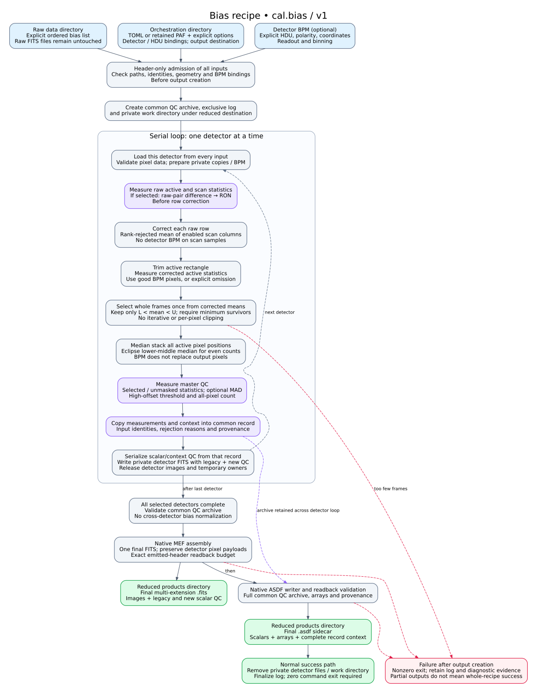

# mefpp recipe architecture

## Bias recipe



[Open the vector diagram](bias-recipe.svg) · [Editable Graphviz source](bias-recipe.dot) · [Mathematical guide PDF](../../bias-recipe-mathematical-guide-v1.pdf) · [LaTeX](../../bias-recipe-mathematical-guide-v1.tex)

The diagram describes normal standalone `cal.bias` operation at implementation
revision `b8ca41fce6df5f34cd8668c574d873a8168797b2`. It separates untouched raw
storage, orchestration, the serial detector loop and final reduced products.
It is an implementation diagram, not a proposed change to processing.

Solid arrows show the normal processing/publication sequence. Dashed arrows
show the next-detector loop, retained QC archive or representative failure
exits. Violet blocks construct QC; green blocks identify final products or
successful completion. Red marks failure after output creation; earlier
admission failures stop before product/log creation. Not every error edge is
drawn.

Important details:

- The detector BPM selects active-pixel statistics and frame means. It is not
  applied to electronic scan samples and does not replace output pixels.
- Raw-pair RON is measured before row correction and independently of subsequent
  frame rejection. MAD and the pair are explicit choices.
- Frame retention is **strictly** `L < mean < U`. Equality at either endpoint is
  rejected. A zero-width band therefore leaves no survivors. This corrects the
  former endpoint wording in the guide; see [documentation issue #276](https://github.com/fselman/wenu-imaging/issues/276).
- QC is archived for every submitted input, including rejected frames. FITS
  scalar/context cards and ASDF are serialized from that common record.
- The all-pixel high-offset count uses a threshold estimated from the selected
  master population. Its name does not imply a dark-current measurement.
- All detectors must complete before native MEF assembly. Native ASDF follows;
  FITS, ASDF and log publication is not one atomic transaction.
- The log and private work directory are created under the reduced destination,
  while the invocation runs from the orchestration directory. Private detector
  FITS files are removed on normal success. Explicit recovery after failure is
  separate from the normal recipe and is not drawn as automatic processing.

Source anchors (repository root):

| Boundary | Implementation |
|---|---|
| Admission, serial loop and final publication | [mefpp_bias.c](../../../../mefpp2/ins/mef/recipes/mefpp_bias.c) |
| Detector calculation and QC populations | [mef_cal_bias.c](../../../../mefpp2/ins/mef/common/mef_cal_bias.c) |
| Frame selection and median stack | [mef_bias_kernel.c](../../../../mefpp2/ins/mef/common/mef_bias_kernel.c) |
| Common QC and FITS mapping | [mef_bias_product_qc.c](../../../../mefpp2/ins/mef/common/mef_bias_product_qc.c), [mef_bias_qc_fits.def](../../../../mefpp2/ins/mef/common/mef_bias_qc_fits.def) |
| Native MEF assembly | [mef_mef_assemble.c](../../../../mefpp2/ins/mef/common/mef_mef_assemble.c) |
| Native ASDF write/readback | [mef_product_qc_asdf.c](../../../../mefpp2/ins/mef/common/mef_product_qc_asdf.c) |

Regenerate the SVG from the repository root:

```sh
dot -Tsvg docs/developer/architecture/mefpp/bias-recipe.dot \
  -o docs/developer/architecture/mefpp/bias-recipe.svg
```

Documentation rendering only; no native build, configuration or reduction is
required.
