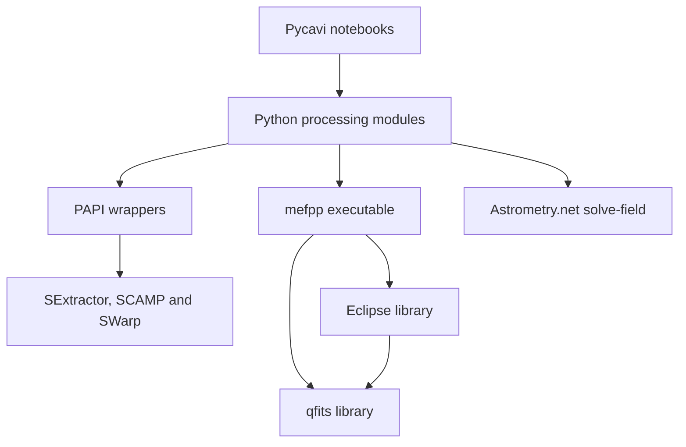

# Pycavi2, mefpp2 and qfits52: as-is audit and proposed working agreement

Prepared for Fernando Selman — 20 October 2026.

**Status:** first source-based audit, architecture review and proposed roadmap. No source, notebook, build, configuration or remote repository files have been changed. Proposed instructions below are not installed or approved.

## 1. Principal conclusion

The existing separation between Python orchestration, the mefpp reduction engine, Eclipse image processing, qfits FITS support, and external astronomy programs provides a reasonable starting point for a minimal portability effort. The evidence does not justify a rewrite, repository merger, new workflow engine, or immediate replacement of the C build system.

The first implementation should address installation contracts and reproducible execution. A particularly clear defect is that executable setup records the full mefpp executable path, while notebook 03 and its reduction functions treat that value as an installation directory. Scientific changes should remain a separate workstream.

This is not a certification of numerical correctness or successful installation. Runtime and platform validation remain outstanding.

## 2. Reproducible baseline and scope

| Repository | Examined branch | Exact commit |
|---|---|---|
| fselman/Pycavi2 | main | b1c401d612aee50a804942969fcb72738fafbcef |
| fselman/mefpp2 | main | c69c314a24e56311dfd0efeb5721c3549aa5cbd0 |
| fselman/qfits52 | main | 9470098a68ebaf8e2ba67f2bde1f5b1090a2524b |

Repository trees were retrieved without truncation. Inspection covered 83 text files: 26 distributed Python files, 15 distributed notebooks, Python packaging and selected configuration files, both C configuration generators and bootstrap scripts, relevant Makefiles, mefpp's recipe and common code, selected qfits sources, and installation/license documents. The broader C numerical codebase and experimental `testing/` contents have not received a line-by-line review. Full tree inventories were used to check file presence. No `AGENTS.md` or GitHub Actions workflow was present in any of these trees.

Checks actually performed:

- All 26 inspected Python files passed `ast.parse`; invalid escape sequence warnings were emitted in some files. This checks syntax, not imports, dependencies or behavior.
- All 15 distributed notebooks were parsed as JSON and their code cells inspected. They were not executed.
- Both `sysconf.c` files passed `cc -fsyntax-only` with Ubuntu GCC 13.3.0. Both emitted warnings for formatting `sizeof` values with `%d`. No executables or generated configuration files were produced by these checks.
- No complete C build, Python wheel build, clean installation, external-program invocation, FITS reduction, numerical comparison or macOS execution was performed.

Terminology: **verified** means visible in pinned source or reproduced by the checks above; **risk** means an execution consequence inferred from source; **open** means further evidence is needed. Priorities below indicate order of investigation for installation, not measured scientific impact.

## 3. Existing architecture

### Components and boundaries

| Component | Existing responsibility | Existing interface |
|---|---|---|
| Pycavi notebooks | User choices, project setup, sequencing, inspection and QC | Python calls plus project files |
| `pycavi.pycavi` | Instrument configuration, association, reduction orchestration, astrometry, calibration and catalogues | Python objects, CFG/PAF, FITS and file lists |
| `pycavi.papi` | SExtractor, SCAMP and SWarp wrappers used by current astromatic tools | External commands and generated configuration/catalogue/header files |
| mefpp recipe | Calibration construction and instrument-signature processing | `mefpp` command, PAF, input lists, FITS and QC headers |
| Eclipse inside mefpp2 | Image processing and supporting utilities | `libeclipse.a` and C headers |
| qfits52 | FITS/PAF support, memory management and standalone FITS utilities | `libqfits.a`, headers and command-line tools |
| Other software | Source extraction, astrometric solution/refinement and resampling/coaddition | SExtractor, `solve-field`, SCAMP and SWarp |

The C dependency direction is established by linker flags: mefpp links `-leclipse -lqfits -lm`. The mefpp repository is an Eclipse source distribution with instrument recipes, not just a small standalone C application.



The diagram describes component dependencies rather than processing order. Direct Python calls to qfits command-line utilities were not found in the inspected distributed Python files or notebook code. The confirmed dependency is through the C libraries; the claim that Python directly invokes qfits tools remains open for other branches or local modifications.

### Processing flow

1. Obtain raw exposures and calibrations; WFI has an additional calibration-selection notebook.
2. Configure a project and instrument using notebook 00, CFG and PAF files.
3. Partition and associate exposures in notebook 01 using `PartitionsTree` and related classes.
4. Notebook 03 invokes mefpp for calibration/science processing and then Python normalization. `mefpp_normalize_science` explicitly multiplies extension data by average gain divided by exposure time, and updates `BUNIT`, `SATLEVEL` and `ONEADU`. Responsibility for e-/s conversion therefore includes Python.
5. Notebook 04 obtains extension WCS solutions with `solve-field` and assembles the resulting frame.
6. Notebook 05 performs source extraction and SCAMP refinement; catalogue and `.ahead`/`.head` files connect those stages.
7. Notebook 06 uses SWarp to resample and coadd science/standard partitions.
8. Notebook 07 performs photometric calibration; later notebooks inspect QC, estimate illumination corrections using Chebyshev or kriging methods, and build/correct catalogues.

This sequence is visible in the notebooks and processing modules. Scientific validity, the intended production subset of later notebooks, and exact success/restart rules still need confirmation.

### Existing state and configuration

There are three important locations: installed package resources; user-wide executable selection at `~/.pycavi/pycavi_astrosoft.cfg`; and per-project CFG/PAF, lists, symlinks, logs and generated data. Stages also depend on current working directory and filenames. Preserving these contracts is more important initially than rearranging modules.

The active notebook path uses `pycavi_astromatic_tools.py`, which imports the PAPI wrappers. A second wrapper implementation exists in `pycavi_astromatic.py`, and older command scripts use different import names. These are not equivalent entry points until demonstrated otherwise.

## 4. Findings requiring attention

### F01 — mefpp executable and installation directory are conflated

**Priority: first. Status: verified interface mismatch; failure not exercised.** `pycavi_setastro.py` records a full executable path. Notebook `03_pycavi_run.ipynb`, code cell at JSON cell index 2, assigns it directly to `mefpp_dir`. `mefpp_reduce_bias` and related functions append `/bin/mefpp`; `mefpp_reduce_bpm` appends `/static_cal/...`; `copy_paf` can append `/config/...`. A stored `/prefix/bin/mefpp` therefore becomes `/prefix/bin/mefpp/bin/mefpp` for execution.

**Minimal direction:** define separate executable and resource locations, or formally retain an installation-root contract with an explicit conversion at the boundary. Decide this once and carry it consistently through notebook 03 and setup. Preserve existing reduction options.

Evidence: [executable setup](https://github.com/fselman/Pycavi2/blob/b1c401d612aee50a804942969fcb72738fafbcef/pycavi/pycavi_setastro.py), [notebook 03](https://github.com/fselman/Pycavi2/blob/b1c401d612aee50a804942969fcb72738fafbcef/pycavi/notebooks/03_pycavi_run.ipynb), [reduction functions](https://github.com/fselman/Pycavi2/blob/b1c401d612aee50a804942969fcb72738fafbcef/pycavi/pycavi/pycavi_associate_reduction.py).

### F02 — Python packaging has unresolved file and resource declarations

**Priority: first. Status: verified declarations; distribution outcome untested.** `pyproject.toml` references root `LICENSE`, absent from the pinned tree. The package list contains only `pycavi`, `pycavi.pycavi` and `pycavi.papi`; resource declarations refer to `pycavi.config`, `pycavi.data` and `pycavi.notebooks`. `MANIFEST.in` instead lists root `config/*` and `data/*`, while actual resources live under `pycavi/`. Setup uses `importlib.resources` to load configuration and notebooks.

**Minimal direction:** resolve the license-file discrepancy with the authors; build and inspect a wheel and source distribution in a disposable copy, install the wheel outside the checkout, and verify every required resource. An editable installation alone would not establish distributable packaging correctness.

Evidence: [pyproject.toml](https://github.com/fselman/Pycavi2/blob/b1c401d612aee50a804942969fcb72738fafbcef/pyproject.toml), [MANIFEST.in](https://github.com/fselman/Pycavi2/blob/b1c401d612aee50a804942969fcb72738fafbcef/MANIFEST.in), [setup resource copying](https://github.com/fselman/Pycavi2/blob/b1c401d612aee50a804942969fcb72738fafbcef/pycavi/pycavi_setup.py).

### F03 — Dependency metadata does not describe the whole notebook workflow

**Priority: first. Status: verified.** The calibration module imports `skimage.transform.resize` and `IPython.display`, but `scikit-image` and IPython are not direct project dependencies. The documented `jupyter notebook` launch is also not provisioned explicitly. `pycavi_tools` imports Tkinter at module import time, coupling non-GUI uses to availability of Tk. The declared Python range starts at 3.9; compatibility of the complete dependency set and imported APIs across that range has not been validated.

**Minimal direction:** agree on a deliberately small supported Python/platform matrix; distinguish Python dependencies, notebook environment, optional GUI support and external executables. Do not upgrade all dependency bounds as a side effect of installation work.

Evidence: [calibration imports](https://github.com/fselman/Pycavi2/blob/b1c401d612aee50a804942969fcb72738fafbcef/pycavi/pycavi/pycavi_zpcal.py), [tools imports](https://github.com/fselman/Pycavi2/blob/b1c401d612aee50a804942969fcb72738fafbcef/pycavi/pycavi/pycavi_tools.py), pyproject.toml.

### F04 — External-program selection is inconsistent

**Priority: early. Status: verified.** Setup scans `/usr/local`, `/opt/local`, `/home`, `/Users` and `/usr` recursively for each program, deduplicates through sets, and stores `NOT FOUND` instead of failing validation. Recursive matching checks names rather than executable permission or version. `run_sextractor_on_target` constructs a PAPI SExtractor wrapper and calls `.run(image_name)` without forwarding the saved executable selection. SCAMP and SWarp have explicit path parameters in the tools module.

**Minimal direction:** deterministic PATH discovery plus explicit overrides, validation of executable/version, and a single configuration interpretation at every call site. Keep exhaustive search as an explicit fallback if it remains useful.

Evidence: executable setup; [astromatic tools](https://github.com/fselman/Pycavi2/blob/b1c401d612aee50a804942969fcb72738fafbcef/pycavi/pycavi/pycavi_astromatic_tools.py).

### F05 — Command execution and stage failure detection need characterization

**Priority: early. Status: verified patterns; execution consequences are risks.** Several runners exist. `pycavi_tools.run_command` waits in a busy polling loop before draining stdout/stderr pipes, risking a deadlock for sufficiently verbose commands. Its logfile branch searches for `Error` rather than using the process exit status; a nonzero exit without that string can be misclassified. String commands passed through a shell also make spaces and shell characters in paths significant. Changes of process-wide current directory often lack exception-safe restoration.

**Minimal direction:** first test the runners actually used by supported notebooks with successful, failing and verbose dummy commands. Reuse an existing runner as the common boundary where feasible; standardize return status, logs, working directory and argument passing through small changes. Do not claim all runners have identical defects.

Evidence: tools `run_command`; association module `run_commands`/`runCmd`; legacy astromatic `run_commands`; PAPI wrappers and `papi_misc_utils`.

### F06 — Failed astrometry workers may not be reported by the parent

**Priority: early. Status: verified source pattern; runtime impact untested.** `run_solve_field` uses `pool.starmap_async(...)`, calls `result.wait()`, then closes the pool. It does not retrieve results with `.get()` there. Worker exception propagation and final output validation need explicit tests. Presence of a previously generated file is also used to skip work.

**Minimal direction:** define success in terms of process status and required outputs, and demonstrate that a failed extension prevents a partition being reported as successfully solved. Check multiprocessing behavior on macOS separately.

Evidence: [pycavi_solve.py](https://github.com/fselman/Pycavi2/blob/b1c401d612aee50a804942969fcb72738fafbcef/pycavi/pycavi/pycavi_solve.py), `run_solve_field`.

### F07 — Existing C build support should be tested before replacement

**Priority: first build investigation. Status: verified.** Both packages already have Linux and Darwin branches, configurable installation prefixes and static-library support. mefpp supports `--qfits=PATH`. The bootstrap scripts invoke `cc`/`gcc` directly, hide compiler diagnostics, pass `./sysconf $*` without argument quoting, and do not consistently preserve failure status. Both configuration generators have the reproduced `%d`/`sizeof` warnings. Shared-library targets use direct `ld` invocation and legacy flags.

**Minimal direction:** keep configure/Makefiles initially, test native GCC and Apple Clang, and repair demonstrated failures. Prefer the existing static qfits linkage initially if approved. Shared-library portability, compiler overrides and parallel-build ordering need independent validation; Linux/Darwin branches alone are not evidence of current support.

Evidence: [mefpp configure](https://github.com/fselman/mefpp2/blob/c69c314a24e56311dfd0efeb5721c3549aa5cbd0/configure), [mefpp sysconf](https://github.com/fselman/mefpp2/blob/c69c314a24e56311dfd0efeb5721c3549aa5cbd0/sysconf.c), [qfits configure](https://github.com/fselman/qfits52/blob/9470098a68ebaf8e2ba67f2bde1f5b1090a2524b/configure), [qfits sysconf](https://github.com/fselman/qfits52/blob/9470098a68ebaf8e2ba67f2bde1f5b1090a2524b/sysconf.c).

### F08 — C installation does more than copy binaries

**Priority: first installation investigation. Status: verified.** mefpp's install target copies PAF files and compressed BPMs, then invokes `funpack -v *.fits.fz`. This dependency is missing from its short dependency document. Pycavi expects uncompressed BPMs under an installation `static_cal` directory. Binary copying is conditional on the presence of the unrelated `3color` executable. Neither top-level install target establishes a complete build prerequisite chain, and conditional copying can leave an incomplete installation.

**Minimal direction:** document and verify the complete installed layout, explicitly check tools/resources, preserve BPM bytes and extension mapping, and fail clearly on incomplete installation. Consider separating decompression from copying only after agreeing on resource ownership.

Evidence: [mefpp Makefile](https://github.com/fselman/mefpp2/blob/c69c314a24e56311dfd0efeb5721c3549aa5cbd0/Makefile), [dependency document](https://github.com/fselman/mefpp2/blob/c69c314a24e56311dfd0efeb5721c3549aa5cbd0/docs/Usage/dependencies.rst), reduction `mefpp_reduce_bpm`.

### F09 — Existing test commands do not establish regression coverage

**Priority: before implementation claims. Status: verified inventory.** qfits `make check` runs tests only if a `test/` directory exists; none is tracked in the pinned tree. That command can therefore complete without executing tests. No automated CI workflow was found in any tree. Pycavi's `testing/` directory and notebook history should not be counted as a reproducible regression suite without examination.

**Minimal direction:** record what each check actually executes. Use small synthetic FITS cases for interfaces and failure handling, plus representative real WFI and OmegaCAM reductions for scientific preservation.

Evidence: [qfits Makefile](https://github.com/fselman/qfits52/blob/9470098a68ebaf8e2ba67f2bde1f5b1090a2524b/Makefile), full tree inventories.

### F10 — Multiple generations of interfaces coexist

**Priority: scope decision. Status: verified.** Files under `pycavi/scripts` import modules such as `mefpp_solve`, `mefpp_astromatic`, `mefpp_associate_reduction` and `zp_calibration`, absent under those names in the tree. One script has fixed user paths. Their entry points are commented out in packaging. The active notebooks import the packaged modules and PAPI wrappers instead.

**Minimal direction:** initially identify the notebooks as the reference workflow if Fernando agrees. Label other scripts as legacy/unvalidated until characterized. Keep them during the initial audit; do not delete or modernize them automatically.

Evidence: distributed scripts, pyproject.toml, notebook imports, astromatic tools.

### F11 — Scientific defaults and rerun behavior need reference evidence

**Priority: validation design. Status: verified operations; correctness open.** Python normalization changes pixel values and FITS headers in place. File existence is used to skip stages; this alone does not prove that products match current inputs, configurations or executable versions. The tracked TODO already discusses repeated calibration, silent solve failures and incomplete calibration handling, with a mixture of DONE and PENDING entries. Those notes are leads, not current test results.

**Minimal direction:** establish an immutable input set, agreed stage outputs and tolerances, and controlled fresh/rerun/failure cases. Preserve average-gain normalization, clipping, masks, weighting, calibration transformations and illumination defaults during portability work.

Evidence: reduction normalization, solve module, [TODO](https://github.com/fselman/Pycavi2/blob/b1c401d612aee50a804942969fcb72738fafbcef/TODO).

### F12 — qfits memory settings deserve measurement, not an automatic change

**Priority: later characterization. Status: verified default.** `src/xmemory.c` defaults to 2,000,000 tracked pointers and declares fixed tables including 64-byte source filenames and 256-byte mapped filenames per entry. This implies substantial static storage when that configuration is used. Configure supports memory-mode/pointer-count options. Older mefpp installation prose refers to a different pointer default.

**Minimal direction:** record effective build settings and measure actual memory behavior on representative mosaics. Do not reduce limits, change allocator behavior, or replace FITS I/O in the portability patch without evidence.

Evidence: [qfits xmemory.c](https://github.com/fselman/qfits52/blob/9470098a68ebaf8e2ba67f2bde1f5b1090a2524b/src/xmemory.c), qfits sysconf and mefpp installation documentation.

## 5. Proposed architecture decisions

These are recommendations for discussion, not implementation authorization.

| Decision | Proposed initial choice | Reason |
|---|---|---|
| Repository structure | Keep three repositories | Existing boundaries already reflect language and library responsibilities. |
| Internal names | Preserve `pycavi`, `mefpp`, `libqfits` and existing CLI names initially | Repository names need not force interface changes. Decide distribution names separately. |
| Primary user workflow | Existing notebooks, with their current processing order | Avoid expanding the portability scope to repair every historical script. |
| C build | Retain configure/Makefiles and use explicit prefixes/qfits path | Test and repair the current machinery before choosing a replacement. |
| Installation layout | Preserve `bin`, `config`, `static_cal`, libraries and headers initially; represent locations explicitly | Minimize breakage while resolving F01. |
| Python installation | Verify wheel and source-distribution installation in an isolated environment | Editable checkout behavior is insufficient. |
| External dependencies | Explicit installed tools and separate astrometry index/catalogue requirements | A Python installer cannot be assumed to provision the full reduction environment. |
| Execution boundary | Converge on an existing runner, in focused steps | Reduce divergent behavior without building a new orchestration layer. |
| Scientific behavior | Preserve defaults and outputs within agreed tolerances | Portability success requires scientific regression evidence. |

No Homebrew formula, Conda package, container, bundled external tool, CMake migration or automatic installer is selected at this stage. Choose a distribution strategy after the native installation requirements are known.

## 6. Proposed agent instructions

The following is a reviewable draft for a root `AGENTS.md` in each repository. It is not a ChatGPT skill, and has not been added to any repository. Duplicate a concise common policy across all three roots so that a clone remains understandable by itself; add the repository-specific section described afterward.

```markdown
# Agent working agreement

## Objective
Audit and make the existing Pycavi2/mefpp2/qfits52 system straightforward to
install on the agreed Linux and macOS platforms, with minimal changes and
preserved scientific behavior for WFI and OmegaCAM data.

## Current phase and authorization
The current phase is audit, architecture and roadmap review.
Read sources and run non-mutating static checks. Write review documents outside
the source trees. Do not edit source, notebooks, packaging, build scripts,
configuration defaults or repository state until Fernando approves the relevant
implementation stage. Builds that generate files must use disposable copies;
never operate on observational originals.

## Evidence and decisions
Record repository, branch and commit for every baseline. Cite files/functions
for findings. Distinguish verified facts, reproduced failures, inferred risks
and open questions. State exactly what was and was not tested.
Describe the existing architecture before proposing changes. Record approved
decisions and changes of scope in project documentation.

## Change discipline after stage approval
Inspect and reuse existing functionality first. Prefer focused refactoring and
compatibility fixes. No broad rewrite, repository merger, build-system migration,
module relocation, interface rename or unrelated cleanup without an explicit
decision. Keep repository names, Python imports, distribution names, library
names and executable names as separate decisions.

## Scientific invariants
Preserve reduction algorithms, units, precision, gain/exposure normalization,
mask and extension mapping, rejection thresholds, weights, calibration choices,
FITS scaling/headers and illumination defaults unless separately approved.
Record defects even when outside scope; do not silently fix them in a portability
patch. Stop and explain an unexpected scientific-output difference.

## Validation
Use immutable raw inputs and fresh output directories. Record software versions,
build options, configuration and data identities. Verify clean installed packages
outside their checkouts. Check required resources and external programs.
Use tests that exercise real interfaces and failures, not implementation copies.
Validate representative WFI and OmegaCAM cases with agreed tolerances. A skipped
test, syntax check, Linux build or editable install must not be described as
broader platform/scientific validation. Report unsupported cases explicitly.

## Git and review
Preserve authorship, notices, history and unrelated local changes. After approval,
use focused branches and commits. Coordinate cross-repository interface changes
with exact compatible commits. Do not push to the original repositories.
Do not merge, delete branches, tag or publish a release without instruction.

## Communication
Explain findings in plain language. For each proposed change give the problem,
smallest justified correction and validation criterion. Report blockers promptly;
ask only for decisions that materially affect scope or scientific behavior.
Finish with changed files, checks, limitations and the next decision.
```

Repository-specific additions should record:

- **Pycavi2:** reference notebooks, production versus legacy scripts, Python dependency/resource rules, executable configuration schema, scientific output contracts and treatment of GUI/network dependencies.
- **mefpp2:** embedded Eclipse structure, supported recipe scope, approved qfits dependency versions, native build/install commands, compiler options, installed PAF/BPM layout and numerical precision policy.
- **qfits52:** FITS/PAF API compatibility, static/shared scope, memory settings, build/install commands, actual test inventory and preservation of existing exported names.

These additions should contain verified commands after baseline builds, rather than guessed commands presented as established practice.

## 7. Proposed roadmap and acceptance gates

| Stage | Work and deliverable | Completion criterion |
|---|---|---|
| 0 — Review | Review this audit, agree on instructions, architecture boundaries and target platform matrix. Record exclusions and open questions. | Fernando approves the working agreement and roadmap; no implementation before this gate. |
| 1 — Characterize unchanged software | Obtain complete pinned checkouts in disposable workspaces. Attempt current C builds, wheel/sdist builds and clean installs. Record failures and warnings. Inventory external versions, astrometry indexes and resources. | Reproducible baseline logs per tested platform; remaining platforms explicitly marked untested. Any proposed build fix remains a separate patch. |
| 2 — Define regression evidence | Select representative WFI and OmegaCAM raw/calibration inputs, trusted products and stage outputs. Capture baseline commands/options and tolerances. Add synthetic FITS/interface cases when authorized. | Fernando agrees which results constitute scientific equivalence, how to handle timestamps/header ordering, and how reruns/failures are judged. |
| 3 — Minimal installation fixes | Repair demonstrated packaging/resource issues, dependency declarations, executable/resource path contracts and necessary C compiler/install behavior. | Clean installation outside checkouts; notebooks/config/BPM resources present; required tools resolved; clear failures; no unrelated scientific changes. |
| 4 — Execution reliability | Characterize and minimally fix the supported command path, exit-status handling, worker failures, working-directory restoration and restart behavior. | Deliberate executable/worker failure is visible; paths with spaces and verbose commands are handled; successful reference stages remain equivalent. |
| 5 — Validate and document | Run the agreed matrix and real-data reductions. Write tested user installation instructions and maintainer checks; add CI where authorized. | WFI/OmegaCAM acceptance criteria pass; exact limitations and compatible repository versions recorded. Release only when instructed. |

Stages 1 and 2 characterize the current system; they must not quietly become implementation. If the unchanged software cannot produce a trusted baseline, document that fact and agree how existing trusted products or a known working installation will supply the reference before scientific changes.

Each implementation proposal should identify affected repositories, findings addressed, files/contracts changed, expected unchanged scientific behavior, tests and rollback. Avoid converting the roadmap into a large all-at-once branch.

## 8. Decisions needed from Fernando

1. **Support matrix:** which Linux distributions/versions and macOS versions are required? Is macOS Intel, Apple Silicon, or both required? Which Python versions are genuinely needed? Start with a small explicit matrix.
2. **Reference interface:** are the existing notebooks the production workflow for the first portability release, leaving historical scripts present but unvalidated?
3. **Naming:** may repository names carry the `2` suffix while imports, executable names and C library names remain compatible initially?
4. **Scientific references:** where is the current known working installation, and which small WFI and OmegaCAM data sets and trusted products may be used? Include required calibrations and BPM identities, not just science frames. Define numerical tolerances before using comparisons as pass/fail gates.
5. **Installation target:** is a documented user-owned prefix plus an isolated Python environment acceptable initially, before considering managed packages or a one-command installer?

## 9. Important limitations and follow-up

This first audit establishes architecture and several concrete interface/installation defects. It does not exhaustively audit memory safety, numerical algorithms, performance, every dependency API, all notebook branches, or every C source file. Catalogue services, astrometry index selection, resource redistribution and the correctness of photometric transformations require further characterization. Existing ESO and third-party attribution must remain intact; this review does not make legal conclusions about ownership or select a new license.

The next useful step is to review sections 5–8 together, finalize the instructions and support matrix, then authorize baseline characterization. No implementation is implied by acceptance of the audit findings alone.
