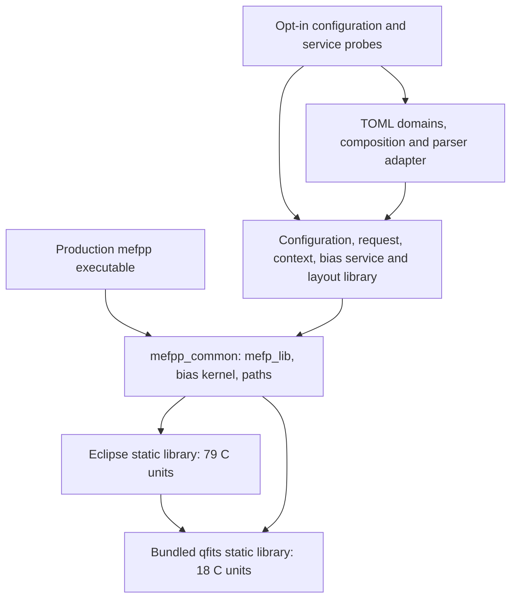
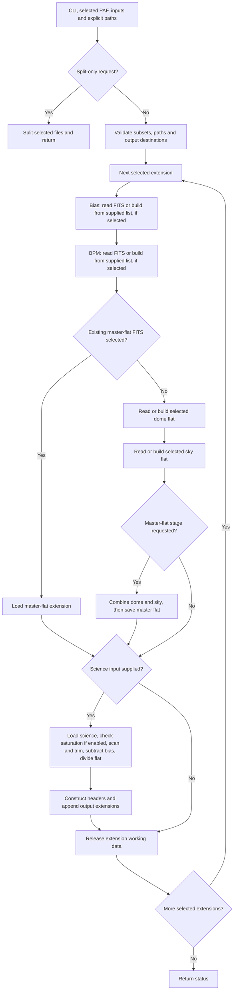
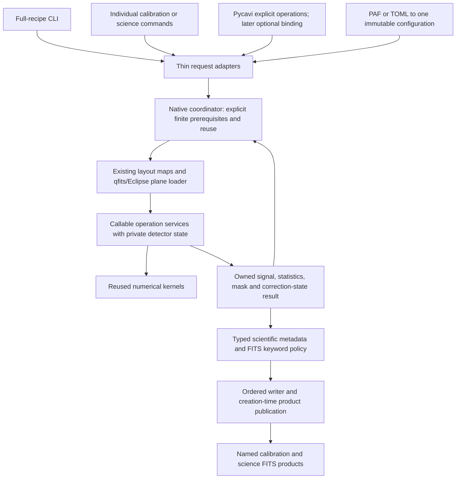
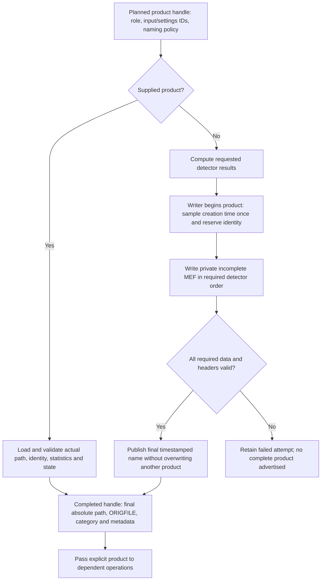
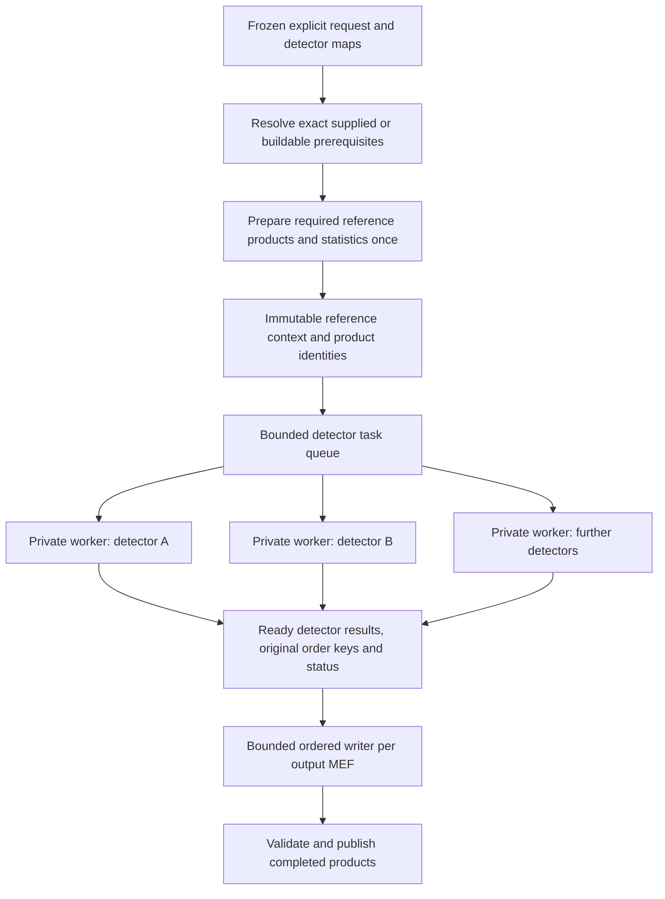

# mefpp architecture review and proposed delivery roadmap

Date: 1 November 2026, America/Santiago. Review version 2. Word review edition.

Owner update: add target command/TOML examples; complete the first bias stage with
PAF, then connect TOML immediately and repeat bias with equivalent TOML settings.
For this refactoring cycle, iterate on Intel Mac using C17 only, followed by a
consolidated Mac C90 check and then Chapman verification. No native execution is
started by this document revision.

**Status: source audit and design proposal for owner review, not implementation acceptance.**
Source is pinned to `493e4f6e6674bbf30f09dd6bdfa6af24fc2a3cf7`, the merged
installed-large-file comparison receipt. Track M5 in [#203](https://github.com/fselman/wenu-imaging/issues/203).
The owner subsequently requested discussion before implementation and this complete
architecture review. No numerical, native build, installed program, observation,
configuration selection or reduction has been changed by this review.

## 1. Scope, evidence and conclusion

The architecture should retain the efficient C numerical implementation while
separating five responsibilities: configuration/input resolution; recipe coordination;
detector operations; scientific metadata and FITS keyword policy; ordered publication.
The full recipe and individual commands must call the same numerical services.
Serial equivalence precedes process parallelism. New numerical capabilities have
their own stages and cannot be smuggled into an extraction.

The [source and keyword inventory](audits/mefpp-architecture-2026-11-01/source-and-keyword-inventory.json)
covers 464 tracked source/header/build/configuration/test files, 145,949 lines,
including all four normal-engine C units, the 79 Eclipse and 18 qfits library
source units, and the separate service/configuration boundary. It records blob
identities, SHA-256, categories, 349 non-comment core FITS/PAF call sites and
1,470 PAF declarations across the three supplied instrument configurations.
Dynamic keyword expressions remain explicit; this is not a list of 349 unique
keywords or a preprocessed compiler call graph.

Review method: trace the complete production recipe and its helper functions;
inspect all native service interfaces, configuration composition and ownership
boundaries; trace numerical dependencies used by calibration/science, qfits
offset/scaling/header/cache/memory paths, build/install selection and the Pycavi
consumers. Inventory auxiliary distributed tools rather than infer that everything
in `src/` runs in a reduction. The inventory is complete within its stated file
types; it is **not line-by-line scientific or memory certification of every bundled
auxiliary program or all 145,949 lines**. No native build, test, benchmark or real
reduction was run for this documentation audit. Previous accepted evidence is
referenced, not relabelled as a new run.

The retained 28 October `wenu-imaging_conversation_synthesis.docx` was also read.
Its detector-identity/order, coherent C/header interfaces, serial-before-parallel
and numerical-preservation requirements agree with this design. Its exploratory
backend/language/GUI ideas are not adopted here. The current discussion adds
explicit dual invocation, creation-time naming, configurable CMDP/SMDP prefixes,
a common calibration directory, and durable normalization statistics.

## 2. As-is build architecture: two distinct paths



`mefpp2/CMakeLists.txt:102–176` establishes this separation. The ordinary engine
links `mefp_lib.c`, `mef_bias_kernel.c`, `mef_paths.c`, Eclipse and qfits.
The M1/M2/M4 service library and TOML readers are under
`MEFPP_BUILD_CONFIG_PROBES`, OFF by default. Their existence and qualification
do not mean that the normal recipe uses them. `mef_execute` still returns
unsupported because a metadata-only request has no numerical payload.

The supported configure/make/install frontend delegates to CMake. Preserve the
selected tools, ANSI C90 baseline, explicit C17 lane, parser-only C99 exception,
resource installation and platform contract. Do not revive old generated build
machinery as a competing primary build or prune library sources merely because
they are absent from one recipe's apparent calls. Existing `fitsmd5`/`flipx`
findings #199/#198 belong to separate tools, not this architecture's implementation.

## 3. As-is runtime architecture

`main` initializes Eclipse, calls `mef_bb_load`, runs `mef_engine`, destroys the
context and propagates status. Informational options precede configuration work.
`mef_bb_load` first selects the PAF and path controls, then constructs the legacy
context and applies processing options. The normal configuration remains PAF.
TOML versions 1/2/3, typed domains, source retention and project subset migration
already exist through the opt-in native reader and Python migration boundary;
they need production connection, not another TOML parser or defaults implementation.

`mef_bb` mixes immutable settings, selected input/output names, physical extension
ordinal, statistics arrays, provenance identities and work ownership. This is the
main coupling to dismantle. Explicit M3 paths already permit execution from an
unrelated directory with absolute frame-list members. Legacy relative-list
semantics still require a declared base; never silently redefine them as list-relative.



This is a fixed serial sequence, not a recursive dependency resolver. A supplied
FITS means reuse; a supplied list means construction. An absent calibration file
does not cause discovery of raw observations. The master-flat block is entered
when both dome and sky names are set, or a master-flat name is set; unsuccessful
or incomplete input combinations can fail. Supplying an existing MFF bypasses
dome/sky processing but does not cancel separately selected bias/BPM work.

Bias/dome/sky are saved according to their save flags. BPM construction includes
its own header and disk publication. A newly combined master flat is saved.
Science output is per exposure, assembled extension by extension. Completed
earlier output can remain after a later failure; current ordinary publication
does not provide a whole-run transaction.

## 4. Actual algorithms and normalization

| Operation | Existing implementation and invariant |
|---|---|
| Scan correction and trim | `mef_overscan_correction` and cube wrapper; retained rejected-row mean, crop geometry and scan QC. The legacy helper temporarily adjusts geometry arrays and changes working pixels. |
| Bias | `mef_build_cal("bias")` and the shared `mef_bias_stack`; frame-mean rejection and median stack. Opt-in `mef_cal_bias` already adds immutable-input/owned-result validation. |
| BPM | `mef_build_bpm`; scan/trim, optional supplied bias subtraction, proportional or robust gain-map construction, mean normalization and thresholds. Mask good/bad convention must survive extraction. |
| Dome/sky | `mef_build_cal`; scan/trim before frame rejection, retain frames strictly inside configured mean thresholds, derive clipped selected-region medians, normalize each accepted plane, median-stack and multiply by detector/reference level ratio. |
| Master flat | `mef_ff_combine`; optionally scaled-bias-subtract normalized dome/sky, divide sky by dome, smooth the ratio with/without BPM, multiply by dome. It currently mutates supplied dome/sky arrays. |
| Science | Inline `mef_engine`; optional saturation check, scan/trim, bias subtraction, flat division, QC/header writing. BPM is not directly applied to science pixels in this block. |
| Python normalization | `mefpp_normalize_science` uses average selected detector gain and exposure to convert to e-/s; optional light correction is separate. Do not move or repeat it by accident. |

For a flat type and detector d, retain separately:

- The whole trimmed-frame mean/median/stdev already measured for accepted frames.
- Each frame's clipped normalization-region median m(d,i), before division.
- Original frame index and its acceptance decision; scan QC for original frames.
- L(d), the legacy float accumulation/average of the contributing m(d,i).
- L(ref), its declared reference detector and the exact reference input/settings identity.
- The resulting ratio L(d)/L(ref), normalization/correction state, and product median.

Conceptually the builder computes `median_i(I(d,i)/m(d,i)) * L(d)/L(ref)`.
This notation is descriptive, not permission to reassociate floating arithmetic,
change float accumulation, alter region endpoints or replace Eclipse's median.
The retained even-sample median convention and strict rejection endpoints are
part of compatibility. The reference is not silently changed to the first worker
to finish or the first remaining detector after an exclusion.

`QC FRMEDIAN` on dome/sky currently stores L(d), despite its generic comment;
the whole-frame median and final product median are different quantities. The
full-frame and region measurements must not share an ambiguous result member.
The existing region settings have native index semantics; do not convert them
as though they necessarily use the scan/crop FITS-1-based convention.

The intended relative-response/gain-harmonization information belongs in the
scientific result and reload contract as well as its FITS rendering. The inspected
Pycavi normalization function does not read these flat QC cards directly: it
reads configured detector gain headers and scales by average gain/exposure.
Preserve both boundaries without claiming a later QC-header consumer was found.
Missing original normalization information is not recoverable by taking the
median of a normalized flat.

## 5. Source findings requiring explicit treatment

These are source findings, not newly reproduced crashes or numerical failures.
They do not authorize silent changes during documentation or invalidate accepted
results outside their stated scope. Search of existing issues preceded new tickets.

| Finding | Evidence and disposition |
|---|---|
| [#204: flat reload loses original normalization meaning](https://github.com/fselman/wenu-imaging/issues/204) | Existing-flat recipe branches set dome/sky levels from `image_getmedian(loaded_flat)` at lines 867/974; builders preserve L(d), writer stores it with BSCALE=1, combination uses reference levels for bias scaling. Constructed versus reload paths are not established equivalent. First reproduce with nonzero structured bias and unequal detector responses. |
| [#205: flat rejection/QC correspondence](https://github.com/fselman/wenu-imaging/issues/205) | `cube_reject_planes` compacts planes, but original-frame decisions/indices are discarded; compacted measurement arrays are later labelled against original frame lists. Retain original indices; numerical rejection and QC metadata correction are separate assertions. |
| [#206: selected-extension statistics indexing](https://github.com/fselman/wenu-imaging/issues/206) | One selected physical extension allocates one result slot, while aggregate header cards access `[xtnum-1]`. Publication for a physical extension above one needs a focused bounds/control correction. |
| [#207: creation timestamp fraction](https://github.com/fselman/wenu-imaging/issues/207) | Clock helper packs centiseconds but formats `packed_time % 1000` as milliseconds; it also samples date/time separately and uses local time. Historical names remain unchanged; define one sampled instant, zone and collision handling before new naming. |
| [#23](https://github.com/fselman/wenu-imaging/issues/23), [#24](https://github.com/fselman/wenu-imaging/issues/24) | Science extension metadata can inherit calibration observation times; common calibration Phase-3 helper still uses float time arithmetic. The science primary has a separate double path. Do not claim both are already fixed. |
| [#125](https://github.com/fselman/wenu-imaging/issues/125), [#128](https://github.com/fselman/wenu-imaging/issues/128) | Existing long-string/serialization and lower-level pixel-write status limits remain. The checked native output wrapper does not establish arbitrary-card safety or every delayed close error. |

Further review items, rather than newly proved bugs: missing header cards passed
to `qfits_header_mod` are not inserted; generic merge has first-match update
semantics and cannot be assumed to preserve repeated commentary; primary/header
creation is tied to physical extension 1; validity of arbitrary inherited WCS
cards after trimming needs a declared instrument contract. Relevant source is
mapped in section 7 and the call-site inventory. Do not confuse an old issue's
original body with its current state: #144/#171/#194/#195/#201 are closed after
bounded corrections and are not resurrected by this review.

## 6. Target architecture and service contracts



The return edge supplies completed prerequisites; it does not permit cycles in
the executable task graph. The coordinator resolves only explicitly selected
products or supplied raw lists and settings. It does not infer the best flat
from all files in a shared directory or implement automatic association policy.
Pycavi may keep constructing calibrations individually, or request a full native
chain. Native commands remain usable without ASDF/Python project persistence.
The future project executor references these same native contracts.

### Responsibilities

| Boundary | Owns | Must not own |
|---|---|---|
| Configuration reader | Format parsing, validated typed values, source/override provenance | Numerical processing, hidden defaults or selected calibration discovery |
| Request adapter | Explicit lists, selected products, detector map, paths and requested operation | A duplicate implementation of the recipe mathematics |
| Coordinator | Which products to reuse/build; finite dependency order; per-attempt state | Per-pixel algorithms, speculative directory association or automatic future cascades |
| Detector service | Operation validation, owned scratch/results, calculation, structural checks and declared QC | Config parsing, cwd mutation, shared MEF appends or product-name prediction |
| Metadata policy | Keyword authority, units, applicability, provenance and correction-state serialization | Silent correction of original observations or selection of numerical estimators |
| Writer | Output shape/type/order/scaling, one product identity, checked publication | Re-running science, reconstructing missing normalization or picking calibrations |

Use the accepted M1 pattern: NULL-start/occupied outputs; status authoritative
even if allocating an error fails; immutable request/configuration; explicit
borrowed/owned/transferred arrays; safely destructible partial result; one cleanup
path; success transfers ownership once. Keep operation-specific payloads. Do not
turn `mef_bb` into another larger generic context, add a registry/vtable framework
without a real need, or expose Eclipse structs as a permanent Python ABI.

The numerical result should own what must survive context destruction, but this
does not mandate copying every calibration frame. Reuse the existing bias owner
as the reference contract; document and measure its copies. For flat combination,
choose explicit exclusive ownership transfer or copy-on-entry when reuse requires
it. Preserve a borrowed read-only caller contract where promised. Do not hide an
expensive unconditional copy behind an accessor. Small arithmetic helpers need
direct typed arguments, not separately allocated contexts per pixel or row.

### Existing and later operations

| Callable service | M5/next scope | Later extension contract |
|---|---|---|
| `mef_cal_bias` | Existing service; connect loader/writer and command | Required variance at M6a; new QC estimators separately defined |
| `mef_cal_bpm` | Extract existing mask builder; publication outside calculation | Detector validity/uncertainty semantics, not an automatic change to Pycavi's supplied-mask recipe |
| `mef_cal_domeff`, `mef_cal_skyff` | Separate public operations, shared private legacy flat kernel | Explicit normalization levels, reference and indexed frame QC |
| `mef_cal_mff` | Controlled dome/sky ownership and existing combination | Exact supplied-versus-built state and shared-reference applicability |
| `mef_sci_pp` | M6 extraction of existing science calculation | Explicit selected correction steps and exactly-once state |
| `mef_cal_linearity` | M6b, not implemented by this review | Build a versioned model separately from its private application kernel; declared units/domain/order and uncertainty |
| `mef_cal_dark` | M6c | Distinguish exposure-matched signal from rate product; subtraction/scaling only under a qualified model |
| `mef_cal_fringes` | M6d | Template construction with coverage/provenance; subtraction remains the separately planned later Python operation |

Trace `detector_linearity_fit`/`cube_correct_detlin` before proposing replacement
code; their presence is not a complete accepted service. The order of later
linearity/dark operations depends on the model's signal convention and must not
be frozen as a universal diagram sequence now. All affected calibration inputs
must share compatible correction state, units and applicability.

## 7. FITS keyword architecture: explicit scientific authority

Treat FITS headers as ordered cards plus typed scientific meaning. Preserve
untouched raw cards wherever possible; retain unknown telemetry and commentary.
Do not convert a header into a dictionary that discards order, duplicates or
raw values. qfits already supplies the card representation and parser; add a
small policy/writer layer above it, not another FITS parser.

### Current header paths

- `mef_header_primary[_at]`: reads supplied FITS/first list member and changes
  the working BITPIX card. Original input files remain unchanged.
- `mef_header_ext`: copies an extension, applies optional WFI reference-coordinate
  policy and configured CRPIX/crop changes. Header I/O currently performs this
  transformation; it must become an explicit metadata operation.
- `mef_header_mainsubset`: obtains instrument/observation metadata from selected
  calibration references, constructs dimensions and generic cards; this is the
  source of #23 when merged into science.
- `mef_header_esophase3`: category/observation/programme/time/software cards, with
  a legacy `PHASE3` claim and remaining #24 precision limits.
- `mef_header_eclipse`: raw member basenames, calibration ORIGFILE references,
  processing parameters, scan/crop/median region and configured gain/RON.
- `mef_get_headers_for`: merges those sources, adjusts primary/extension structural
  cards and scaling, appends aggregate/per-frame QC.
- `mef_build_bpm` constructs/writes its own headers; the science recipe has another
  inline header path. These must converge on shared policy without forcing all
  products to inherit the same source header.
- `fits_header_merge`: update-by-key first-match logic; `qfits_header_mod` modifies
  existing cards only. Neither is an authoritative scientific merge specification.

### Proposed authority and preservation matrix

| Keyword family | Authority and target rule | Verification boundary |
|---|---|---|
| SIMPLE/XTENSION/BITPIX/NAXISn/PCOUNT/GCOUNT/EXTEND/END | Writer derives from actual output layout/type; distinguish primary image, empty primary and IMAGE extension | Independently inspect framing, HDU count, dimensions, payload spans and FITS padding |
| BSCALE/BZERO | Loader applies input storage scaling once; writer states actual output representation, normally current float storage with 1/0 | Unsigned endpoints and nontrivial scaling; avoid duplicate scaling or stale inherited cards |
| EXTNAME/EXTVER and instrument detector IDs | Original independent map and declared output ordering; configured assertions remain labelled | Shuffled calibration HDUs, duplicates/missing IDs, primary/one-extension and excluded reference cases |
| DATE-OBS/MJD-OBS/EXPTIME and science timing | Science exposure is authoritative for science; calibration contributors have separate provenance/time policy | Primary-extension consistency and #23/#24 controls; creation time never replaces observation time |
| TIMESYS | Explicit source/derived observation-time convention | Do not relabel an unknown time scale as verified by adding a card |
| ORIGFILE/product creation identity | One runtime creation event for the complete product, configurable identity prefix, consistent dependencies | #207 clock controls, identical identity in all relevant records, no name assumed before creation |
| Configured category key, DPR classifications, product purpose | Validated category mapping for actual operation; product profile separate from reduction purpose and ordered recipe | Category conflicts and unknown input classification explicit; do not conflate PRODCATG spelling with a filename |
| Programme/OB/template/filter/binning/readout | Appropriate source observation or declared contributor aggregation, retaining original evidence | Reject unsupported conflicts; do not copy unrelated calibration observation identity into science |
| WCS/CRPIX/CRVAL/CD/CTYPE/geometry sections | Original science WCS plus the explicitly selected instrument/crop transformation | Pin existing endpoint/origin conventions before a separate correction; no accidental application twice |
| Gain/RON/BUNIT/exposure normalization/saturation | Separate configured detector values, characterized measurements and processed effective quantities | Native ADU versus later Python e-/s; exactly-once scaling and matching saturation units |
| Raw member and calibration provenance | Ordered members and product IDs; preserve duplicates deliberately | Duplicate basenames do not establish identity; long absolute paths stay in full run records until safe supported card serialization |
| Frame mean/median/stdev and scan QC | Operation result, indexed by original frame and detector with measurement state | #205; rejected/not-measured values cannot become zero or a quality pass |
| Normalization-region levels and shared reference | Required scientific metadata with definition, unit, region, correction state and reference ID | #204; in-memory and reload equivalence; six-decimal old cards may not preserve exact internal float bits |
| HISTORY/COMMENT/unknown cards | Preserve ordered repeated content unless an explicit product rule excludes it | Round-trip/order checks; generic last/first-value dictionary merge is insufficient |
| CHECKSUM/DATASUM and inherited integrity cards | Never retain a stale integrity assertion after changing headers/pixels | Explicit omit/recompute policy and independent verification when enabled; unrelated fitsmd5 tool is not a substitute |
| Variance/mask/model/correction provenance | Owned results at their accepted later milestones, exact references and squared units | Missing variance is unavailable, not zero; optional input BPM does not make required M6a variance optional |

For each generated card define keyword spelling, source authority, type/unit,
required/optional/unknown state, primary/extension placement, update/insert/delete
policy, duplicate handling and serialization limits. Required insertion must not
use modify-only semantics. Preserve the existing legacy keyword view initially;
new unambiguous normalization metadata requires a versioned documented mapping
and an explicit reader policy. Do not repurpose `QC FRMEDIAN` silently.

Full normalization precision should be available on reload. A reviewed additive
card mapping can write sufficient decimal digits for the stored float/double,
while retaining old QC formatting for compatibility. Missing/rounded historical
metadata requires a declared compatibility result or refusal; never fabricate
exact equivalence. Header formatting precision and mathematical precision are
different acceptance questions.

The presence of `PHASE3="ESOPHASE3"` or configured Phase-3 keywords is not a
compliance result. Current scientific validation and final ESO product/export
validation remain separate. No new ESO standard version or universal required
keyword checklist is adopted by this source review.

## 8. Product naming, common calibration directory and publication

Current PAF `MEF.*.NAME.O` provides conventional output roots such as `OCAM_MB`;
`mef_get_output_filename` appends partition and `.fits`. Separately,
`mef_create_orig_filename` hardcodes CMDP (Calibration Mefpp Data Product) or SMDP
(Science Mefpp Data Product), instrument and the clock helper into ORIGFILE.
That is not currently the physical filename. Category is a separate card.

The owner requires configurable CMDP/SMDP values and final creation-time names.
Retain separate settings for identity prefix, category mapping and legacy output
root. Preserve existing defaults while defining supported PAF/TOML fields and
migration; the exact new key spellings/final filename grammar need review.
Do not silently append a category or use the old output root as the identity prefix.



Before creation only a local logical handle exists, not a guessed future path.
Capture the timestamp at the actual chosen creation event, before writing its
primary header; do not substitute finish time after hours of writing. One
product has one identity across extensions. Preserve the precise creation-event
definition in the contract and do not rewrite historical ORIGFILE identities.

A shared calibration directory is storage, not selection policy. Multiple filters,
epochs and versions coexist because each published product has its returned path
and exact identity. Never choose a calibration by prefix, directory position or
filename timestamp alone. Keep full ordered source paths in the run record;
basenames in FITS provenance are display labels, not unique keys.

Parallel-safe uniqueness requires exclusive filesystem reservation across
independent runs, validation of configured path characters/length, bounded
collision handling and a declared clock-zone policy. A timestamp alone, a process
local counter, check-then-rename, or the current one-second science sleep is not
a cross-process guarantee. POSIX rename can overwrite an existing destination:
do not claim it implements no-clobber publication by itself. Publishing FITS and
a separate metadata record is not automatically a multi-file transaction; record
recoverable attempt states and advertise success only after required steps.

In-memory cascade consumers can use completed detector results before the whole
MEF is published, provided their dependency and failure states are explicit.
External invocation consumers receive only complete published products. If a
required prerequisite fails, dependent results are not advertised as successful.
Ephemeral unsaved calibrations still need a truthful runtime identity/result and
provenance; whether every on-the-fly intermediate becomes durable is an explicit
output policy, not an accidental change to legacy save flags.

## 9. Parallel-ready execution without premature concurrency



This is a target execution relationship, not measured parallel software. Initially
one serial caller executes the same detector task. Later use processes, not
threads, because qfits/Eclipse still contain process-global caches, static buffers,
logging/allocator state, OS handles and fatal error exits. Explicit context types
alone do not make the dependency libraries reentrant or safe inside Python.

The reference-first strategy is a simple initial proposal: prepare the required
reference closure once, retain its products, then dispatch dependent detectors.
It is not mandatory to perform a second full reference reduction or calculate
the same reference twice. A later staged-statistics barrier may expose more
parallelism if measured beneficial; either strategy preserves numerical order,
reference identity and retained-input state. If the reference detector is excluded
from output, its required statistics remain available. If unavailable, fail or
use a separately reviewed reference policy; do not substitute another detector.

No worker appends to a shared MEF or changes global cwd/configuration. Worker
scratch, logs and failure state are private; calibrations are read-only unless
ownership is transferred explicitly. Do not fork and casually reuse inherited
live qfits mappings/file owners; choose a clean worker lifecycle. The parent is
responsible for cancellation, failure propagation, reaping and truthful state.

Bound the number of workers by actual allocation and measured per-task peak
memory/I/O. One detector can still require a cube of all its calibration/science
frames: do not describe memory as just one plane. Avoid serializing image arrays
through JSON or copying an entire mosaic. Bound completed-result queues so a
slow early detector cannot retain every later detector's arrays. Private spill
files are an option with measured I/O cost, not a free performance assumption.
Do not change median stacking into an approximate streaming algorithm to save RAM.

## 10. Proposed roadmap refinement within M5–M11 and later P/G

This refines the existing [implementation plan](../architecture/proposed/implementation-plan.md),
not a second independent schedule. Milestone order and scientific extensions are
retained. Product/normalization/header refinements below are proposed, not approved
runtime changes. No implementation starts merely because this report is published.

| Stage | Bounded deliverable | Acceptance and rollback |
|---|---|---|
| M5.0 — review contracts | Approve service boundaries, dual invocation, product/statistics/keyword authority and output policy; triage #204–#207 | Concrete schemas/signature sketches and fixture matrix; retain accepted native baseline and all old products |
| M5.1 — common result and metadata boundary | Operation-specific owned results, explicit normalization/reference metadata, original input-index decisions, keyword policy above qfits | Tiny lifetime/partial-failure and card-authority controls; no new estimator or numerical reordering |
| M5.2 — first bias adapter with PAF | Existing `mef_cal_bias` to explicit loader/result/minimal writer and `mefpp cal bias`; legacy recipe calls the same operation boundary | Mac C17: existing bias oracle plus changed I/O/header/lifetime controls; preserve PAF reference and avoid unrelated matrices |
| M5.3 — TOML immediately after bias | Connect the accepted TOML reader to the same effective settings; repeat the complete bias operation with equivalent TOML files before starting BPM or flats | Mac C17: exact PAF/TOML settings and signal/metadata agreement, except separately generated product identities; preserve original sources and explicit override history |
| M5.4 — extend publication service | Extend bias publication to all product roles, configurable CMDP/SMDP prefixes, ordered primary/extensions, category/provenance, common calibration directory and returned final paths | Mac C17: clock/collision/non-overwrite/partial-write controls; #206/#207 scoped work; old naming mode retained until migration accepted |
| M5.5 — BPM service | Extract existing construction, separate its embedded publication and expose `mefpp cal bpm` | Exact mask/QC/category/provenance and optional-bias cases; distinguish supplied-mask Pycavi recipe; no silent new mask generation |
| M5.6 — dome and sky services | Two callable services sharing existing private arithmetic; preserve reference levels and frame identities | Built-vs-reloaded normalization and #204/#205 controls, ordered input decisions and selected-region semantics; separate documented corrections from extraction |
| M5.7 — master-flat service and calibration coordinator | Controlled input ownership; same combination routine; individual and in-recipe use with explicit prerequisites | Mixed supplied/built calibration paths, bias-scaled combination, with/without BPM and non-mutation/transfer checks; keep old coupled recipe until equivalent |
| M5a — QC contracts | Retain old measures with explicit meaning/availability; define any new mean/RON/scan estimators separately | Review estimator definitions before code, no automatic scientific cuts or replacement of configured gain/RON |
| M6 — science service and complete serial native chain | Extract inline science; same service for standalone and full cascade; required calibrations may be built from supplied lists | Exact stage-boundary arrays, mapping, headers and correction-state comparisons; #23/#24 reviewed separately; Python e-/s boundary remains exactly once |
| M6a — variance | Qualified initialization and propagation through science and calibration operations | Analytic and estimator controls, masks, squared units and shared-calibration/reference uncertainty limits; no normal variance-off mode in the new chain |
| M6b — linearity | Model builder and separate application kernel with declared applicability/order | Known response curves, identity/invalid-domain/model-uncertainty controls; do not assume an existing Eclipse helper is a qualified model |
| M6c — dark | Native dark builder and explicitly selected subtraction | Matched exposure/rate convention, temperature/readout applicability, no double subtraction, propagated uncertainty; no inferred scaling |
| M6d — fringes | Native template builder; explicit handoff for later Python subtraction | Source masking/normalization/coverage, membership and shared-template uncertainty; no automatic subtraction in mefpp |
| M7–M9 — project integration | Persist the same native contracts, frozen selected plans and returned product identities in WAD/ASDF; thin notebook/headless planner and serial executor | Round trips, exact versions, offline resources, original order, failed attempts and reuse; does not force native C kernels to parse ASDF |
| M10 — optional mefppy | Evaluate a narrow binding only after hosting/fatal-exit/lifetime review | Repeated success/failure in one interpreter; no thread-safety claim; CLI remains fallback |
| M11 — cumulative serial acceptance | Accepted OCAM and WFI coverage, primary/one-extension operation, metadata and downstream normalization/WCS boundaries | Mac C17 development, then consolidated Mac C90 and representative shared Chapman verification, no reproducible same-workload slowdown; separate scientific/ESO acceptance and explicit normal activation |
| P — process parallelism | Allocation-aware detector workers, frozen reference barriers and bounded ordered assembly | One-versus-many exact equivalence, reversed completion, exclusions, failure/cancel/restart, shared calibration once, memory/I/O and timing evidence |
| G1–G4 — later reduction cascades | Advisory impact plans, then explicitly approved incremental execution and only later bounded automatic/iterative policies | Preserve frozen releases, recompute only effective changed dependencies, bound resources and reject executable cycles |

The native on-the-fly cascade requested now is a manually initiated finite recipe
over explicit inputs. It is distinct from future monitoring/new-arrival-driven
reprocessing. Do not bring automatic G-stage behaviour forward merely to allow
one native invocation to construct all its prerequisites.

### First implementation recommendation

Review M5.0 first. Then use the existing bias service as the first end-to-end
result/header/writer example with PAF, implementing only the common infrastructure
it actually requires. Immediately afterwards connect TOML and repeat the bias
stage with equivalent TOML settings, as the owner now requests. Only then proceed
to BPM and flat services. M5.1–M5.4 identify separable boundaries, not a mandate to
build a large unused framework before bias works. #204/#205 belong to flat
acceptance; #206/#207 touch publication and require earlier scope decisions.
Clock/header/normalization corrections have their own commits and controls;
do not normalize their differences away in a supposedly exact refactor comparison.

## 11. Verification matrix and efficiency gates

| Boundary | Minimum meaningful controls |
|---|---|
| Invocation | Same operation through individual and full recipe; absolute inputs from unrelated cwd; mixed supplied and missing-but-buildable prerequisites; missing raw inputs fail explicitly |
| Configuration | Accepted native field bits after PAF/TOML loading, explicit local overrides and retained original source text/identity; no hidden format-specific numerical defaults |
| Calibration arithmetic | Existing frozen legacy references and known answers at each changed service boundary; preserve rejection/median/order/float precision and scientific thresholds |
| Flat persistence | Construct, publish, reload and combine against in-memory case; unequal detector response, nonzero bias and nontrivial spatial structure; old insufficient metadata classified honestly |
| Metadata/QC | Original frame indices after rejection; unit/region/method/reference meaning; retained/inherited cards, absent/duplicate/long/quoted cases and actual insertion semantics |
| Detector mapping | Different calibration HDU order, selected physical extension >1, primary and one-extension layouts, duplicate IDs, disabled outputs and an excluded-but-required reference |
| Publication | Runtime identity once per product, prefix configuration, collision, existing destination, interrupted/failed header/pixel/close paths; success never advertises partial MEF |
| Ownership | Borrowed inputs stable, owned result independent, controlled flat mutation, partial construction/allocation/cleanup at changed boundaries; scoped sanitizer evidence only |
| Uncertainty | Pre-M6a variance explicitly unavailable; M6a+ requires valid initialization and propagation; optional input BPM distinct from generated validity/masks |
| Performance | Matched optimized builds, same workload/corrections/output, wall/CPU time, RSS and I/O, recorded resource conditions; no preapproved percentage slowdown |
| Processes | Out-of-order completion and bounded buffering, no shared append/cwd, missing reference, failed/cancelled worker, preserved complete independent products and truthful retry state |

The [performance preservation contract](native-performance-portability-contract-2026-10-31.md)
applies to serial extraction as well as later parallelism. Do not replace mapped
offset-based access with whole-file loads, repeatedly scan headers for every pixel
operation, hash all gigabytes per service call, or round-trip intermediate FITS
solely for function modularity. Reuse existing qfits offsets and scaling, and
retain the distinction between wide file positions, checked memory sizes and
ordinary bounded plane indices. Accepted >4-GiB I/O is not an arbitrary-plane-size
or whole-file-memory claim. `.fz` support remains a far-future possibility.

No benchmarks or platform matrices are launched by this document. For each
implementation increment explain actual routines/inputs/writes/criteria first,
then run only affected controls, using selected tools, niceness at least 10,
two build jobs and one numerical thread unless the reviewed task states otherwise.
For this refactoring cycle, perform implementation and affected functional checks
on the actual Intel Mac in C17 only. After the agreed Mac C17 refactoring work is
ready, perform a consolidated C90 compatibility check on that Mac, then qualify
the same candidate on one representative shared Chapman host with the applicable
C90/C17 controls. Do not repeat Chapman or dual-language matrices for every
intermediate edit. Preserve C90-compatible core source throughout; C17 is the
iteration/build lane, not permission to introduce C17-only constructs. A failure
at a later gate is corrected and rechecked at the affected boundary. Later
Apple Silicon/Ubuntu remain required; Windows preparation is informational and
must not impose overhead or a new Mac/Linux gate. Optional accelerators and
threading remain separate decisions.

## 12. Decisions still needed before implementation

1. Exact new prefix fields, final filename grammar and creation-time zone policy;
   preserve legacy naming as a compatibility mode until explicitly retired.
2. Which on-the-fly intermediates must be published, versus retained only as
   runtime prerequisites; preserve truthful provenance when not published.
3. Normalization metadata mapping/precision and historical reload compatibility;
   distinguish a new corrected contract from old behaviour under #204.
4. Explicit input ownership for `mef_cal_mff`, correction-state vocabulary and
   supported primary/MEF output layouts; no frozen ABI is claimed yet.
5. Required keyword authority/unknown/conflict rules and separately approved
   handling of #23/#24/#125/#128 at each affected boundary.

These are concrete review points, not permission requests for every routine
implementation choice. Publishing this proposal does not select their answers,
accept numerical changes, start M6 extensions, enable processes, switch an
installation or authorize merge/branch deletion.

## 13. Source anchors and retained references

All code references below are at the pinned source; line numbers describe that
version and are not promises about subsequent edits.

- [Build targets](https://github.com/fselman/wenu-imaging/blob/493e4f6e6674bbf30f09dd6bdfa6af24fc2a3cf7/mefpp2/CMakeLists.txt#L102).
- [CLI loading and path setup](https://github.com/fselman/wenu-imaging/blob/493e4f6e6674bbf30f09dd6bdfa6af24fc2a3cf7/mefpp2/ins/mef/recipes/mefpp.c#L142).
- [Full recipe](https://github.com/fselman/wenu-imaging/blob/493e4f6e6674bbf30f09dd6bdfa6af24fc2a3cf7/mefpp2/ins/mef/recipes/mefpp.c#L404).
- [Explicit paths and list parsing](https://github.com/fselman/wenu-imaging/blob/493e4f6e6674bbf30f09dd6bdfa6af24fc2a3cf7/mefpp2/ins/mef/common/mef_paths.c).
- [BPM builder](https://github.com/fselman/wenu-imaging/blob/493e4f6e6674bbf30f09dd6bdfa6af24fc2a3cf7/mefpp2/ins/mef/common/mefp_lib.c#L2529).
- [Bias/flat builder and master-flat combination](https://github.com/fselman/wenu-imaging/blob/493e4f6e6674bbf30f09dd6bdfa6af24fc2a3cf7/mefpp2/ins/mef/common/mefp_lib.c#L2890).
- [Header source/authority helpers](https://github.com/fselman/wenu-imaging/blob/493e4f6e6674bbf30f09dd6bdfa6af24fc2a3cf7/mefpp2/ins/mef/common/mefp_lib.c#L3305).
- [Creation naming and header assembly](https://github.com/fselman/wenu-imaging/blob/493e4f6e6674bbf30f09dd6bdfa6af24fc2a3cf7/mefpp2/ins/mef/common/mefp_lib.c#L4122).
- [Output writer](https://github.com/fselman/wenu-imaging/blob/493e4f6e6674bbf30f09dd6bdfa6af24fc2a3cf7/mefpp2/ins/mef/common/mefp_lib.c#L4637).
- [qfits card operations and serialization](https://github.com/fselman/wenu-imaging/blob/493e4f6e6674bbf30f09dd6bdfa6af24fc2a3cf7/mefpp2/qfits5/src/fits_h.c).
- [Clock helper](https://github.com/fselman/wenu-imaging/blob/493e4f6e6674bbf30f09dd6bdfa6af24fc2a3cf7/mefpp2/src/unix/t_iso8601.c#L124).
- [Existing owned bias service](https://github.com/fselman/wenu-imaging/blob/493e4f6e6674bbf30f09dd6bdfa6af24fc2a3cf7/mefpp2/ins/mef/common/mef_cal_bias.h).
- [Layout and identity contract](https://github.com/fselman/wenu-imaging/blob/493e4f6e6674bbf30f09dd6bdfa6af24fc2a3cf7/mefpp2/ins/mef/common/mef_layout.h).
- [Native TOML domains](https://github.com/fselman/wenu-imaging/blob/493e4f6e6674bbf30f09dd6bdfa6af24fc2a3cf7/mefpp2/ins/mef/common/mef_config_toml.c) and [Python migration](https://github.com/fselman/wenu-imaging/blob/493e4f6e6674bbf30f09dd6bdfa6af24fc2a3cf7/Pycavi2/pycavi/pycavi/pycavi_configuration.py).
- [Python science normalization](https://github.com/fselman/wenu-imaging/blob/493e4f6e6674bbf30f09dd6bdfa6af24fc2a3cf7/Pycavi2/pycavi/pycavi/pycavi_associate_reduction.py#L1345).
- [M1 operation pattern](../architecture/proposed/m1/README.md), [command names](../architecture/proposed/command-line-services.md), [BPM/variance policy](../architecture/proposed/bpm-variance-policy.md).
- [Accepted large-file qualification](large-file-image-io-paired-results-2026-10-31.md) and [installed real-data receipt](large-file-installed-real-data-2026-11-01.md); these are prior bounded evidence, not tests run for this review.

## 14. Audit verification and remaining limits

Documentation checks verify source revision and inventory hashes/counts, internal
links and pinned source anchors, balanced Mermaid fences and absence of changes
to native/Python/build/configuration files. They do not execute the recipe,
reproduce #204–#207, render a scientific product or establish numerical, memory,
performance, FITS-standard or ESO compliance. A textual Mermaid structure check
is not visual rendering validation. The Word review edition additionally renders
the equivalent diagrams and all document pages for visual layout inspection;
this does not change the native execution limits above. The review remains a
proposal until the owner accepts the concrete contracts and implementation scope.

## 15. Target command line examples and required TOML files

These are **illustrative target invocations and proposed request-file syntax**.
The grouped commands, `--config`, `--request` and request schema shown here are
not implemented by the audited production engine. Do not run these examples
against the current installed executable. They make the interface reviewable;
option names and the new request fields must be settled before code. The native
configuration schema version 3 and its included domain files already exist.

### 15.1 The configuration files

For the smallest setup, two TOML files are sufficient: one complete native
configuration and one operation request. Reusable composition can instead use
an entry file plus three native domain files. This is an organizational choice,
not a requirement to hand-write four files for every reduction.

| File | Required content | Existing or proposed |
|---|---|---|
| `native.toml` | One complete native schema-3 document, or an entry including the three complete domain subsets below | Existing native TOML format; production command connection is pending |
| `instrument.toml` | Instrument identity, all configured detector characteristics, scan/crop geometry, gain/RON and configured reference coordinates | Existing schema-3 instrument domain; CHIPn is the legacy configuration ordinal, not the physical detector ID |
| `processing.toml` | Complete retained processing parameters: rejection thresholds/counts, minimum frames, median region, smoothing and saturation controls | Existing schema-3 processing domain; retain exact migrated stored values |
| `product.toml` | Complete existing product/header mappings, categories and legacy output roots | Existing schema-3 product domain; the new CMDP/SMDP naming fields below are not yet part of that schema |
| `bias-request.toml` or another operation request | Explicit input list, detector selection/map, supplied prerequisite paths or build requests, output/work/log locations and requested product policy | Proposed target request schema, separate from the native settings schema |

An existing valid native entry has this shape:

```toml
schema_version = 3
include = ["instrument.toml", "processing.toml", "product.toml"]
override_keys = []
```

Each included native file also declares `schema_version = 3`. Its domain table
has `schema_version = 1`, and each leaf is a typed `value`/`unit` descriptor.
All required legacy settings must be present after composition, even when the
selected operation only uses some of them. Operation-specific partial settings
are not an existing supported mode. A complete standalone migrated profile is
an equally valid alternative.

The following instrument fragment illustrates the format; it is not a complete
32-detector configuration:

```toml
schema_version = 3

[instrument]
schema_version = 1
detector_count = { value = 32, unit = "count" }
name = { value = "OMEGACAM", unit = "none" }

[instrument.detectors.CHIP1]
gain = { value = 2.0, unit = "electron/adu" }
ron = { value = 4.099999904632568, unit = "electron" }
```

The long decimal is an example of preserving the migrated binary32 value, not a
new detector measurement. Use the complete retained profiles in
`docs/architecture/proposed/m2/examples/omegacam/` or the complete standalone
`migration-examples/omegacam.toml` as the source of settings. Do not complete the
fragment above by guessing values. An equivalent WFI example exists alongside it.

Native include paths resolve against the containing TOML file. Native explicit
overrides use the existing allowlist; detector, identity and header changes must
not be introduced through a forbidden override. The proposed request-file
schema is separate: it cannot be pasted into an existing schema-3 native file,
whose unknown-key rejection remains valuable.

### 15.2 First construct the bias with PAF then repeat with TOML

The first end-to-end bias adapter remains PAF-driven. Its illustrative invocation
is:

```bash
mefpp cal bias \
  --pafname /config/omegacam.paf \
  --request /config/bias-request.toml
```

Immediately after that stage, connect the existing TOML configuration reader and
repeat the same operation with the same frames and effective settings:

```bash
mefpp cal bias \
  --config /config/native.toml \
  --request /config/bias-request.toml
```

Use distinct output/work/log locations for the paired attempts. Compare effective
configuration bits, all bias pixels, frame acceptance, scan/QC measurements,
detector order and relevant headers. Creation identities will be generated
separately; compare provenance consistency without pretending timestamps should
match. No other numerical/header difference may be ignored silently. Future
BPM, flat and science examples then use TOML.

### 15.3 Request a bias product alone

The proposed request below identifies all raw bias frames through an existing
absolute-path list and explicitly omits an input BPM. The input detector map must
be validated against the instrument's actual FITS identity convention. A numeric
HDU is a separate selector, never the detector's identity.

```toml
request_schema_version = 1
operation = "cal.bias"
inputs = "/data/lists/bias.list"
detector_selection = "all_configured"
input_bpm = "omitted"

[output]
calibration_dir = "/reduction/calibrations"
work_dir = "/reduction/work/bias-001"
log_path = "/reduction/logs/bias-001.log"
result_record = "/reduction/records/bias-001.json"
publish_requested_product = true
```

`all_configured` means use the supplied validated map to select configured
logical detectors and preserve physical output order. It does not infer hardware
identity from CHIP1 or HDU1. A subset request will name logical detector IDs and
explicitly account for a required normalization reference. The exact mapping
serialization remains a review item; it must reuse M4 rather than invent another
FITS parser. Full paths in `bias.list` are used unchanged and list order is kept.

The command creates only the requested bias. Its result record reports the
actual final path, ORIGFILE, category, detector coverage and status. Until the
writer begins creation, that final path is unknown. A JSON record here is a small
proposed native handoff, not adoption of the later ASDF project service or a
requirement to encode image arrays as JSON.

### 15.4 Build a master flat using supplied calibrations

```bash
mefpp cal mff \
  --config /config/native.toml \
  --request /config/mff-request.toml
```

An illustrative `mff-request.toml` contains:

```toml
request_schema_version = 1
operation = "cal.mff"
detector_selection = "all_configured"
input_bpm = "omitted"
flat_bias_subtraction = true

[calibrations.bias]
source = "product"
path = "/reduction/calibrations/CMDP.OMEGACAM.2026-11-01T10:00:00.000.fits"

[calibrations.domeff]
source = "product"
path = "/reduction/calibrations/CMDP.OMEGACAM.2026-11-01T10:01:00.000.fits"

[calibrations.skyff]
source = "product"
path = "/reduction/calibrations/CMDP.OMEGACAM.2026-11-01T10:02:00.000.fits"

[output]
calibration_dir = "/reduction/calibrations"
work_dir = "/reduction/work/mff-001"
log_path = "/reduction/logs/mff-001.log"
result_record = "/reduction/records/mff-001.json"
publish_requested_product = true
```

The timestamped paths are examples of products that already exist; they are not
predictions of names a future run will create. The shown request explicitly omits BPM and enables flat bias subtraction under
the reviewed compatibility convention. Existing
product readers must recover original normalization/reference metadata and
correction state, rather than estimate the lost levels from normalized pixels.
That is the #204 acceptance boundary. Only the master flat is constructed here;
existing dome/sky products must not be modified in place through borrowed handles.

### 15.5 Process science using already prepared calibrations

```bash
mefpp sci pp \
  --config /config/native.toml \
  --request /config/science-ready.toml
```

The proposed science request names its science list and explicitly selected bias
and MFF product paths, with BPM selection reported separately. It supplies science
output/work/log roots and the result record. There are no calibration build tasks
unless explicitly supplied. The service applies the requested native corrections
once, preserves authoritative science keywords and writes native preprocessed
pixels. The later Python e-/s normalization remains a separate declared step.

### 15.6 Run the full cascade starting with no prepared calibrations

The grouped science operation remains the entry point. A request can supply raw
calibration lists instead of product paths:

```bash
mefpp sci pp \
  --config /config/native.toml \
  --request /config/science-build.toml
```

An illustrative request structure is:

```toml
request_schema_version = 1
operation = "sci.pp"
inputs = "/data/lists/science.list"
detector_selection = "all_configured"
input_bpm = "omitted"

[calibrations.bias]
source = "build"
inputs = "/data/lists/bias.list"

[calibrations.domeff]
source = "build"
inputs = "/data/lists/dome-r.list"

[calibrations.skyff]
source = "build"
inputs = "/data/lists/sky-r.list"

[calibrations.mff]
source = "build"
domeff = "request:calibrations.domeff"
skyff = "request:calibrations.skyff"
bias = "request:calibrations.bias"

[output]
calibration_dir = "/reduction/calibrations"
science_dir = "/reduction/science"
work_dir = "/reduction/work/science-001"
log_path = "/reduction/logs/science-001.log"
result_record = "/reduction/records/science-001.json"
publish_built_calibrations = true
```

The `request:` values are local logical handles for the requested products, not
filename templates or global catalogue queries. The coordinator resolves them,
builds required prerequisites once and passes ready detector results downstream.
The writer supplies creation-time identities and eventual published paths. This
example deliberately omits input BPM, as the accepted optional-input policy
allows; adding BPM construction requires its own explicit raw input list and
validated prerequisites. It does not change the numerical compatibility recipe
by making native mask construction mandatory.

Mixed requests are permitted: bias can be `source = "product"` while dome/sky/MFF
are `source = "build"`. A missing product is not silently replaced by a build;
the request must name the raw construction inputs. Required reference statistics
are resolved before dependent detector work. These examples do not schedule
parallel workers: serial service equivalence still comes first.

### 15.7 Naming settings and later operations

The configuration must eventually expose separate calibration and science
identity prefixes, initially CMDP and SMDP, and retain the existing category and
legacy-root mappings. Their precise TOML key names and supported domain-version
change are still to be reviewed. Do not add an invented `product.naming` table
to a schema-3 document and imply that the current strict reader accepts it.
The physical final basename follows the reviewed creation-time naming policy;
the category remains explicit metadata regardless of whether it is also included
in a future filename grammar.

Dark creation/subtraction, linearity model creation/application and fringe-frame
creation later add their own operation/request contracts, applicability and
correction-state fields. They call the same configuration, result, keyword and
publication boundaries. Their algorithms, scientific order and uncertainty
policies are not introduced by these examples. M6a required variance and the
later Python fringe subtraction retain their separate gates.

### 15.8 Verification sequence agreed for this work

1. Implement and iterate the current refactoring on the actual Intel Mac with
   C17, using affected controls and the already selected compiler/tools.
2. Complete the first bias adapter using PAF, connect TOML immediately next,
   and repeat bias with equivalent TOML settings before moving to other builders.
3. Continue the agreed Mac C17 work without repeating a dual-language or Chapman
   matrix for every intermediate edit. Keep core source C90-compatible throughout.
4. When the agreed candidate is ready, check C90 on the Mac; then run the
   applicable verification on one representative shared Chapman host. Record
   actual host/source/tool/results, and repair failures at the affected boundary.
5. Normal installation/activation, merge and cleanup remain explicit later actions.

The Word review copy retains editable paragraphs, code examples and tables.
Figures have numbered captions so comments can identify a diagram precisely.
Word comments and tracked suggestions can be returned in the same file; they
will be read with their anchored text before any subsequent revision.
