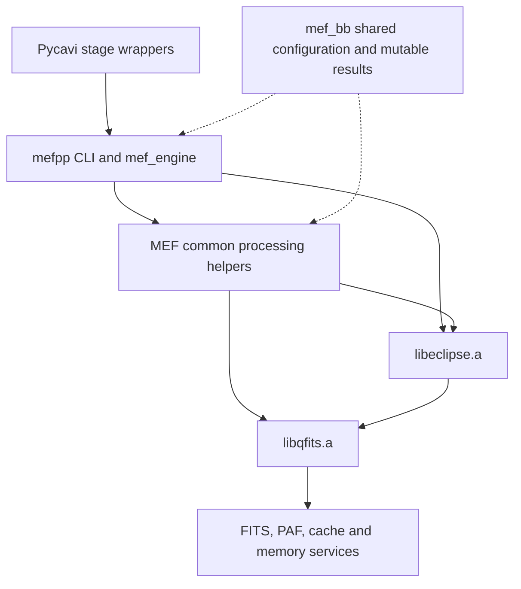
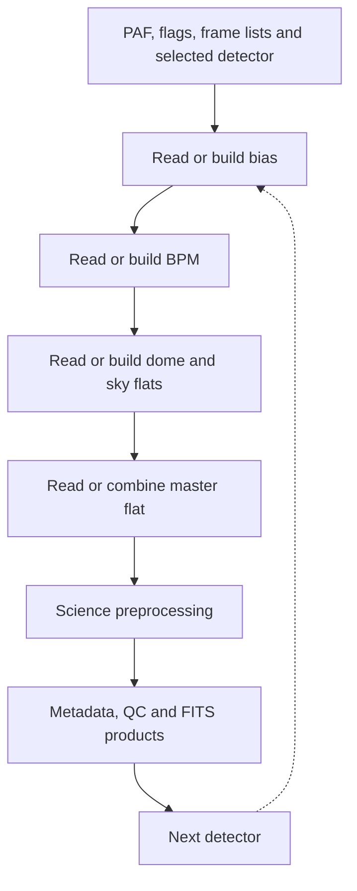

# mefpp current architecture

Version 1, 25 October 2026. Observed native source baseline: main
2cd54c1206ccb7b68b2eb0a5f70d9b28f1188cde; unchanged at documentation head
b2867c1da3ae4567cc7168c2f0ca13021aea2f33.
mefpp2 tree: 8d0bc2a81da4be75b5b5d0017bd0e9e83207e25b.
qfits52 tree: af5c2837c22b66a0388b9ccd866df3eb0ccf1fc3.

This describes the software as inspected, not the future component architecture.
The [version-1 roadmap](mefpp-modernization-roadmap-v1.md) is a separate proposal.
Detailed methods and source-use evidence are in the
[architecture audit](native-architecture-audit-2026-10-25.md).
Update this description when source changes; preserve its version/baseline history.

## Source and build organization

| Location | Current role |
|---|---|
| mefpp2/ins/mef/recipes/mefpp.c | CLI, mef_engine, detector loop, science arithmetic and output handling; 1422 lines |
| mefpp2/ins/mef/common/mefp_lib.c | PAF/context construction, calibration operations, scans, metadata, QC and FITS output; 4208 lines |
| mefpp2/ins/mef/common/mefp_lib.h | Broad mef_bb mutable context and MEF declarations; 389 lines |
| mefpp2/src and include | Embedded Eclipse image/cube/math/runtime code; libeclipse.a |
| qfits52 | Sibling FITS/PAF/memory source and tools; libqfits.a |
| mefpp2/configure, sysconf.c, Makefile | Shell/bootstrap configuration generator, generated host configuration and recursive make |
| qfits52/configure, sysconf.c, Makefile | Separate qfits configuration/build/install system |
| Pycavi2/pycavi/pycavi/pycavi_associate_reduction.py | Calibration/science wrappers, staging and subsequent science normalization |

The recipe/common objects link with -leclipse -lqfits -lm. pfits, Eclipse command
utilities and jitter programs are additional build products, not recipe link
requirements merely because the build produces them. qfits has not yet moved
under mefpp; the requested mefpp2/qfits5 location belongs to the roadmap.

Arrows indicate calls/dependencies, not independent runtime services.

## Configuration, state and execution

mef_bb_load constructs the context through mef_bb_new before CLI parsing.
The constructor reads cwd/mefpp.paf; configuration selection is therefore not
an explicit independent constructor argument. The PAF defines instrument geometry,
detector/HDU associations, processing choices and paths. CLI options alter context
state. Pycavi stages working files/PAF and invokes the native command; this can
hide the native dependence on current directory and fixed names (#76).

mef_bb mixes configuration, calibration identity, detector selection, statistics,
filenames, intermediate arrays and results. Its broad public structure has about
202 semicolon-delimited declarations; that is a structural metric, not a count of
independent concepts. Lifecycle/ownership is not uniformly enforced across paths.

The engine iterates detectors serially. Within each detector's work it reads or
builds required calibrations according to flags and existing files, and processes
science frames. The following is a high-level outline, not a universal acquisition
or data-dependency graph:

| Operation | Existing routine / boundary |
|---|---|
| Scan correction / trimming | mef_overscan_correction, mef_cube_overscan_correction |
| Bias, dome and sky construction | mef_build_cal(bb, "bias" / "dome" / "sky") |
| BPM | mef_build_bpm, using Eclipse gain-map algorithms |
| Master-flat combination | mef_ff_combine, mef_image_filter_flat |
| Science | Inline in mef_engine: load, optional saturation checks, scans/trim, bias subtraction, flat division and output |
| Metadata and output | mef_get_headers_for, mef_header_* helpers, mef_save, mef_hdrpix_dump and recipe code |

The Python mefpp_reduce_bias/dome/sky/science wrappers do not establish independent
C components. mefpp_reduce_sky also requests master-flat creation. Current Python
mefpp_reduce_bpm copies the installed static mask, despite native BPM-generation
code existing (#13). The inspected bp_map arithmetic use is in flat smoothing;
provenance in a science header alone does not establish pixel-level correction.

## Normalization and numerical ownership

Dome/sky builders use detector-zero statistics, including dome_median[0] and
sky_median[0], for common normalization. This preserves relative detector response
across the mosaic. Fernando confirms that this is intentional acquisition
information, not incidental state to remove during parallelization.

mef_ff_combine modifies input dome/sky arrays in place. Configuration and ownership
must therefore be disentangled before callers can safely reuse those inputs.
The native preprocessing and Python mefpp_normalize_science are separate: Python
performs the current mean-CONAD/exposure normalization to e-/s and header updates.
Moving that boundary without an explicit contract could double-apply scaling.

## Eclipse and qfits usage: what the audit establishes

The archived analysis compiled 2 MEF, 79 Eclipse and 18 qfits C units on the agent
Linux host. It did not link or run a target executable. Potential function calls
and conservative whole-object symbol closure give different inventories:

| Group | Built C units | Files with potential calls from main | Conservative object closure |
|---|---:|---:|---:|
| Eclipse image processing | 35 | 15 | 27 |
| Eclipse math | 14 | 5 | 12 |
| Eclipse spectroscopy | 4 | 0 | 0 |
| Eclipse Unix/runtime | 26 | 13 | 14 |
| Eclipse total | 79 | 33 | 53 |
| qfits total | 18 | 12 | 14 |

Used categories include image/cube allocation, FITS loading, image arithmetic,
statistics, median combinations, extraction, gain-map/BPM construction, flat
filtering, frame lists, logging/configuration and time/string helpers. qfits
provides FITS/PAF, byte conversion, cache/error and allocation services.

All four spectroscopy units and 22 other Eclipse units are outside the inspected
mefpp object closure. Another 20 Eclipse units enter only through whole-object
dependencies without identified function reachability. This does not prove they
are unused by other programs, alternate modes or future requirements. The
[per-file inventory](audits/native-architecture-2026-10-25/source-use.md) is the
reference for exact classification; no deletion is justified by these counts.
RTD socket/shared-memory paths occur through a generic loader's conditional
branch, not demonstrated use in the FITS pilot. Some callback paths need manual
review; the call graph is not runtime coverage or a target linker map.

## Present limitations and unimplemented target services

- Eclipse detector_linearity_fit and cube_correct_detlin exist but are not
  connected to the inspected mefpp main path. Fit/application coefficient
  compatibility and scientific qualification remain open.
- There is no demonstrated complete public linearity/shutter/gain/RON service,
  dark service or fringe construction/Python application contract in this audit.
  The roadmap must trace any reusable legacy implementation before adding code.
- main ignores the engine result (#71); some engine error paths destroy bb before
  main also destroys it (#75). These are source findings, not deliberately
  reproduced target failures.
- Compile-only analysis emitted 19 format-related diagnostics (#74). No sanitizer
  or leak-clean qualification is established by that compilation.
- Eclipse/qfits globals, caches, allocator state and static buffers preclude
  assuming reentrant/thread-safe processing. Internal mefpp multiprocessing does
  not exist in the current baseline.
- Hand-written configuration/install machinery has confirmed fixture failures
  and provenance/dependency problems (#65–#70). Historical binaries running on
  Mac/Linux do not establish clean-source build/install or native Windows support.

Selected existing binaries/library paths passed Mac and chapman3 observational
functional checks, with exact limits in the pilot records. They do not certify
all calibration builders, WFI, memory safety, single-detector layouts, CMOS,
parallel processing or scientific accuracy. Keep these distinctions when updating
architecture and roadmap as implementation proceeds.

## Revision record

| Version | Date | Description |
|---|---|---|
| 1 | 2026-10-25 | Source-based current architecture, linked audit evidence, explicit current/proposed separation |
