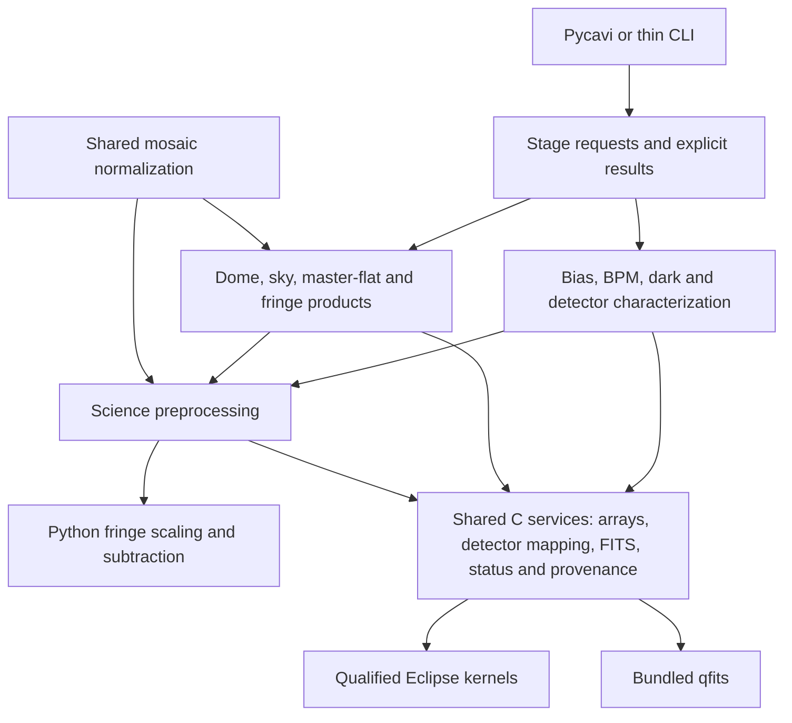

# mefpp modernization roadmap — version 1

Stage 2.1 endpoint revised by owner, 29 October 2026: [immutable amendment v2.8](native-roadmap-amendment-v2.8-2026-10-29.md) makes the gate **current mefpp/Pycavi reduction through notebook 04: native calibration/science preprocessing, Python normalization, solve-field and WCS-corrected MEF assembly**. Keep one filter and at most five equal-integration-time science exposures per instrument; all three WFI partitions are authorized for the same five exposures in total. Notebook 05 extraction/SCAMP, SWarp, photometric/illumination work, downstream QC and final catalogues are outside Stage 2.1 and deferred to later workflow work. Older v2.7/full-chain completion wording is historical and superseded; do not reopen it as a closure requirement.

WFI has passed native preprocessing, configured-gain normalization and notebook-04 astrometry for five exposures / 40 detectors, with pixel/input preservation checks. OCAM is prepared but its execution/result has not been returned; verify its existing status and complete only missing work through notebook 04. The failed first WFI SCAMP attempt and successful first catalogue remain retained outside this completion gate. #30/#131 remain recorded; VizieR availability, downstream processing and their production corrections do not block this stage. No stage-wide completion or automatic Stage 2A/refactoring is claimed.

Historical Stage 2.1 addition, 28 October 2026 (endpoint superseded by v2.8): [immutable amendment v2.7](native-roadmap-amendment-v2.7-2026-10-28.md) inserts full processing of one complete OCAM dataset and one complete WFI dataset with current mefpp/Pycavi before Stage 2A. New order: accepted Stage 2 → **Stage 2.1 full current-workflow baseline** → Stage 2A review → extraction. One inventory/input/software lock, both existing complete supported reduction chains, retained outputs/QC and one baseline report; no new algorithm, format migration, automatic tuning, repeated memory matrix or duplicated platform run. Stage 2 stays accepted at 19/19 planned, 29 actual; #116 open/deferred, Phase 3 deferred. Planning only tonight; both user checkouts stay clean on main, no processing/installation/sync needed to review. Exploratory ASDF/WISDG/layout ideas are not adopted requirements.

Frozen roadmap accepted, 28 October 2026: Fernando instructed "proceed" after reviewing v2.0 and requesting amendment v2.1 (paired final Chapman3 C17/C90 regression). The [accepted execution record](native-roadmap-v2-acceptance-2026-10-28.md) activates the frozen contract plus amendment; earlier proposal/pending-acceptance statements are historical. Begin one read-only WFI inventory and one integrated-fixture/harness preparation pass, then the fixed F1–F5 campaign: Mac C17 diagnostics, one final C90 build, paired compact Chapman3 closure, at most 19 planned native launches and two global correction/retest rounds. No new BPM-only matrix, automatic scope expansion, processing before input/reference lock, merge or branch deletion is authorized. Keep the frozen files byte-identical, all prior evidence and installations preserved, and #116 explicitly open pending its final-review disposition.

Owner-requested frozen-roadmap amendment v2.1, 28 October 2026: Fernando explicitly requested a compact final Chapman3 C90 regression together with C17. See [immutable amendment v2.1](native-roadmap-amendment-v2.1-2026-10-28.md). F5 now contains two compact target launches, one per mode; the campaign cap is 19 planned native launches. The original frozen v2.0 file/checksum, one-day preparation checkpoint, two global correction-round limit and all other scope/stopping rules remain unchanged. No build or processing starts from this documentation update.

Frozen simplification proposal requested, 28 October 2026: Fernando requested an immutable, finite roadmap instead of successive BPM matrices. Review [frozen native roadmap v2.0](native-roadmap-frozen-v2.0-2026-10-28.md) and its separate [fixed-row progress ledger](native-roadmap-v2-progress.md). It consolidates calibration/science collection through the existing engine, makes Mac C17 the diagnostic lane, retains one final C90 compatibility build, limits Chapman3 to one compact C17 regression, and caps the declared Stage 2 campaign at 18 planned launches plus at most two scoped correction rounds. Target external diagnostics and #116 remain honestly recorded; no implicit finding closure. The concrete proposal requires owner acceptance before execution; no new workload, merge or deletion starts from publication. Once published, never edit the frozen contract in place: amendments need explicit agreement and a new numbered file. This supersedes neither accepted evidence nor the old rules until that acceptance. Documentation review occurs on GitHub with both user hosts remaining on clean main; no diagnostic reruns or host synchronization are needed to review this document.

Date: 26 October 2026. Revision: 1.6. Status: agreed sequencing and requirements amendment; implementation acceptance remains bounded.
Documentation baseline: b2867c1da3ae4567cc7168c2f0ca13021aea2f33.
Owner: Fernando Selman; canonical development repository: fselman/wenu-imaging.

Current bounded qualification and remaining work are recorded in the
[26 October ledger](native-qualification-and-roadmap-2026-10-26.md).
Earlier platform/pending statements are historical where superseded by that ledger.

## Purpose and decision status

Make the existing native system reproducibly buildable and installable, establish
memory correctness, review data standards and representation, and only then
reorganize its functionality. Retain ANSI C,
scientific behavior, instrument information and the working installations during
qualification. The target architecture and this roadmap are living documents:
revise them when evidence changes, recording the reason, affected gate and approval.
Publication of version 1 authorizes no implementation, install, merge or rerun.

The [current architecture](mefpp-current-architecture.md) is an observed baseline;
the design below is a proposal. See the [installation audit](native-installation-audit-2026-10-25.md)
and [architecture audit](native-architecture-audit-2026-10-25.md) for evidence.
Tracking parents: #64 (build/install) and #73 (architecture/roadmap).

### Requirements established by Fernando

- Clean build/install on the Intel Mac first, then chapman3, without relying on
  a historically installed mefpp or qfits. Bundle one qfits source copy under mefpp.
- Investigate and correct memory leaks and invalid memory use before component
  extraction. Preserve the current serial algorithm baseline through these phases.
- Components for BPM, linearity/shutter/gain/RON, bias, dark, dome/sky/master flats,
  fringe-frame determination and science preprocessing.
- Stage 4 must create per-pixel frame variances and propagate them through
  calibration and science processing, with explicit units, masks and provenance.
- Preserve common mosaic flat normalization and relative detector response. This
  encodes acquisition information; independent per-detector renormalization is
  not an optimization and is not authorized.
- Support single detectors, followed by safe parallel mosaic reductions within
  one node. Native Windows build/install is a requirement, designed in early.
- CMOS-specific reduction services are the final functional extension, preceded
  by a detector/readout-mode review. Keep scientific parameter tuning deferred.

## Early ESO Phase 3 requirements audit and reduction profiles

Approved 26 October 2026: audit the applicable ESO Phase 3 instructions now as
requirements work alongside bounded qualification. Do not wait until final export
to discover changes required in calibration, science metadata or associated products.
The audit itself is pending; this roadmap records its scope, not checked compliance.

Inventory official instructions/standards, product-specific rules, release-description
guidance and validation tooling. Record exact document versions/dates and separate
mandatory requirements, recommendations and unresolved interpretations. Build a
requirements matrix mapping each item to the affected stage/component, raw evidence,
planned metadata/product, test and verification status. Cover science images and
catalogues, uncertainty/weight and quality products, associations, units, WCS/time,
photometric calibration, provenance, coverage and release documentation as applicable.
Do not infer that all possible companion products are universally mandatory.
Track the delivery audit with #9 and BPM/weight behavior with #91.

Propose ESO_Phase3 as a named reduction/product profile: a versioned set of
requirements, compatible processing policies, required metadata/associated products
and validation rules. A profile may constrain processing upstream as well as export.
It is not a plotting style, a header-stamping option or a compliance certificate.
Separate shared scientific correctness from profile-specific delivery constraints.
Other profiles may be defined later without weakening mask/uncertainty guarantees.
No profile implementation or exact configuration syntax is selected here.

Publish the requirements/gap matrix early enough to inform each bounded correction.
At the mandatory review after Stage 2, consider the audit findings before approving
representation/interfaces or dependent implementation. Missing public guidance or
uncertain applicability is recorded explicitly, not guessed. Final Phase 3 validation,
release preparation and any submission remain separate from functional acceptance.

## Sequence and review gates

| Stage | Deliverable | Completion gate |
|---|---|---|
| 0 | Toolchain/build decision and qualification fixtures | Review the selected tools, platform matrix, invariants and bounded first implementation |
| 1 | Clean serial build and installation | Fresh source and private-prefix installed tests on Mac, then chapman3; no historical native dependency |
| 2 | Memory and failure correctness | No unexplained memory diagnostics or leaks on the declared normal/error/repeat suite; cleanup and status tests pass |
| 2.1 | Current OCAM/WFI mefpp/Pycavi reduction through notebook 04 | Bounded one-filter sets finish calibration/science preprocessing, normalization, solve-field and WCS-corrected MEFs; evidence/provenance reviewed; no SCAMP/coadd/catalogue gate |
| 2A | Data standards, storage and representation audit | Reviewed format-neutral data contract and retain/adopt decision before component interfaces are fixed |
| 3 | Component contracts and extraction of existing behavior | Serial legacy/component comparisons pass with agreed tolerances; ownership, metadata and normalization preserved |
| 4 | Calibration services and frame variances | Linearity/shutter/gain/RON, dark, fringes and variance creation/propagation have defined products and separately qualified methods |
| 5 | Single-detector CCD service | Primary-image and single-extension layouts, geometry and calibration behavior pass dedicated tests |
| 6 | Parallel mosaic service | Serial/parallel equivalence, resource limits, failure isolation and restart tests pass |
| 6A | Optional accelerator assessment | Profiled CPU/thread/GPU comparison and explicit adopt/defer decision; CPU fallback retained |
| 7 | Native platform completion | Native Apple Silicon and Windows build/install and supported serial/parallel suite on actual targets; remaining Ubuntu qualification recorded |
| 8 | CMOS review and services | Camera/mode-specific acquisition, calibration, timing, masks and uncertainty contracts reviewed and tested |

Windows portability checks begin in stages 0–1; stage 7 is full target acceptance,
not permission to defer all platform design until then. Native Apple Silicon is a required support target, alongside Intel Mac, chapman3,
Windows and Ubuntu; record real target results with pending status until tested.
No dates or throughput promises are assigned before representative measurements.

## Stage 0 — Select tools and freeze the comparison baseline

**Recommendation for review:** CMake for configuration, dependency targets and
installation, with CTest as the test entry point. Use generated Unix Makefiles
initially where the existing make is suitable; Ninja may be selected explicitly
rather than becoming an unnoticed dependency. Use a stable, recorded CMake
version compatible with macOS 13.7.8; do not require the newest release by default.

| Choice | Benefit | Cost / decision |
|---|---|---|
| Repair existing configure/sysconf/Make | Smaller initial build-system change; familiar tools | Must repair probes, tool propagation, dependency graph, staging and Windows assumptions ourselves |
| CMake + CTest (recommended) | Compiler/capability probes, target dependencies, out-of-source builds, install/test integration and Windows generators | New build dependency and migration verification; framework does not fix algorithms or OS-specific code |

Do not maintain two independent canonical build descriptions indefinitely.
Retain the old source snapshot and instructions as comparison evidence while
qualifying the selected replacement. A compatibility configure launcher, if
wanted, must delegate rather than duplicate platform detection logic.

### Language policy: C89/C90 source and C17 compatibility

Retain ANSI C89/C90 as the portable source baseline for code maintained in the
mefpp numerical core. Require explicit C90 and C17 compilation/behavior checks;
C17 is a compatibility target, not permission to introduce C17-only constructs.
This supersedes the conversational recommendation to make C17 the source baseline.
Any newer-language facility requires an explicit reviewed exception or revision.
Explicit language-mode selection has since been implemented in the candidate;
acceptance is bounded by the dated build/resource/runtime records.

Use explicit compiler modes (for example -std=c90 and -std=c17 on GCC/Clang),
classify pedantic diagnostics, and inventory existing GNU/vendor extensions.
Do not declare legacy Eclipse/qfits strictly C90-compliant before that audit.
Keep dependency requirements, optional accelerator/OpenMP code and necessary
POSIX/Windows APIs separately documented; isolate exceptions behind interfaces
rather than treating C90 syntax as proof of operating-system portability.
Compiler flags differ on Windows: qualify available conformance diagnostics and
record any inability to enforce a strict C90 mode rather than claiming parity.

Run the same representative numerical, FITS/metadata, failure/cleanup and memory
checks for qualified C90 and C17 builds, with agreed comparison tolerances.
Compilation alone does not establish equivalent behavior. C23 is an optional
forward-compatibility diagnostic lane when available, not a release requirement
or justification for an unapproved compiler upgrade. Revisit the baseline only
when a concrete benefit and complete platform/dependency evidence justify it.

Apple Clang 15 and the reported GNU GCC 13 installations on the Mac support a
C17 language mode. The actual Intel Mac direct CMake C90/C17 build/resource/
private-install checks passed at source 41c8e6a..., while observational equivalence
and the restored frontend target gate remain pending. The fresh chapman3
inventory reports CentOS 7 x86_64, glibc 2.17, GCC 4.8.5 and Clang 3.4.2, with no
newer compiler shown by that inventory. Those system compilers cannot serve as
the C17 qualification toolchain. Investigate an isolated compatible toolchain;
do not replace system tools, upgrade glibc or modify the working imaging
environment implicitly. A candidate compiler is not qualified until tested there.

Proposed initial compiler families: Apple Clang on Mac, a verified compatible
modern GCC on chapman3, and MSVC or clang-cl for native Windows. Record compiler,
archiver, linker, SDK/library and build-tool paths/versions per target. C++
implementation, new bindings and unrelated engine upgrades are not prerequisites.

Capture immutable observational and small synthetic fixtures for bias, BPM,
flats and science, including header/unit expectations and detector mapping.
Record source/binary/resource identities. Establish comparison tolerances before
running changed code. The existing Mac one-exposure and chapman3 functional
products are useful evidence, not complete calibration or WFI certification.

## Stage 1 — Build and install the current serial software

Fernando requires ./configure; make; make install as the normal supported user
interface. Thin frontends delegate to CMake, which remains the sole build graph
and installer. Select platform tools and check prerequisites automatically, retain
explicit overrides, propagate failures and reject stale failed configuration.
Keep optional make check and detailed qualification in developer documentation.
The restored frontend needs actual target acceptance before resuming CP Pup
comparison; it is not a package-manager implementation.

1. Move qfits52 to the proposed mefpp2/qfits5 as one canonical source copy,
   retaining history, notices, licenses and public names. Coordinate path/docs
   changes and source identity checks; do not silently replace qfits/Eclipse.
2. Configure from explicit inputs and capability probes: compiler, headers,
   library functions, byte order, type sizes, large-file behavior and required
   OS services. Report unsupported requirements clearly; do not infer capability
   solely from OS strings. Honor selected tools and propagate every failure.
3. Express qfits -> Eclipse -> mefpp dependencies and header/archive relinking.
   Start with static libraries. Separate the required engine/resources from
   optional legacy commands, development libraries and headers.
4. Build outside the source tree, excluding tracked binaries and generated host
   files from compilation decisions. Resolve version provenance without inventing
   an upstream version. No hidden dependency on old include/library prefixes.
5. Provide explicit prefix and staging support, manifest, license installation,
   safe repeat-install behavior and bounded removal. Install PAF templates and
   required BPM resources; identify funpack or avoid runtime decompression by a
   reviewed packaging choice. Never overwrite edited configuration silently.
6. Test installed programs/resources from outside the checkout. Verify missing
   inputs/tools, failed configuration/build/install and native processing report
   failure. Correct status/cleanup defects needed for truthful acceptance without
   broad component extraction (#65–#71, #75–#76 as applicable).

Mac first: fresh source/private prefix; record compiler/SDK/archive/resource
identities, run small native and representative reduction tests through the
installed Pycavi wrapper with explicit paths. Preserve the selected old engine.
Then repeat on chapman3 using its actual allocation/filesystem/toolchain. Add
a native arm64 Apple Silicon build/install lane as soon as a target is available;
verify executable/library architecture, SDK/dependencies and installed runtime,
without an accidental Rosetta/x86_64 dependency. Do not assume all newer Macs or
macOS releases pass because the Intel Mac passed. An
agent-host Linux compile is not acceptance of either machine. Select a candidate
as the normal engine only after its target gate; retain rollback information.
Build graph parallelism and runtime detector parallelism are separate questions.

### Deferred TODO — simple user distribution

Fernando defers the pip-versus-Conda/micromamba selection while the current native
qualification continues. Compare a platform-specific mefpp wheel plus the existing
Pycavi wheel against a Conda native recipe/application environment. Review build
and runtime dependencies, resource layout/relocation, platform/OS/glibc constraints,
fresh-user installation, updates/removal and maintenance cost. Retain CMake/CTest
and the portable C core regardless of the distribution route.

Keep this as a Stage 1 distribution-usability TODO before advertising a simple
public installer; it does not block the current CP Pup native regression or
chapman3 build/install qualification. No recipe implementation, package manager
installation, channel/account registration or publication is selected by this TODO.
The short user guide stays under docs; detailed qualification stays under
docs/developer. Physical document relocation follows a separate link inventory.

## Stage 2 — Memory, ownership and failure correctness

Inventory allocation/ownership across the recipe, mef_bb, Eclipse images/cubes,
qfits caches and memory manager. Resolve double cleanup, invalid accesses,
use-after-free, buffer overflows, nonliteral formats and leaks (#74–#75), including
partial-construction/error exits. Define which scope destroys each object.

Use compiler diagnostics and compatible AddressSanitizer/UndefinedBehaviorSanitizer
builds; qualify LeakSanitizer or an appropriate platform leak tool on the actual
compiler/OS. Verify that instrumentation observes the legacy qfits allocator;
consider a supported diagnostic allocator configuration without changing the
production allocation policy silently. Unsupported tooling is a documented gap,
not a passing check. Do not enable all warnings as errors before classification.

Exercise successful calibrations/science, missing/corrupt inputs, rejected
configuration, allocation/I/O failure where practical, repeated stage calls and
cleanup after partial results. Include small known-invalid fixtures to establish
that the selected diagnostic configuration actually detects errors. Assess
retained cache allocations separately from lost allocations and repeated growth.

Gate: no unexplained findings in the declared suite on supported target tooling,
correct exit status/cleanup and equivalent scientific outputs. This is bounded
memory evidence, not proof of absence of leaks in every possible execution.
Broader refactoring waits for this gate. Re-run relevant checks after extraction.

### Accepted Stage 2 exit and next baseline

Stage 2 bounded acceptance is recorded in amendment v2.6; #116 remains open/deferred and Phase 3 work is deferred. It is not a new gate before the next functional baseline. The owner's subsequent amendment v2.7 inserts Stage 2.1 before representation work. Completion of either stage does not automatically authorize backend migration or component extraction.

## Stage 2.1 — Current reductions through notebook 04

Run the current mefpp/Pycavi notebook-00/01 setup/association, notebook-03 calibration/science preprocessing and normalization, and notebook-04 detector solve-field/WCS-corrected MEF assembly. Use one filter and at most five science exposures of the same integration time within each instrument set; keep required calibration inputs separately. The selected WFI five exposures span three owner-authorized partitions.

Pin source/tools/configuration and input hashes; retain supported calibration products, supplied BPM provenance, preprocessed and normalized science MEFs, solved detector products, WCS-corrected MEFs and a concise baseline report. Use the expressly authorized configured WFI gains through recorded working-copy header preparation; do not add scientific audits, new calibration methods or numerical tuning.

Gate: both selected instrument sets finish through notebook 04 with the intended exposure/detector coverage, actual detector solutions, finite WCS checks, pixel preservation across WCS assembly and input/configuration provenance. Functional checks are not independent astrometric/scientific/Phase 3 certification. Existing successes are reused rather than rerun. See [controlling v2.8 scope and status](native-roadmap-amendment-v2.8-2026-10-29.md).

Notebook 05 source extraction and SCAMP, SWarp/coaddition, photometric calibration, illumination/QC/catalogues and full raw-collection reductions are outside this completion gate. Retain them as later workflow work without inventing a new stage number or automatic launch. VizieR access and the preserved SCAMP failure do not block Stage 2.1. After both instrument baselines are reviewed, Stage 2A review may follow; implementation/extraction still requires its concrete scope.

## Stage 2A — Data standards, storage and representation audit

This review follows the accepted memory qualification and Stage 2.1 reduction baseline through notebook 04, before component contracts/extraction. New storage may improve intermediate processing,
but no replacement is selected and FITS is not presumed obsolete. Distinguish:
(1) on-disk containers, (2) astronomical metadata/data models, and (3) in-memory
array/state structures. A different container does not supply the scientific
semantics, remove allocation bugs or automatically make concurrent writes safe.

Keep FITS as the ingestion/interchange baseline and preserve original files.
Evaluate retaining FITS throughout against conversion after ingestion to a
reviewed intermediate representation, with FITS export wherever external tools
or product delivery require it. An in-memory abstraction may be sufficient;
conversion of every image is not a prerequisite. ESO Phase 3 output requirements
must be checked separately, not inferred from an internal format choice.

| Candidate | Reason to investigate | Required caution |
|---|---|---|
| FITS / multi-extension FITS | Current instrument/external-tool interoperability and established baseline | Compare subset access, compression, metadata and memory behavior using actual workloads |
| HDF5 | Hierarchical datasets/metadata, chunked arrays and a native C library | Review C language/toolchain requirements, library dependencies, schema, locking and process/thread access modes |
| ASDF | Astronomy-oriented schema-based hierarchical metadata and arrays; relevant WCS/model serialization | Establish suitable C access or Python-owned boundary, schema/plugin availability and interoperability |
| Zarr v3 | Chunked arrays and sharding with multiple language implementations | Verify actual C feature/codec support, shared-filesystem file counts, write ownership and version compatibility |
| Relevant IVOA models | Metadata semantics, discovery/interoperability and provenance review | Distinguish approved Recommendations from drafts/notes; these are not substitute array containers |

### Observatory and archive practices required in the review

Investigate JWST, Roman, Rubin, ELT and public future ESO archive proposals, not
only generic container specifications. For each record source/date/version,
raw/intermediate/delivered product types, metadata/WCS and uncertainty/mask model,
internal abstraction versus physical serialization, adopted versus proposed
status, access patterns and implications for a portable C core/Python client.

Preliminary official-source pointers, checked 25 October 2026 (not the completed
stage-2A audit):

| System | Current documented direction / question for the audit |
|---|---|
| JWST | Pipeline products are predominantly FITS, with ASDF metadata/WCS and some standalone ASDF reference files; study the data-model abstraction rather than treating this as universal FITS replacement |
| Roman | WFI science products use ASDF; inspect schemas, arrays, WCS, calibration provenance and supported implementations. Roman WFI is distinct from ESO's WFI instrument |
| Rubin | Published DP1 raw/deep-coadd images are FITS; Butler abstracts storage/retrieval. Study image/variance/mask objects, dataset identity and storage adapters; Butler is not a file format |
| ELT | Public ICS Data Acquisition manual ESO-396401 v3 (2024-12-11) describes FITS data products; investigate instrument/product-specific requirements instead of inferring all future ELT formats |
| ESO archive evolution | Review current DIC, Phase 3 product standard and public archive/ELT plans; distinguish binding releases, drafts and research proposals |

ESO's DIC page identifies version 8, released 5 March 2025, as the official
version at the time of this check. Current public Phase 3 guidance describes FITS
products. No adopted archive-wide FITS replacement was established by this initial
search. Recheck during the full audit; if future documents/drafts are unavailable,
record that uncertainty rather than inventing policy or contacting ESO without
Fernando's instruction. A new internal representation must not silently change
the delivery format required by ESO or other consumers.

This is a shortlist, not an exhaustive standards audit or a claim of one accepted
successor to FITS. During the review verify current specification status, adoption,
implementations, maintenance, licenses and versions using primary sources. Include
other credible candidates if the evidence warrants; explicitly distinguish
widespread adoption from formal standardization.

Define the format-neutral logical product first: science arrays, variance or
uncertainty, flagged masks, detector/amplifier geometry and identity, acquisition
and effective gain/RON, units, correction state, time/WCS, calibration links,
shared mosaic normalization, QC, provenance and schema versions. Preserve original
FITS cards (including duplicate/commentary cards where needed) alongside parsed
semantics; a dictionary conversion alone must not silently discard information.
Specify array shape/type/strides/endian conventions, missing values, integer nulls,
ownership/lifetime, read-only views, lazy access and chunk/region access needs.
Core arithmetic should not depend on a particular serialized container or Python
object model. Check any proposed dependency against the ANSI-C core requirement.

Use representative OCAM/WFI calibration stacks and science images on the Mac and
chapman3. Compare end-to-end read/compute/write cost, peak memory, size/compression,
per-detector/region access, worker access patterns, metadata fidelity, recovery
and deployment burden. Include conversion overhead and FITS boundaries needed by
SCAMP/SWarp and other clients. Do not infer speed from format descriptions alone;
introduce only separately agreed disposable prototypes/dependencies for benchmarks.

Deliver a standards/adoption matrix, measured comparisons, migration cost/risks,
recommended internal schema/adapters and a retain-FITS/adopt-alternative decision
record. Gate: Fernando reviews the evidence and logical data contract before
component interfaces are fixed. If a new backend is selected, stage its migration
and round-trip/equivalence qualification separately before dependent extraction.
Re-run memory/ownership checks for new adapters/libraries. Do not bundle a storage
migration into a numerical refactor. Retaining FITS is a valid review outcome.

### Science, variance, quality and profile contract

Define aligned science, variance and integer data-quality arrays, mask polarity,
flag reasons and task-specific exclusion rules. Keep uncertainty in squared science
units; distinguish total variance from background-only variance used by external
tool adapters, inverse variance, diagnostic flags and coverage/exposure maps.
Unknown variance must not produce infinite weight. Zero usable weight does not
erase the original science measurement or its exclusion reason.

Design local resampling/convolution covariance separately from shared calibration
and fitted-parameter uncertainties, including cross-exposure terms. Compact local
kernels do not by themselves represent all shared systematics. Define association,
geometry/WCS, correction state and uncertainty provenance through all boundaries.

Define acquisition electronic gain/RON per detector/amplifier with canonical units,
source, uncertainties and measured/default status. Preserve originals and distinguish
electronic gain from BPM relative-response slope and from processed effective gain.
Record scale/exposure/flat transformations needed to interpret processed noise.
The current mean-CONAD/exposure conversion is an invariant of comparisons until
a separately reviewed change; do not silently replace it with detector gain scaling.

Review how the proposed ESO_Phase3 profile constrains this logical model without
preselecting a physical container or making profile-specific metadata the whole
internal schema.

## Stage 3 — Explicit contracts and existing-function extraction

Prefer one modular ANSI-C library, focused headers and a thin compatible CLI.
Components need not be separate repositories, executables or shared libraries.
Keep Pycavi notebooks and configured Python scripts as clients of the same
processing routines; choose subcommands/direct API/bindings only when needed.

| Proposed service | Existing starting point / qualification need |
|---|---|
| mefpp_cal_bias | mef_build_cal(bb, "bias") |
| mefpp_cal_bpm | mef_build_bpm; integrate actual generation rather than only static-mask copying (#13) |
| mefpp_cal_domeff | mef_build_cal(bb, "dome") |
| mefpp_cal_skyff | mef_build_cal(bb, "sky"); disentangle Python's coupled master-flat request |
| mefpp_cal_masterff | mef_ff_combine and mef_image_filter_flat; explicit input mutation and shared normalization |
| mefpp_sci_pp | Extract current inline science block; retain alias cal_sci_pp only if needed for compatibility |
| mefpp_cal_lin | Stage 4: existing uncalled Eclipse fit/application routines are candidates, not a complete qualified service |
| mefpp_cal_dark | Stage 4: establish current usable behavior and intended method before implementation |
| mefpp_cal_fringe | Stage 4: fringe construction; Python application is a separate service |

Every service contract defines detector/amplifier identity, geometry/readout mode,
input units and correction state, immutable versus owned mutable arrays, output
units/products, masks, uncertainty/QC, calibration applicability and provenance,
status/diagnostics, output naming and interrupted/repeated-run behavior. No public
API should require a caller to mutate the whole historical mef_bb correctly.

Separate shared services for configuration, detector mapping, arrays, FITS I/O,
logging/errors and metadata, using the reviewed stage-2A data contract and storage
adapters. Pass explicit state instead of relying on cwd or
hidden static buffers. Preserve original acquisition metadata while distinguishing
processed quantities. Extract one service at a time with before/after comparisons.
Do not delete Eclipse code based on single-root reachability; optional pruning
requires multi-root/instrument coverage and actual target linker evidence.

Require each component and detector-extraction writer to preserve science/variance/
quality associations, coordinate mapping, calibration references and uncertainty
state. Specify metadata insertion and transformation boundaries explicitly; copying
a raw gain keyword after pixel scaling is insufficient. Profile validation should
report missing or inconsistent required information before dependent processing.
Profile mechanisms remain design work, not an already implemented API.

### Mandatory mosaic and unit invariants

Common flat normalization preserves relative detector response and acquisition
information. Represent its definition, reference detector/statistics and scale
explicitly; compute required shared quantities before independent application.
Do not substitute independent unit-median flats for the present common reference.
Keep detector identity stable if HDU order changes or a detector is unavailable;
missing reference behavior must be an explicit reviewed policy, not a silent swap.

Python currently performs mean-CONAD/exposure normalization after C preprocessing.
Keep that numerical behavior in comparisons and define its future owner before
moving it. Never apply it twice. Preserve ADU/electron/electron-per-second versus
physical-flux distinctions and define propagated variance/mask semantics.

## Stage 4 — Calibration characterization and missing services

### Implementation subdivisions agreed 26 October 2026

- **4A — Detector characterization and metadata:** qualify relative-response/BPM,
  electronic gain/RON, non-linearity and shutter estimators; preserve sequence/pair
  membership, establish compatible measured/default values and write their provenance
  into native science detector products before downstream extraction.
- **4B — Calibration and science uncertainty:** create and propagate variance through
  calibration construction/application, normalization and Python corrections, retaining
  shared-reference/fitted-parameter uncertainty and invalid-pixel states.
- **4C — Mask and weight integration:** trace BPM/data-quality exclusions into
  extraction and coaddition input weights. A bounded binary-mask sentinel test may
  precede full physical variance implementation; binary usability weights must not
  be advertised as calibrated inverse variance. Tool adapters must respect background
  versus source-noise conventions, gain handling and explicit rescaling policies.
- **4D — Final-product uncertainty:** preserve variance/quality through detector
  extraction, resampling, combination and photometry; validate covariance approximations,
  coverage and associations. Derive uncertainty for the actual combination method:
  the current median coadd cannot use a weighted-mean variance formula by assumption.

Each subdivision has independent known-answer and statistical recovery tests.
Exclude flagged samples without silently replacing their science values; interpolation,
diagnostic source flags and exclusion are distinct policies. Verify a known detector
coordinate and an unflagged control through actual downstream tools. Do not infer
mask use from an output weight image, a filename or the mere presence of a BPM.
ESO_Phase3 requirements inform all four subdivisions; final validation remains a
separate application delivery gate.

### Frame variance creation and propagation

Create variance planes for science exposures and calibration products, per detector
and per amplifier where relevant. Bind their geometry, masks, units and processing
state to the associated image. Define variance in squared image units; distinguish
it explicitly from standard deviation, inverse variance, exposure/coverage maps
and arbitrary weights. Missing uncertainty is flagged as unknown, never silently
represented by zero variance or infinite statistical weight.

Define the initial noise model using compatible measured gain/readout noise
(or the documented default/fallback policy), appropriate Poisson terms and other
identified noise contributions. Specify bias/background treatment, valid signal
range, saturated/bad pixels and handling of negative background-subtracted values.
Keep this distinct from the paired-flat variance estimator used to characterize
detectors: one global gain or sample variance is not a frame variance plane.

Propagate image and calibration uncertainty through overscan/bias/dark subtraction,
non-linearity and shutter corrections, dome/sky/master-flat construction and
application, shared mosaic normalization, gain/exposure/flux scaling, and fringe
template construction and subsequent Python amplitude fitting/subtraction.
Every component must state its propagation rule, independence/covariance
assumptions, rejected-pixel behavior and uncertainty in fitted parameters or
calibration reference quantities. Include correlations introduced by shared
calibrations and mosaic normalization; do not silently assume all pixels or
detectors are independent. Preserve the common flat reference and relative
detector responses.

Use the stage-2A logical data contract and stage-3 component interfaces to carry
science, variance, masks and provenance together. Define the handoff to Pycavi,
resampling/coaddition and photometry, including correlated-noise limitations and
conversion to tool-specific weight maps. A SWarp weight product alone does not
establish propagated physical variance. Storage layout and any covariance
representation remain reviewed design decisions, not a new selected file format.

Acceptance must include independently calculated small fixtures for noise
initialization, subtraction, multiplicative scaling, flat division, calibration
combination and shared normalization; test units, masks, unknown/invalid values
and uncertainty provenance. Assess resampling correlations and validate the
adopted approximation on representative data, with suitable statistical recovery
tests. Document which uncertainty terms are modeled and which remain unsupported.
This is Stage 4 work; it does not add variance algorithms to the current build
migration or claim that existing frames already have qualified variance products.

### Paired flat sequence: linearity, shutter, gain and readout noise

Fernando specifies OCAM/WFI sequences: at least two initial bias exposures;
randomized integration times from low signal to saturation, always two consecutive
flats per integration time. Preserve chronological order and pair membership;
validate metadata rather than sorting by time and blindly pairing files. Historical
template variants may differ and require explicit association rules.

Produce per-detector (and per amplifier where relevant) signal/time and
variance/signal measurements, conversion gain, readout noise, non-linearity and
shutter-error products, with errors, fitting regions and rejected/saturated samples.
Retain full-range exposures for characterization while excluding invalid ranges
from the ordinary gain estimator. Use pair differences to suppress fixed pattern;
handle illumination differences/drift and spatial structure explicitly.

For matched pairs, a useful estimator specification, with g in electrons/ADU, is:
S = (mean(F1)+mean(F2))/2 - mean_bias;
V = (Var(F1-F2)-Var(B1-B2))/2; V approximately S/g in the valid linear region;
RON_e = g sqrt(Var(B1-B2)/2). Define masks, sampling regions, robust estimators,
correlation assumptions and any corrections before adopting the final method.

One public mefpp_cal_lin service can coordinate separate internal estimators for
response non-linearity, shutter timing, gain and RON. Distinguish signal-dependent
response from effective exposure offsets and lamp drift; check identifiability
from the available sequence and request additional calibration data when needed.
Do not force a simultaneous solution the data cannot constrain. Export a shutter
map/model in time units with explicit sign convention and validity. Non-linearity
coefficient direction/order must match the application function; existing degree-4
Eclipse fits cannot simply be fed into a three-coefficient cubic application.

Select compatible measured gain/RON when available; otherwise use a versioned
instrument/detector/readout-mode default table. Reject invalid/incompatible
measurements with an explicit fallback reason. Store selected values, uncertainty,
measured/default status and provenance in science detector extensions, preserving
original values. Default entries must come from verified instrument information,
not fabricated constants. A missing valid measurement and default is a clear error.

For the documented ESO detector-header convention, ESO DET OUTn CONAD is e-/ADU
and ESO DET OUTn GAIN is ADU/e-. ESO QC quantities named gain can use e-/ADU.
Use explicit canonical internal units and per-instrument keyword mappings, never
magnitude-based guesses or a universal interpretation of the word GAIN. Verify
RON keyword units from actual instrument headers/documentation. Keep acquisition
gain/RON distinct from effective values after scaling or coaddition.

### Dark frames

Define matched temperature, exposure, binning and readout configuration, bias
handling, hot-pixel masks, uncertainty and reuse. Establish whether scaling with
exposure is valid for the detector/mode; do not assume it universally. A component
being available does not make dark subtraction mandatory for every instrument.

### Fringe frames and Python application

mefpp_cal_fringe constructs detector/filter/configuration-specific templates from
appropriate blank-sky or dithered science data, masking sources and separating
smooth background. Record normalization, masks/uncertainty/QC and provenance.
Python later determines each exposure's amplitude and subtracts the additive
fringe contribution. Define compatible units, source masks, model validity and
failure diagnostics; do not absorb the fringe template into a multiplicative flat.
The proposed usual placement is after compatible bias/flat corrections and before
resampling/coaddition, but exact ordering relative to other corrections belongs
to the reviewed product contract. Preserve astronomical extended structure.

Gate for new services, including variance creation/propagation: synthetic recovery tests, independent reference checks,
representative instrument data and Fernando's scientific acceptance of methods.
Existing functional notebook success is not this gate. Keep method validation
separate from later scientific parameter optimization across all survey fields.

### Later science extension: NB_659 continuum subtraction

Retain the requested integrated OmegaCAM NB_659/r_SDSS continuum-subtraction
extension after the mask/uncertainty foundation, without making it a prerequisite
for current Stage 1 qualification. Plan transmission-aware treatment of the four
quadrant filters and detector/filter provenance, per-CCD spatial PSF models with
PSFEx, a common target PSF, SCAMP astrometry and SWarp resampling/coaddition.
Continuum scaling, response corrections, PSF matching and subtraction should be
integrated before final coaddition where appropriate. Design covariance before
implementing the PSFEx interface: C_out = A C_in A^T, compact spatially varying local
correlations plus shared-reference/cross-exposure terms as required. Preserve masks,
variance, line-response maps and transmission-aware weights; distinguish a
continuum-subtracted narrowband product from calibrated H-alpha, including possible
[N II] contamination. Review the method and acquisition requirements separately;
no new processing or scientific defaults are selected by this planning entry.

## Stage 5 — Single-detector CCD support

Support primary-image and one-image-extension FITS through explicit detector
mapping rather than pretending every input has 32 chips. Preserve geometry,
overscan availability, binning, calibration matching, shutter/gain/RON metadata,
units, masks and uncertainty. Compare one extracted mosaic detector with the same
service operating independently. Test complete genuine single-detector datasets;
layout acceptance alone is not a validated CCD reduction. This abstraction feeds
both mosaic workers and the later CMOS service.

## Stage 6 — Parallel mosaic processing

Start with independent worker processes rather than assuming thread-safe Eclipse/
qfits calls. Profile CPU, peak memory and I/O to choose worker limits. One detector
may be a useful work unit, but full-cube calibration combines and shared statistics
still have dependencies. Make reference-normalization computation a barrier;
workers consume immutable calibration and normalization inputs.

Use isolated contexts, temporary paths and outputs, with one writer per file and
a coordinator for final MEF assembly. Keep deterministic detector ordering and
explicit partial-failure policy. Test one and multiple workers, allocation limits,
worker termination, disk/I/O failure, cleanup, resume and avoidance of duplicate
correction. Compare scientific pixels and relevant metadata with the serial
baseline, measuring any floating-point changes against agreed tolerances.

Stay within one node and account for outer processes times internal tool/BLAS
threads. No MPI or new threading requirement is implied. Most arithmetic may be
independent; the current implementation is not thereby already concurrency-safe.

### Threads inside each detector

Evaluate detector processes and intra-detector threads separately. First qualify
one CPU thread per worker; then benchmark representative pure numerical kernels
with controlled threading. Candidate work includes pixel arithmetic, filtering,
per-pixel fits and stack reductions. Use tiling/halos where neighborhood operations
require them. Keep FITS I/O, shared qfits/Eclipse state and final writers outside
threaded regions unless explicitly made and tested thread-safe.

OpenMP is a candidate optional C threading interface, not a selected requirement;
check compiler/runtime support on all targets, especially Apple Clang. Preserve a
serial build without its runtime. Compare workers x threads configurations under
a global CPU/memory budget; external tool/BLAS threads count too. More threads per
detector is not a universal default: memory bandwidth, small tasks, shared cache,
I/O and nested parallelism can limit gains. A single detector or few exposures may
benefit differently from a full mosaic. Require race, reproducibility and failure
checks in addition to speed measurements; memory-leak checks alone do not test races.

## Stage 6A — Optional GPU and accelerator assessment

This is an assessment deliverable, not a GPU implementation commitment or a new
prerequisite for CPU functionality. GPUs are valid scientific computing devices;
benefit and accuracy depend on algorithm, precision, backend and actual hardware.
Profile first. Candidate kernels include repeated large pixel operations,
convolutions/filtering and batched per-pixel fits; small fits, FITS parsing, metadata
and filesystem work are unlikely first targets. Even large simple arithmetic may
be limited by memory traffic rather than computation.

Compare serial/vectorized CPU, detector processes, controlled CPU threads and
selected GPU kernels on the same workloads. Include transfer/conversion, kernel
launch, synchronization, memory allocation and end-to-end I/O costs; measure peak
memory and throughput with the shared mosaic normalization preserved. Unified
memory does not remove bandwidth, synchronization or layout costs.

Keep the portable ANSI-C CPU core mandatory and any accelerator behind a narrow
optional backend. CUDA/NVIDIA and Metal/Apple are different ecosystems; shader or
GPU-specific code is not itself portable ANSI C. Do not introduce C++ as a core
requirement by selecting a backend silently. Investigate alternatives only against
actual supported hardware, toolchains, dependency/licensing and maintenance cost.
No NVIDIA GPU on chapman3 or GPU on the Intel Mac is assumed from existing records.

Define precision per operation, especially accumulation, variance, fitting and
rejection decisions. Verify FP32/FP64 support and throughput on each target; do
not infer double-precision compute from 64-bit integer or address support or from
CPU double support. No automatic FP64-to-FP32 conversion or fast-math change.
Compare pixel/calibration/QC results and selection boundaries against the CPU
reference with reviewed tolerances; deterministic reductions and reproducibility
policy must be explicit. Retain CPU fallback for unavailable/unsupported devices.

Gate: a measured adopt/defer recommendation with scope, precision, platform matrix,
CPU fallback, scientific equivalence and cost. GPU implementation, if worthwhile,
gets its own approved plan and may be deferred without blocking CMOS design or
other CPU-only deliverables. No hardware purchase or GPU dependency is implied.

## Stage 7 — Native Apple Silicon and Windows qualification

Apple Silicon is an explicit supported-platform requirement, not optional GPU
support. Qualify native arm64 source build, bundled libraries/resources, installation,
C/Python boundary and representative serial/single-detector/parallel paths on an
identified current machine/macOS/compiler. Inspect binary/dependency architectures;
Rosetta execution is not arm64 acceptance. Record minimum OS/SDK and tested hardware;
new Apple Silicon generations remain targets to qualify rather than an unbounded
claim of compatibility. CPU-only operation must work without a GPU backend.

### Windows build and installation

Audit paths, process launching, temporary files, permissions, getopt, shell helpers,
Unix sockets/shared memory and other POSIX dependencies. Isolate/disable optional
legacy interfaces explicitly where they are not part of the supported FITS path;
do not remove required functionality silently. Require native compiler/linker,
installed resources, large FITS files, paths with spaces and documented launch/
configuration behavior. WSL execution does not establish native Windows support.

Gate: clean native build/install and representative installed serial/single-detector/
parallel tests on an identified Windows machine, with compiler and OS recorded.
This gate covers mefpp and bundled dependencies. Full Pycavi plus all external
astronomy engines on Windows is a distinct application qualification, not promised
by this native roadmap. Retain pending Apple Silicon/Ubuntu target acceptance.

## Stage 8 — CMOS review and reduction services

First publish a camera/readout-mode-specific review and calibration acquisition
plan. Reuse qualified array/FITS/mask/provenance infrastructure; determine where
CCD assumptions fail. Cover pixel-dependent offsets, gain and read-noise maps,
dark/exposure/temperature behavior, unstable switching pixels, row/column patterns,
gain-channel transitions, non-linearity/saturation, on-camera corrections and
rolling/global exposure timing. These are possible properties, not universal CMOS
features or a reason to apply image denoising to science data without review.

Identify actual cameras, mode metadata, monochrome/colour layout if applicable,
required datasets and target platforms. Define uncertainty propagation and tests
of photometry/timing, then implement bounded services. Do not claim that single-HDU
support or one scalar gain makes the pipeline CMOS-qualified.

## Proposed target relationships — not an implemented API

This diagram expresses service relationships, not the final calibration acquisition
DAG or a requirement to run all corrections. Detector-specific validity and
correction-state contracts determine the actual order.

## Acceptance records and change control

For every bounded implementation: identify issue, baseline, affected contracts,
invariants, fixtures, expected results/tolerances, target platforms and rollback.
Before each functional/result test explain purpose, actual production routines,
inputs/actions/outputs/pass criteria and limitations. Script section comments and
those explanations must correspond both ways. Record what actually ran; a zero
wrapper exit, compile-only probe or written test is not product acceptance.

Maintain a platform matrix (pending/pass/fail with exact evidence) and gate ledger.
Measure regressions and resource use only on identified inputs and environments.
Protect raw data, original calibrations, accepted outputs and working installations.
No broad upgrades, new scientific defaults, archive submission or branch cleanup
are implicit in this plan. WFI needs dedicated qualification; OCAM alone is not it.

The wider Pycavi thin-notebook/configured-script/library audit and Phase 3 work
remain in [the overall roadmap](roadmap.md). This native sequence is brought
forward by Fernando's explicit decision; it does not close those other work items.

### Revision procedure

Keep version 1 as the initial design record. For each material revision, increment
version/date and record evidence, decision, affected interfaces/gates and whether
prior acceptance needs repeating. Update this file and the current architecture
when implementation actually changes; do not rewrite a proposed design as if it
were already installed. Discuss scope/order changes before dependent work.

| Version | Date | Change | Status |
|---|---|---|---|
| 1 | 2026-10-25 | Initial build -> memory -> data review -> components -> single-detector -> parallel -> Windows -> CMOS plan, with calibration contracts | Proposed for review; no implementation started |
| 1.1 | 2026-10-25 | Observatory/archive scope for data review; explicit native Apple Silicon acceptance; optional intra-detector threading and GPU assessment | Planning amendment; no implementation or GPU backend selected |
| 1.2 | 2026-10-25 | C89/C90 portable source baseline with explicit C17 compilation and behavior checks; actual chapman3 toolchain constraint | Policy clarification; source compliance and target qualification pending |
| 1.3 | 2026-10-25 | Fernando adds per-pixel frame-variance creation and propagation to Stage 4, including calibration uncertainty, common normalization and downstream handoffs | Planning requirement; no variance implementation or new processing |
| 1.4 | 2026-10-25 | Defer pip-versus-Conda/micromamba distribution evaluation as a TODO; resume current native regression/build-install gates | No package manager selected or package implementation started |
| 1.5 | 2026-10-25 | Restore configure/make/install as the normal thin CMake frontend; auto-select/check tools and keep developer qualification separate | Agent tests passed; actual Mac frontend gate pending before CP Pup comparison |
| 1.6 | 2026-10-26 | Early ESO Phase 3 requirements audit and proposed reduction profiles; explicit science/variance/quality contract and Stage 4A–4D; bounded qualification ledger and mandatory review after Stage 2 | Agreed planning amendment; new profile/variance implementation pending |

## Primary references informing the design

- [HDF5 model/library](https://support.hdfgroup.org/documentation/hdf5/latest/_intro_h_d_f5.html),
  [ASDF specification](https://asdf-standard.readthedocs.io/),
  [Zarr specifications and implementations](https://zarr.dev/), and
  [IVOA standards/status register](https://www.ivoa.net/documents/). These inform
  the review shortlist; no replacement or performance conclusion is selected.
- [CMake C standard selection](https://cmake.org/cmake/help/latest/prop_tgt/C_STANDARD.html)
  and [generators](https://cmake.org/cmake/help/latest/manual/cmake-generators.7.html).
- [Clang AddressSanitizer](https://clang.llvm.org/docs/AddressSanitizer.html),
  [LeakSanitizer](https://clang.llvm.org/docs/LeakSanitizer.html) and
  [UndefinedBehaviorSanitizer](https://clang.llvm.org/docs/UndefinedBehaviorSanitizer.html).
- [ESO OmegaCAM detector monitoring](https://www.eso.org/observing/dfo/quality/OMEGACAM/qc/gain_qc1.html)
  and [historical calibration plan](https://www.eso.org/sci/facilities/paranal/instruments/omegacam/doc/DFS-CAL.pdf).
  Template versions differ: Fernando's adjacent randomized pairs are the current
  requirement; do not infer exact ordering from one historical template.
- [Bagnulo et al. 2015, A&A 583 A115](https://www.aanda.org/articles/aa/pdf/2015/11/aa26497-15.pdf):
  explicit discussion of ESO detector-header versus QC gain naming.
- [McDonald Observatory shutter correction](https://mcdonald.utexas.edu/research-facilities/HJST/DIAFI/diafi-shutter-correction).
- [ESO fringing services](https://www.eso.org/sci/software/pyhdrl/pyhdrl-site/user/func/fringe.html)
  and [CFHT fringe construction](https://www.cfht.hawaii.edu/Instruments/Elixir/mkdetrend.html).
- [Alarcon et al. 2023, astronomical IMX455/IMX411 characterization](https://arxiv.org/abs/2302.03700),
  [pixel-dependent CMOS characterization](https://www.nature.com/articles/s41467-022-30907-2)
  and [Andor exposure-mode explanation](https://andor.oxinst.com/learning/view/article/rolling-and-global-shutter).

### Additional primary references for revision 1.1

- [JWST processing products](https://jwst-pipeline.readthedocs.io/en/stable/jwst/data_products/stages.html).
- [Roman ASDF information](https://roman-docs.stsci.edu/data-handbook/wfi-data-levels-and-products/asdf-format-information).
- [Rubin DP1 raw FITS exposures](https://dp1.lsst.io/products/images/raw_exposure.html),
  [deep coadds](https://dp1.lsst.io/products/images/deep_coadd.html) and
  [Butler/pipeline design](https://arxiv.org/abs/2303.03313).
- [ELT ICS Data Acquisition manual, v3](https://ftp.eso.org/pub/elt/documents/ESO-396401-ELT_ICS_Framework_-_Data_Acquisition_-_User_Manual.pdf).
- [ESO Data Interface Control status](https://www.eso.org/cms/tools-documentation/eso-data-interface-control.html)
  and [Phase 3 product guidance](https://support.eso.org/en-US/kb/articles/description-of-reduced-data-products-in-the-eso-science-archive).
- [OpenMP overview](https://www.openmp.org/spec-html/5.2/openmpch1.html),
  [NVIDIA floating-point guidance](https://docs.nvidia.com/cuda/floating-point/index.html)
  and [Apple Metal compute](https://developer.apple.com/metal/).
