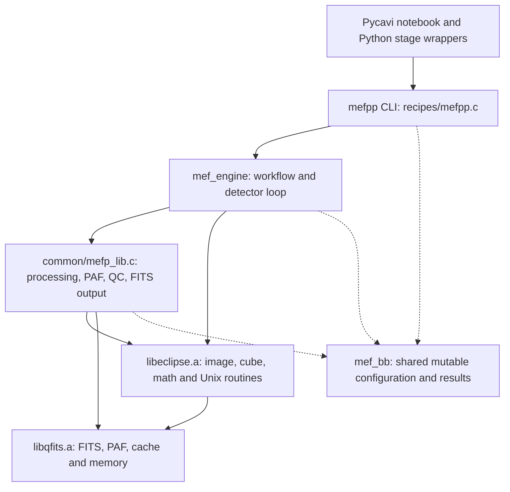
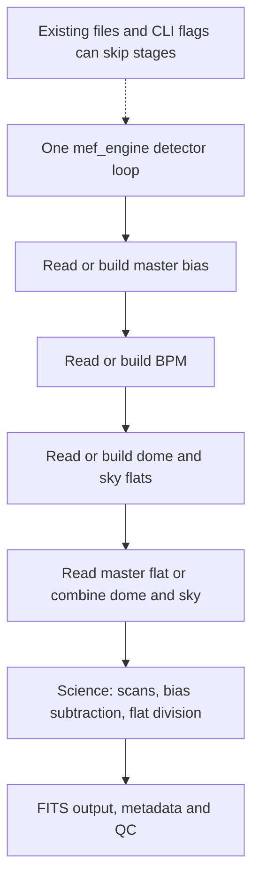
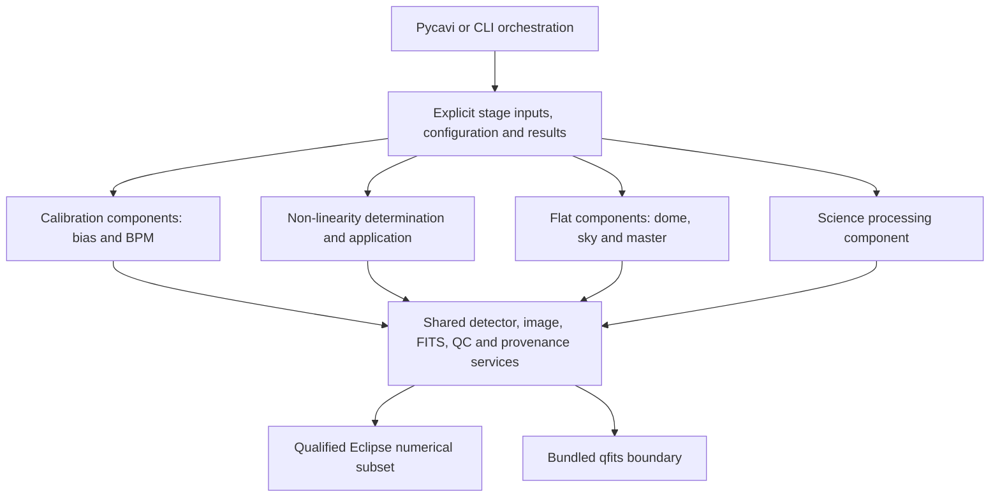

# Native architecture and modernization audit — 25 October 2026

## Scope and conclusion

Fernando requests this audit before the full roadmap, and the full roadmap
before actual modification work. This supersedes proceeding directly from
installation audit PR #72 to the qfits move/build-system fixes.
Tracking: [#73](https://github.com/fselman/wenu-imaging/issues/73).
No native source, workflow, compiler selection or installed environment changed.

**Assessment:** the code has reusable numerical primitives and some useful stage
functions, but its build, installation, verification and API boundaries are
substantially behind the development baseline appropriate for the planned
component workflow. ANSI C, static libraries and make are not themselves obsolete.
The problem is the lack of enforced dependency/contracts/tests and the mixing
of computation, configuration, mutable state, metadata and file management.
A C++/Rust rewrite, dependency replacement or new build framework is not an
automatic conclusion of this audit.

The native baseline is identical to main 2cd54c1206ccb7b68b2eb0a5f70d9b28f1188cde:
mefpp2 tree 8d0bc2a81da4be75b5b5d0017bd0e9e83207e25b and qfits52 tree
af5c2837c22b66a0388b9ccd866df3eb0ccf1fc3. Documentation base is PR #72 head
5b334cc45e65cc30ffd0376648677096dcd346ad. The agent's native source checkout
was an older ancestor with these exact native trees; it is not the user's Mac.

## Current organization

The current workflow is not literally in one C library: the executable links
the recipe and common MEF object with two static libraries. Its domain workflow,
however, is concentrated in two large C files and one shared context.

The build also produces general Eclipse commands, jitter tools and pfits.
Their being built does not establish their use by mefpp. mefpp's recipe link
line is -leclipse -lqfits -lm, not -lpfits.
The qfits utilities are copied into the Eclipse command bundle where available,
but those CLIs are not calls in the current recipe path. The source move requested
by Fernando is still pending; qfits52 is currently a sibling of mefpp2.

| Source / boundary | Observed organization |
|---|---|
| recipes/mefpp.c | 1422 lines: CLI parsing, workflow/detector loop, calibration reuse/build, science operations, output headers and errors |
| common/mefp_lib.c | 4208 lines: context/PAF construction, MEF input, overscan, BPM, flat/bias combinations, QC, naming and FITS metadata/output |
| common/mefp_lib.h | 389 lines; public mef_bb context has about 202 semicolon-delimited declarations, mixing configuration, detector state, filenames, arrays and results |
| Eclipse | Actual archive build list: 79 C translation units across iproc, math, spectro and unix |
| qfits | Actual archive build list: 18 C units; FITS/PAF/memory utilities, plus separately built CLI tools |
| Pycavi interface | Shell-command staging, fixed working filenames, PAF copies and native invocation; Python also normalizes science units afterward |

Pycavi already exposes mefpp_reduce_bias, mefpp_reduce_dome, mefpp_reduce_sky and
mefpp_reduce_science. Their names do not mean the C implementation is modular.
In particular, mefpp_reduce_sky also requests master-flat creation with --mffsave.
mefpp_reduce_bpm currently copies a static BPM instead of calling native BPM
generation (#13). These are relevant existing boundaries to preserve or clarify.

## Which Eclipse parts are used?

### Method and meaning of “used”

A reproducible [analysis script](audits/native-architecture-2026-10-25/analyze.py)
unpacked tracked native source into a disposable directory and generated host
configuration headers there. It compiled **99 units**: the 2 MEF units, 79 Eclipse
archive units and 18 qfits archive units, using GCC 13.3 on the agent Linux host,
-O0 and -fdump-ipa-cgraph. It retained compiler diagnostics and nm symbols.
No archive link, executable run, installed-engine change or Mac/chapman3
qualification occurred. Compile success here is not a production build result.

Three separate measurements are retained:

1. **Direct object demand:** exported symbols referenced by either MEF object.
   This includes references from functions compiled into those objects even if
   they are not reached from main; it is not a runtime-use count.
2. **Potential function-call reachability:** static paths from main through
   compiler-recorded calls/function references, resolving local definitions
   before exported ones. Branches/CLI options are not executed or selected.
3. **Conservative object closure:** transitive unresolved symbol demand for
   whole archive members. This predicts which object files would be needed;
   it is not a captured final linker map and can include unused functions.

The graph is configuration-specific, excludes external application roots and
does not resolve arbitrary indirect callback registration. qfits qerror.c has
an indirect error-display callback; its default stderr callback was manually
identified. Conditional RTD/shared-memory loading remains in potential closure
because generic image_loadext supports filename RTD. That is not evidence that
the actual FITS-only pilot uses RTD.

| Library group | C files built | Direct object demand | Files with potential calls | Conservative object closure |
|---|---:|---:|---:|---:|
| Eclipse image processing (iproc) | 35 | 13 | 15 | 27 |
| Eclipse math | 14 | 3 | 5 | 12 |
| Eclipse spectroscopy | 4 | 0 | 0 | 0 |
| Eclipse Unix/runtime | 26 | 6 | 13 | 14 |
| **Eclipse total** | **79** | **22** | **33** | **53** |
| **qfits total** | **18** | **7** | **12** | **14** |

Thus 20 Eclipse files occur only in the object closure, and 26 are outside both
closures under this root/configuration. “Not reached by mefpp” is not equivalent
to “unused by the repository” or “safe to delete.” Legacy commands, alternate
inputs, other instruments and future components need separate roots/coverage.

[Per-file inventory](audits/native-architecture-2026-10-25/source-use.md),
[machine-readable inventory](audits/native-architecture-2026-10-25/inventory.json)
and [potential calls](audits/native-architecture-2026-10-25/potential-calls.json)
preserve the classifications and names. Compiler-header inline definitions are
not counted as an independent scientific API metric.

### Practical grouping

| Status | Examples and interpretation |
|---|---|
| Core processing reached | cube allocation/loading/median combination, cube bias subtraction/flat division, image arithmetic/statistics, extraction, flat smoothing, pixelmaps |
| Detector routines reached | cube_create_gainmap_robust and cube_create_gainmap_proportional through BPM creation |
| Math/runtime reached indirectly | robust/proportional fitting, medians/RMS, frame lists/tokenization, filenames/logging/configuration/time handling |
| Conditional legacy path reached statically | image_loadext -> rtd_image_get -> RTD sockets/shared-memory helpers; not established as needed for the FITS-only operational interface |
| Present in demanded objects, no potential function call found | detector_linearity_fit, cube_correct_detlin; many matrix/FFT/photometry/detection/gnuplot functions travel with larger object dependency closure |
| Outside current mefpp object closure | all four spectroscopy units; corner/cube_filters/irstd/matchpoint/resampling/shift/slitposition/xcorrelation; several polynomial and Unix helper units |
| Separate products, not recipe link dependencies | pfits library, general Eclipse CLI programs and jitter executables |

The last table groups files and individual functions at different levels on
purpose; consult the explicit per-file inventory before drawing removal claims.
A linked object's unused functions may still exist in an executable depending
on linker dead stripping. Only an actual target linker map and runtime coverage
can settle the target binary composition and exercised code.

## Existing processing components and coupling

This is an outline of the current recipe sequence, not a proposed universal
calibration dependency graph. In particular, current Python static-mask staging,
bias/BPM dependencies and normalization relative to detector zero require
careful contracts before stages can be scheduled independently.

| Desired component | Existing implementation | Boundary that is missing |
|---|---|---|
| Detector geometry / overscan / trimming | mef_overscan_correction and mef_cube_overscan_correction | Geometry/config versus mutable per-detector context and QC; FITS versus array coordinates |
| Master bias | mef_build_cal(bb, "bias") | Shared string-dispatched calibration function, implicit input/output state |
| BPM generation | mef_build_bpm plus Eclipse gain-map fits | Native product/input/QC contract and actual Python generation integration; mask flags and validity need review |
| Non-linearity determination | Eclipse detector_linearity_fit exists | No current mefpp CLI/workflow path; dataset, units/model/validity and calibration-product interface unqualified |
| Non-linearity application | Eclipse cube_correct_detlin exists | Separate correction contract and order relative to bias/scans/other calibration; not currently invoked |
| Dome flat | mef_build_cal(bb, "dome") | Shares function/state with bias and sky; normalization/QC depend on mutable detector arrays |
| Sky flat | mef_build_cal(bb, "sky") | Same coupling, and Python sky wrapper also triggers master-flat combination |
| Master flat | mef_ff_combine and mef_image_filter_flat | Mutates input flat images; smoothing, normalization, bias and mask dependencies need explicit ownership/contracts |
| Science processing | Inline block in mef_engine | No self-contained science stage API; loading, numerical operations, headers, naming and saving interleaved |
| Product I/O / provenance / QC | mef_get_headers_for, mef_header_*, mef_save, mef_hdrpix_dump and recipe code | Shared infrastructure should be separate from stage arithmetic and instrument/product policies |

Important non-linearity details: detector_linearity_fit fits exposure times as
a polynomial in measured pixel signal and accepts degree 3 or 4. It returns
coefficient planes plus a residual plane. cube_correct_detlin accepts three
coefficient images and applies a cubic correction. These are implementation
facts, not proof of a compatible complete calibration method; the fourth-degree
fit output cannot simply be assumed compatible with the three-plane correction.
The mef TODO explicitly lists adding a linearity correction section.
Existing gain-map/BPM fitting is not a substitute for a non-linearity model.

In the inspected science block, the BPM is read and recorded in provenance;
the explicit bp_map numerical use is in master-flat smoothing. This audit does
not infer a separate bad-pixel correction to every science pixel from a header.

The flat builders normalize by a detector-zero reference (dome_median[0] /
sky_median[0]); splitting detectors into independent tasks without preserving
that definition could change results. mef_ff_combine modifies dome/sky arrays
in place, so returning a new result is not the only ownership concern.

## Modern development-practice assessment

This is an engineering assessment against explicit practices, not certification
against a single universal “modern software standard.”

| Dimension | Assessment | Evidence / consequence |
|---|---|---|
| Language and numerical primitives | Reusable foundation | C and static linking remain viable; image_t/cube_t/pixelmap, math and FITS routines already provide useful reusable types |
| Layer separation | Partial, insufficient for intended workflow | Domain functions exist but shared mef_bb and large common/recipe files join configuration, arithmetic, I/O and provenance |
| Public contracts | Weak | Broad mutable context, what-string dispatch, implicit allocation/in-place behavior, NULL/-1 conventions, missing typed stage inputs/results |
| Configuration | Fragile | mef_bb_new reads cwd/mefpp.paf before CLI parsing; advertised PAF selection is not an explicit constructor input (#76) |
| Failure/ownership | Needs correction before extraction | main ignores engine status (#71); engine error branches can destroy bb and main later destroys it again (#75); actual runtime reproductions remain pending |
| Build/dependency/install | Outdated implementation | Hand-written make is valid, but dependency edges, compiler/tool propagation, staged installs, clean artifacts and truthful exit handling fail the installation audit (#65–#70) |
| Memory/string diagnostics | Unresolved | 99 compile-only units succeeded with 19 diagnostics: five nonliteral-format and fourteen format-overflow warnings (#74); not a sanitizer/security certification |
| Reentrancy/concurrency | Not established | Eclipse comm_config, qfits cache/memory/error state and static returned buffers prevent assuming safe threaded library calls |
| Verification and CI | Insufficient native coverage | qfits check is empty in this distribution; pfits has a small separate test; Python regressions do not establish C-stage behavior; no native CI/sanitizer qualification found in inspected tree |
| Reproducibility and provenance | Partial | Git, licenses and retained pipeline evidence are positives; binary/archive/compiler/resource identity and inconsistent embedded versions need a coherent installed manifest |
| Portability | Empirical legacy support | Selected old binaries run on Mac/Linux, but no clean target build/install is implied; generated headers/host helper and toolchain mixing remain real findings |
| Scientific product boundaries | Not yet explicit | Mask semantics, units, nonlinearity validity, detector identity, calibrator applicability and gain/noise propagation need individual contracts; this audit does not validate them |

Source style/headers reflect substantial 1995–2003 Eclipse/qfits heritage with
later mefpp changes. Age is context, not a reason to discard algorithms.
The recipe banner says mefpp-2.0.0 while common/mefp_lib.c embeds mefpp-2.0.3;
qfits version inconsistencies were already recorded in #69. Installation
success alone does not resolve those provenance differences.

Primary reference practices consulted:
[GNU staged installation](https://www.gnu.org/prep/standards/html_node/DESTDIR.html),
[GNU make standard targets](https://www.gnu.org/s/make/manual/html_node/Standard-Targets.html),
[CMake target/dependency model](https://cmake.org/cmake/help/v3.28/manual/cmake-buildsystem.7.html),
[Clang AddressSanitizer](https://clang.llvm.org/docs/AddressSanitizer.html) and
[UndefinedBehaviorSanitizer](https://clang.llvm.org/docs/UndefinedBehaviorSanitizer.html).
GNU documents staging independently of choosing CMake. Sanitizers are future
validation tools, not tests performed in this audit. A modern build tool can
express dependencies, but cannot supply missing scientific contracts.

## Candidate component architecture for the later roadmap

These are design options and reusable boundaries, not an implementation plan,
approved API or final algorithm/data dependency order.

A component need not be a separate repository, shared library or OS process.
One modular C library with focused source files/interfaces and thin CLI stage
commands can expose independently testable components without duplicating
science. Whether to provide subcommands, individual executables or a stable C
API is a decision for the full roadmap.

For every component, that roadmap should define input frames/calibrators,
configuration and detector identity, output products/units, ownership/in-place
semantics, masks/uncertainties/QC, provenance, failure/restart behavior and
validation evidence. Keep file orchestration separate from numerical kernels.
Shared services include detector/HDU mapping, image/cube views, FITS I/O,
configuration, result/status objects, logging and product metadata. Do not
replace qfits/Eclipse merely to obtain these boundaries.

The likely options to compare in the roadmap are a corrected Make-based build
versus a target-based system such as CMake. Choose based on target availability,
dependency expression, testing/install needs and migration cost; a framework
change is not yet approved. Keep the qualified baseline available throughout.

## What this audit does not establish

- No full roadmap or implementation schedule is approved by this report.
- No qfits move, source split, algorithm change or deletion of “unused” code.
- No binary link, native execution, sanitizer run, benchmark or runtime coverage.
- No Mac/chapman3 compile/install acceptance from the agent Linux object inventory.
- No detector/nonlinearity/scientific correctness or Phase 3 acceptance.
- No conclusion that an existing uncalled routine should be enabled without
  characterizing its units, inputs, validity, error behavior and outputs.

The next work is to review this architecture audit and prepare the full roadmap
Fernando requested, including component contracts, build/install design,
preservation/equivalence gates and Mac -> chapman3 acceptance. Modification
work remains paused until that roadmap has been reviewed and agreed.
